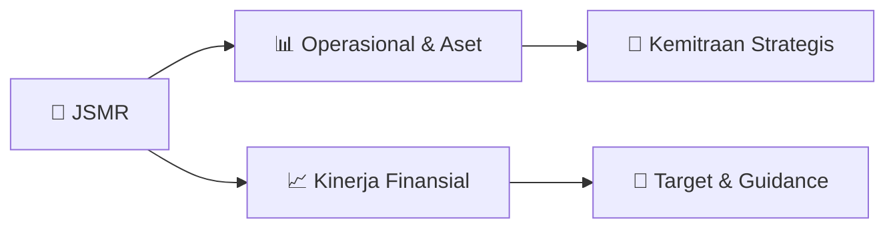

# 📊 Materi Public Expose: [JSMR]

🏢 **Emiten**: `JSMR` | 📅 **Tanggal Pelaksanaan**: `2026-09-14` | 📑 **Total Slide**: `1 Slide`
⬅️ [[knowledge-base/daily-digests/JSMR_20260914|Kembali ke Daily Digest]] | 🎛️ [[Dashboard/JSMR|Ke Dashboard Emiten]]

> [!NOTE]
> Ringkasan materi presentasi resmi Public Expose JSMR yang disampaikan oleh manajemen kepada investor dan bursa. Seluruh poin strategis, matriks operasional, dan angka kinerja diekstrak langsung dari slide deck resmi.

---

## 📅 1. Jadwal & Metadata Penyelenggaraan

| Parameter | Detail Informasi |
|---|---|
| **Nomor Surat Pengantar** | - |
| **Perihal Pengumuman** | Materi Public Expose |
| **Waktu Pelaksanaan** | Rabu, 9 September 2026 11:00 – 12:00 WIB |
| **Lokasi / Media** | Public Expose Live 2026 |
| **Lampiran Resmi** | `Materi Presentasi Slide Deck` |

## 📋 2. Agenda Paparan Publik

- Pemaparan Profil & Struktur Bisnis Perseroan
- Kinerja Operasional & Keuangan
- Arah Strategi Usaha & Target Pertumbuhan
- Sesi Tanya Jawab (Q&A)

## 🏢 3. Profil & Pilar Portofolio Bisnis

## 🏗️ 4. Kinerja Operasional & Portofolio Aset

*Detail aset operasional terlampir pada dokumen slide resmi.*

## 📈 5. Kinerja Keuangan & Posisi Finansial

## 🧭 6. Inisiatif Strategis, Kolaborasi, & Kemitraan

*Strategi usaha difokuskan pada penguatan fundamental dan ekspansi operasional.*

## 🎯 7. Target Pertumbuhan & Guidance Manajemen

*Target pertumbuhan ditetapkan mengacu pada prospek industri dan kondisi makroekonomi terkini.*

## 🗺️ 8. Peta Jalur Strategis & Eksekusi

## 📑 9. Daftar Indeks Slide Presentasi

| Slide # | Judul / Topik Slide | Ringkasan Konten |
|---|---|---|
| Slide 1 | **JSMR Panelist Details** | Panelist Details Attended User Name (Original Name) Join Time |

---

*Dokumen diolah otomatis oleh **Swarm Intelijen Pasar Modal Indonesia** pada 2026-10-12 16:46 WIB.*