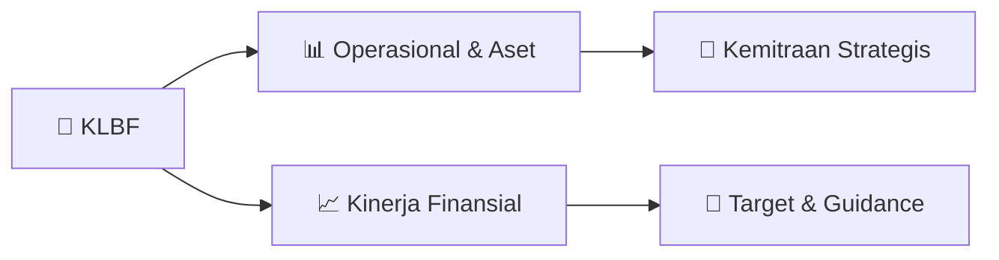

# 📊 Materi Public Expose: [KLBF]

🏢 **Emiten**: `KLBF` | 📅 **Tanggal Pelaksanaan**: `2026-08-28` | 📑 **Total Slide**: `2 Slide`
⬅️ [[knowledge-base/daily-digests/KLBF_20260828|Kembali ke Daily Digest]] | 🎛️ [[Dashboard/KLBF|Ke Dashboard Emiten]]

> [!NOTE]
> Ringkasan materi presentasi resmi Public Expose KLBF yang disampaikan oleh manajemen kepada investor dan bursa. Seluruh poin strategis, matriks operasional, dan angka kinerja diekstrak langsung dari slide deck resmi.

---

## 📅 1. Jadwal & Metadata Penyelenggaraan

| Parameter | Detail Informasi |
|---|---|
| **Nomor Surat Pengantar** | 062/CSEC-KF/VIII-2026 |
| **Perihal Pengumuman** | Rencana Penyelenggaraan Public Expose Tahunan |
| **Waktu Pelaksanaan** | 11 September 2026 09:00 |
| **Lokasi / Media** | Public Expose Live 2026 yang tercantum pada website idx.co.id |
| **Lampiran Resmi** | `0` |

## 📋 2. Agenda Paparan Publik

1. Nama Perusahaan
2. Kode Emiten
3. Lampiran
4. Perihal
5. 062/CSEC-KF/VIII-2026
6. Kalbe Farma Tbk
7. Rencana Penyelenggaraan Public Expose Tahunan
8. Go To English Page
9. Perseroan melaporkan rencana Public Expose Tahunan sebagai berikut:
10. Rencana Penyelenggaraan Public Expose
11. Tahun Buku yang Berakhir pada
12. Tempat
13. : Public Expose Live 2026 yang tercantum pada website idx.co.id
14. Hari/Tanggal
15. : 11 September 2026
16. Waktu
17. 09:00
18. Agenda
19. : 1. Presentasi/Pemaparan Kinerja Perseroan
20. 2. Press Conference
21. Hormat Kami,
22. Demikian untuk diketahui.
23. Gedung KALBE Let.Jend Suprato Kav. 4
24. Corporate Secretary
25. Nama Pengirim
26. Telepon : 42873888
27. Kalbe Farma Tbk
28. Maria Teresa Fabiola
29. Kalbe Farma Tbk
30. Maria Teresa Fabiola
31. Jabatan
32. Corporate Secretary
33. Tanggal dan Waktu
34. 28-08-2026 16:19
35. Dokumen ini merupakan dokumen resmi Kalbe Farma Tbk yang tidak memerlukan tanda tangan karena dihasilkan
36. secara elektronik oleh sistem pelaporan elektronik. Kalbe Farma Tbk bertanggung jawab penuh atas informasi yang
37. tertera didalam dokumen ini.
38. Issuer Name
39. Issuer Code
40. Attachment
41. Subject
42. 062/CSEC-KF/VIII-2026
43. Kalbe Farma Tbk
44. General Announcement Public Expose
45. Go To Indonesian Page
46. Company announces public expose plan Annual as follows:
47. Public Expose Announcement
48. Fiscal Year
49. Place
50. : Public Expose Live 2026 yang tercantum pada website idx.co.id
51. : 11 September 2026
52. 09:00
53. Agenda
54. : 1. Company Presentation
55. 2. Press Conference
56. Respectfully,
57. Thus to be informed accordingly.
58. Kalbe Farma Tbk
59. Maria Teresa Fabiola
60. Corporate Secretary
61. Maria Teresa Fabiola
62. Sender Name
63. Kalbe Farma Tbk
64. Gedung KALBE Let.Jend Suprato Kav. 4
65. Phone : 42873888
66. Corporate Secretary
67. Function
68. Date and Time
69. 28-08-2026 16:19
70. This is an official document of Kalbe Farma Tbk that does not require a signature as it was generated electronically
71. by the electronic reporting system. Kalbe Farma Tbk is fully responsible for the information contained within this

## 🏢 3. Profil & Pilar Portofolio Bisnis

## 🏗️ 4. Kinerja Operasional & Portofolio Aset

*Detail aset operasional terlampir pada dokumen slide resmi.*

## 📈 5. Kinerja Keuangan & Posisi Finansial

## 🧭 6. Inisiatif Strategis, Kolaborasi, & Kemitraan

*Strategi usaha difokuskan pada penguatan fundamental dan ekspansi operasional.*

## 🎯 7. Target Pertumbuhan & Guidance Manajemen

*Target pertumbuhan ditetapkan mengacu pada prospek industri dan kondisi makroekonomi terkini.*

## 🗺️ 8. Peta Jalur Strategis & Eksekusi

## 📑 9. Daftar Indeks Slide Presentasi

| Slide # | Judul / Topik Slide | Ringkasan Konten |
|---|---|---|
| Slide 1 | **Nomor Surat** | Nama Perusahaan Kode Emiten Lampiran |
| Slide 2 | **Letter / Announcement No.** | Issuer Name Issuer Code Attachment |

---

*Dokumen diolah otomatis oleh **Swarm Intelijen Pasar Modal Indonesia** pada 2026-10-12 16:46 WIB.*