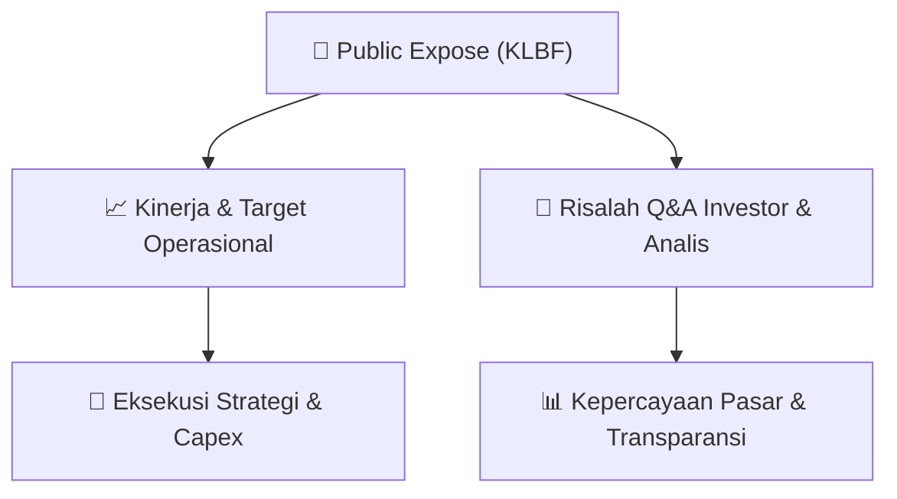

# 📢 Laporan Intelijen Paparan Publik (Public Expose) - [[KLBF]]
🏢 **Emiten**: `[[KLBF]]` | 📅 **Tanggal Pelaksanaan**: `2026-08-28` | 📑 **Dokumen**: `Public Expose`
⬅️ [[knowledge-base/daily-digests/Daily_Digest_20260828|Kembali ke Daily Digest]] | 🎛️ [[Dashboard|Ke Dashboard Utama]]

---

## 📌 1. Ringkasan Eksekutif & Paparan Direksi
> [!NOTE]
> Kalbe Farma Tbk (KLBF) menyampaikan pemberitahuan resmi rencana penyelenggaraan Public Expose Tahunan untuk tahun buku yang berakhir pada 2026. Acara akan diselenggarakan pada 11 September 2026 pukul 09:00 melalui platform Public Expose Live 2026 yang tercantum di website idx.co.id. Agenda meliputi presentasi/pemaparan kinerja perseroan dan press conference. Dokumen disampaikan oleh Corporate Secretary Maria Teresa Fabiola pada 28 Agustus 2026.

#### 🎯 Guidance Operasional & Target Strategis
- Dokumen ini hanya merupakan pengumuman rencana Public Expose dan tidak memuat guidance kinerja, target operasional, rencana ekspansi, atau alokasi belanja modal secara spesifik. Informasi tersebut diharapkan disampaikan pada saat pelaksanaan Public Expose 11 September 2026.

## 📊 2. Matriks Indikator Operasional & Parameter Kunci
| Parameter Utama | Nilai / Keterangan Resmi |
| :--- | :--- |
| **Nama Perusahaan** | `Kalbe Farma Tbk` |
| **Kode Emiten** | `KLBF` |
| **Jenis Acara** | `Public Expose Tahunan` |
| **Tahun Buku** | `2026` |
| **Tanggal Penyelenggaraan** | `11 September 2026` |
| **Waktu** | `09:00` |
| **Tempat** | `Public Expose Live 2026, website idx.co.id` |
| **Agenda** | `1. Presentasi/Pemaparan Kinerja Perseroan; 2. Press Conference` |
| **Corporate Secretary** | `Maria Teresa Fabiola` |
| **Tanggal dan Waktu Pengumuman** | `28-08-2026 16:19` |
| **Nomor Surat** | `062/CSEC-KF/VIII-2026` |

---

## 💬 3. Risalah Tanya Jawab (Q&A Session)
`Materi presentasi Public Expose / Risalah Q&A terlampir dalam dokumen resmi bursa.`

## 📌 4. Peta Jalur Strategis & Roadmap

---

## 🔗 Knowledge Graph
- [[knowledge-base/daily-digests/Daily_Digest_20260828|📄 Daily Digest 2026-08-28]]
- [[knowledge-base/calendars/Action_Calendar|🗓️ Kalender Terpusat Aksi Korporasi]]
- [[Dashboard|🎛️ Kembali ke Dashboard Utama]]