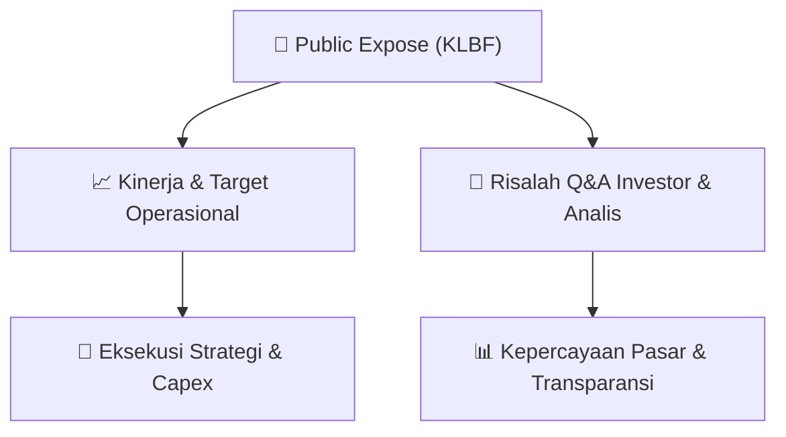

# 📢 Laporan Intelijen Paparan Publik (Public Expose) - [[KLBF]]
🏢 **Emiten**: `[[KLBF]]` | 📅 **Tanggal Pelaksanaan**: `2026-09-16` | 📑 **Dokumen**: `Public Expose`
⬅️ [[knowledge-base/daily-digests/Daily_Digest_20260916|Kembali ke Daily Digest]] | 🎛️ [[Dashboard|Ke Dashboard Utama]]

---

## 📌 1. Ringkasan Eksekutif & Paparan Direksi
> [!NOTE]
> Kalbe Farma Tbk (KLBF) menyelenggarakan Public Expose Tahunan pada 08 September 2026, dengan laporan hasil disampaikan pada 16 September 2026. Acara dihadiri oleh 129 peserta (tidak termasuk manajemen dan karyawan). Paparan ini merupakan agenda tahunan perusahaan untuk mengkomunikasikan kinerja, strategi, dan rencana ke depan kepada investor dan analis. Dokumen yang disampaikan mencakup daftar hadir peserta dan materi hasil public expose.

#### 🎯 Guidance Operasional & Target Strategis
- Dokumen ini hanya berisi laporan administratif penyelenggaraan Public Expose Tahunan. Tidak terdapat rincian spesifik mengenai target kinerja, ekspansi, atau capex dalam dokumen ini. Informasi tersebut kemungkinan terdapat pada lampiran materi public expose (file KLBF Hasil Public Expose 2.pdf) yang tidak disertakan dalam teks yang diberikan. Investor disarankan merujuk pada materi paparan publik lengkap untuk mendapatkan guidance operasional perusahaan.

## 📊 2. Matriks Indikator Operasional & Parameter Kunci
| Parameter Utama | Nilai / Keterangan Resmi |
| :--- | :--- |
| **Tanggal Penyelenggaraan Public Expose** | `08 September 2026` |
| **Tanggal Pelaporan Hasil Public Expose** | `16 September 2026` |
| **Jumlah Peserta Hadir (tidak termasuk manajemen/karyawan)** | `129 orang` |
| **Nomor Surat Pengantar Materi** | `064/CSEC-KF/IX-2026` |
| **Nomor Surat Pelaporan Hasil** | `071/CSEC-KF/IX-2026` |
| **Nama Corporate Secretary** | `Maria Teresa Fabiola` |

---

## 💬 3. Risalah Tanya Jawab (Q&A Session)
### ❓ Pertanyaan 1 (Tidak tersedia dalam dokumen)
**Pertanyaan**: Dokumen ini tidak memuat transkrip tanya jawab antara manajemen dengan investor/analis. Seluruh sesi Q&A kemungkinan tercantum dalam lampiran materi public expose (file KLBF Hasil Public Expose 2.pdf).

**Jawaban Manajemen**: Tidak tersedia dalam dokumen

> [!TIP]
> **Implikasi Bagi Investor**: Investor perlu mengakses lampiran materi public expose untuk mendapatkan informasi lengkap mengenai sesi tanya jawab, termasuk isu-isu strategis yang dibahas manajemen.

## 📌 4. Peta Jalur Strategis & Roadmap

---

## 🔗 Knowledge Graph
- [[knowledge-base/daily-digests/Daily_Digest_20260916|📄 Daily Digest 2026-09-16]]
- [[knowledge-base/calendars/Action_Calendar|🗓️ Kalender Terpusat Aksi Korporasi]]
- [[Dashboard|🎛️ Kembali ke Dashboard Utama]]