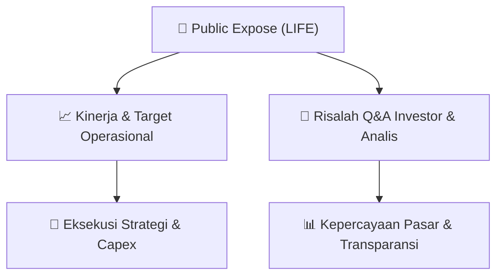

# 📢 Laporan Intelijen Paparan Publik (Public Expose) - [[LIFE]]
🏢 **Emiten**: `[[LIFE]]` | 📅 **Tanggal Pelaksanaan**: `2026-09-11` | 📑 **Dokumen**: `Public Expose`
⬅️ [[knowledge-base/daily-digests/Daily_Digest_20260911|Kembali ke Daily Digest]] | 🎛️ [[Dashboard|Ke Dashboard Utama]]

---

## 📌 1. Ringkasan Eksekutif & Paparan Direksi
> [!NOTE]
> PT MSIG Life Insurance Indonesia Tbk. (LIFE) menyelenggarakan Public Expose Insidentil pada 09 September 2026, berdasarkan surat penyampaian materi No. 57/MSL-CSEC/IX/2026. Acara ini bersifat sukarela dan dihadiri oleh 17 peserta (tidak termasuk manajemen dan karyawan). Laporan hasil public expose disampaikan oleh Corporate Secretary, Leony Samosir, pada 11 September 2026. Dokumen ini merupakan laporan resmi yang disampaikan ke bursa, namun tidak memuat rincian materi presentasi, tanya jawab, atau data keuangan spesifik karena hanya berisi konfirmasi penyelenggaraan dan kehadiran peserta.

#### 🎯 Guidance Operasional & Target Strategis
- Dokumen ini tidak memuat informasi mengenai target kinerja, ekspansi, capex, atau panduan operasional (guidance) dari manajemen. Public expose bersifat insidentil dan laporan yang disampaikan hanya mengonfirmasi pelaksanaan acara serta jumlah peserta yang hadir. Investor perlu merujuk pada materi paparan publik terpisah atau pengumuman lain untuk mendapatkan informasi fundamental dan strategi perusahaan.

## 📊 2. Matriks Indikator Operasional & Parameter Kunci
| Parameter Utama | Nilai / Keterangan Resmi |
| :--- | :--- |
| **Jenis Public Expose** | `Insidentil (Incidental)` |
| **Dasar Pelaksanaan** | `Sukarela (Voluntary)` |
| **Tanggal Pelaksanaan** | `09 September 2026` |
| **Nomor Surat Penyampaian Materi** | `57/MSL-CSEC/IX/2026` |
| **Nomor Surat Laporan Hasil** | `58/MSL-CSEC/IX/2026` |
| **Jumlah Peserta Hadir (di luar manajemen/karyawan)** | `17 orang` |
| **Tanggal Pelaporan** | `11 September 2026` |
| **Corporate Secretary** | `Leony Samosir` |

---

## 💬 3. Risalah Tanya Jawab (Q&A Session)
### ❓ Pertanyaan 1 (Tidak tersedia dalam dokumen)
**Pertanyaan**: Dokumen laporan hasil public expose ini tidak memuat transkrip atau ringkasan sesi tanya jawab dengan investor/analis. Informasi Q&A kemungkinan tersedia dalam materi paparan publik terpisah yang dilampirkan (Laporan Hasil Public Expose Insidental 2026.pdf) namun tidak disertakan dalam teks yang diberikan.

**Jawaban Manajemen**: Tidak tersedia dalam dokumen. Manajemen tidak memberikan jawaban tertulis dalam laporan ini karena hanya berisi konfirmasi administratif penyelenggaraan acara.

> [!TIP]
> **Implikasi Bagi Investor**: Investor tidak dapat memperoleh wawasan tambahan dari sesi tanya jawab melalui dokumen ini. Disarankan untuk mengakses materi paparan publik lengkap atau menghubungi investor relations perusahaan untuk mendapatkan informasi lebih rinci mengenai prospek bisnis dan kinerja keuangan.

## 📌 4. Peta Jalur Strategis & Roadmap

---

## 🔗 Knowledge Graph
- [[knowledge-base/daily-digests/Daily_Digest_20260911|📄 Daily Digest 2026-09-11]]
- [[knowledge-base/calendars/Action_Calendar|🗓️ Kalender Terpusat Aksi Korporasi]]
- [[Dashboard|🎛️ Kembali ke Dashboard Utama]]