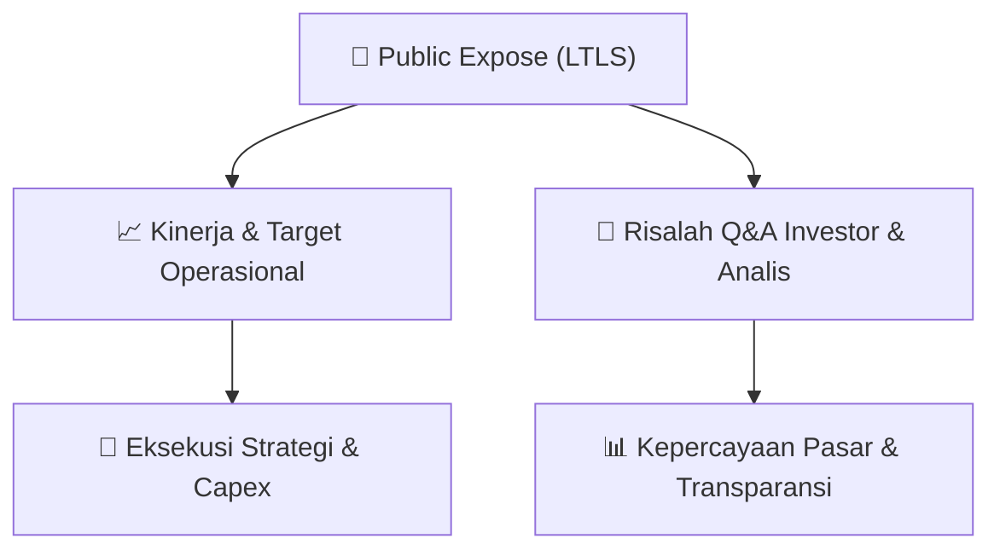

# 📢 Laporan Intelijen Paparan Publik (Public Expose) - [[LTLS]]
🏢 **Emiten**: `[[LTLS]]` | 📅 **Tanggal Pelaksanaan**: `2026-09-10` | 📑 **Dokumen**: `Public Expose`
⬅️ [[knowledge-base/daily-digests/Daily_Digest_20260910|Kembali ke Daily Digest]] | 🎛️ [[Dashboard|Ke Dashboard Utama]]

---

## 📌 1. Ringkasan Eksekutif & Paparan Direksi
> [!NOTE]
> PT Lautan Luas Tbk (LTLS) menyelenggarakan Public Expose Tahunan pada tanggal 03 September 2026, sesuai dengan surat pemberitahuan No. 110/LTL-LCS/IX/2026. Acara ini dihadiri oleh 73 peserta (tidak termasuk manajemen dan karyawan). Hasil Public Expose dilaporkan melalui surat No. 117/LTL-LCS/IX/2026 yang ditandatangani oleh Direktur Elly Mariana Tansil pada 10 September 2026. Dokumen ini merupakan laporan resmi penyampaian hasil kegiatan paparan publik tahunan perusahaan.

#### 🎯 Guidance Operasional & Target Strategis
- Dokumen yang tersedia hanya berisi laporan administratif penyelenggaraan Public Expose Tahunan. Tidak terdapat rincian spesifik mengenai target kinerja, ekspansi, capex, atau guidance operasional dalam teks yang diberikan. Informasi tersebut kemungkinan terdapat dalam lampiran dokumen (Lap. Hasil Pelak Pubex PT Lautan Luas Tbk 2026.pdf) yang tidak disertakan dalam teks mentah ini.

## 📊 2. Matriks Indikator Operasional & Parameter Kunci
| Parameter Utama | Nilai / Keterangan Resmi |
| :--- | :--- |
| **Tanggal Penyelenggaraan Public Expose** | `03 September 2026` |
| **Jumlah Peserta Hadir** | `73 orang (tidak termasuk manajemen dan karyawan)` |
| **Nomor Surat Pemberitahuan** | `110/LTL-LCS/IX/2026` |
| **Nomor Surat Hasil Public Expose** | `117/LTL-LCS/IX/2026` |
| **Tanggal Pelaporan Hasil** | `10 September 2026` |
| **Penandatangan Laporan** | `Elly Mariana Tansil (Direktur)` |

---

## 💬 3. Risalah Tanya Jawab (Q&A Session)
### ❓ Pertanyaan 1 (Tidak tersedia dalam dokumen)
**Pertanyaan**: Tidak ada sesi tanya jawab yang tercantum dalam teks dokumen yang diberikan.

**Jawaban Manajemen**: Tidak ada jawaban manajemen yang tercantum dalam teks dokumen yang diberikan.

> [!TIP]
> **Implikasi Bagi Investor**: Tidak ada implikasi investasi yang dapat dianalisis karena dokumen hanya berisi laporan administratif penyelenggaraan acara, tanpa rincian materi paparan atau sesi Q&A.

## 📌 4. Peta Jalur Strategis & Roadmap

---

## 🔗 Knowledge Graph
- [[knowledge-base/daily-digests/Daily_Digest_20260910|📄 Daily Digest 2026-09-10]]
- [[knowledge-base/calendars/Action_Calendar|🗓️ Kalender Terpusat Aksi Korporasi]]
- [[Dashboard|🎛️ Kembali ke Dashboard Utama]]