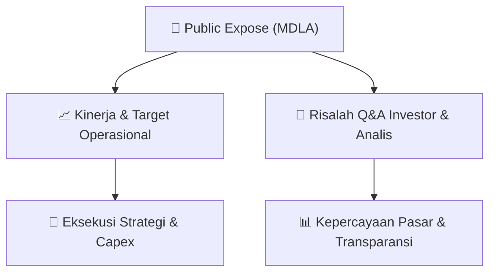

# 📢 Laporan Intelijen Paparan Publik (Public Expose) - [[MDLA]]
🏢 **Emiten**: `[[MDLA]]` | 📅 **Tanggal Pelaksanaan**: `2026-08-27` | 📑 **Dokumen**: `Public Expose`
⬅️ [[knowledge-base/daily-digests/Daily_Digest_20260827|Kembali ke Daily Digest]] | 🎛️ [[Dashboard|Ke Dashboard Utama]]

---

## 📌 1. Ringkasan Eksekutif & Paparan Direksi
> [!NOTE]
> Dokumen ini merupakan pemberitahuan resmi dari PT Medela Potentia Tbk (MDLA) mengenai rencana penyelenggaraan Public Expose Tahunan untuk Tahun Buku 2025. Public Expose akan diselenggarakan pada 08 September 2026 pukul 15:00 melalui platform Public Expose Live 2026 di website www.idx.co.id. Agenda acara meliputi presentasi profil perseroan dan update kinerja perseroan. Tidak terdapat rincian kinerja atau materi paparan dalam dokumen ini.

#### 🎯 Guidance Operasional & Target Strategis
- Dokumen ini tidak memuat target kinerja, ekspansi, atau capex. Informasi yang tersedia hanya sebatas rencana pelaksanaan Public Expose, sehingga katalis dan guidance operasional belum dapat diidentifikasi dari dokumen ini.

## 📊 2. Matriks Indikator Operasional & Parameter Kunci
| Parameter Utama | Nilai / Keterangan Resmi |
| :--- | :--- |
| **Nama Perusahaan** | `PT Medela Potentia Tbk` |
| **Kode Emiten** | `MDLA` |
| **Nomor Surat** | `047/VIII/DIR/MP/2026-E` |
| **Perihal** | `Rencana Penyelenggaraan Public Expose Tahunan` |
| **Tahun Buku** | `2025` |
| **Tempat** | `Public Expose Live 2026 (website www.idx.co.id)` |
| **Hari/Tanggal** | `08 September 2026` |
| **Waktu** | `15:00` |
| **Agenda** | `1. Profil Perseroan, 2. Update Kinerja Perseroan` |
| **Nama Pengirim** | `Edbert Orotodan` |
| **Jabatan Pengirim** | `Direktur` |
| **Tanggal dan Waktu Pengiriman** | `27-08-2026 10:52` |

---

## 💬 3. Risalah Tanya Jawab (Q&A Session)
`Materi presentasi Public Expose / Risalah Q&A terlampir dalam dokumen resmi bursa.`

## 📌 4. Peta Jalur Strategis & Roadmap

---

## 🔗 Knowledge Graph
- [[knowledge-base/daily-digests/Daily_Digest_20260827|📄 Daily Digest 2026-08-27]]
- [[knowledge-base/calendars/Action_Calendar|🗓️ Kalender Terpusat Aksi Korporasi]]
- [[Dashboard|🎛️ Kembali ke Dashboard Utama]]