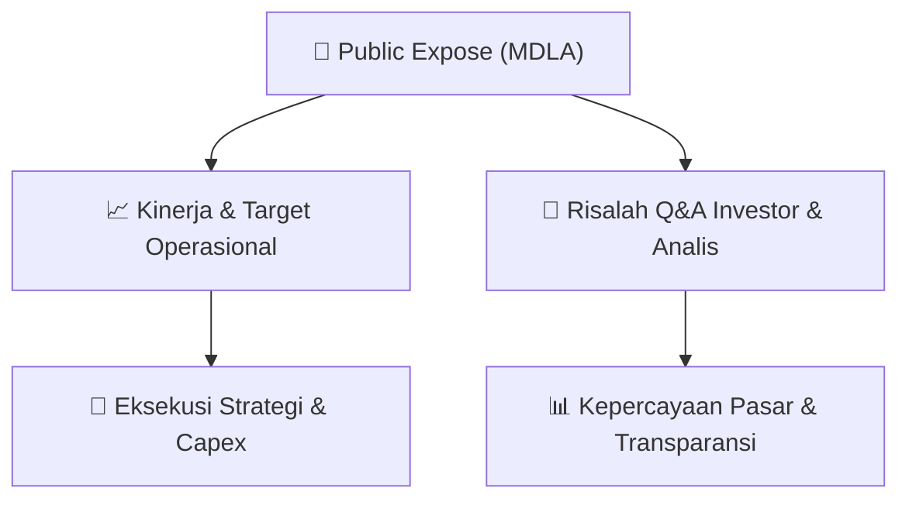

# 📢 Laporan Intelijen Paparan Publik (Public Expose) - [[MDLA]]
🏢 **Emiten**: `[[MDLA]]` | 📅 **Tanggal Pelaksanaan**: `2026-09-03` | 📑 **Dokumen**: `Public Expose`
⬅️ [[knowledge-base/daily-digests/Daily_Digest_20260903|Kembali ke Daily Digest]] | 🎛️ [[Dashboard|Ke Dashboard Utama]]

---

## 📌 1. Ringkasan Eksekutif & Paparan Direksi
> [!NOTE]
> Dokumen yang diberikan merupakan surat pengantar resmi PT Medela Potentia Tbk (MDLA) tertanggal 3 September 2026 perihal penyampaian materi Public Expose Tahunan. Surat ini merujuk pada surat sebelumnya No. 047/VIII/DIR/MP/2026-E tanggal 27 Agustus 2026. Dokumen hanya berisi informasi administratif penyampaian lampiran materi public expose dan tidak memuat isi presentasi, data kinerja, atau pembahasan operasional.

#### 🎯 Guidance Operasional & Target Strategis
- Tidak tersedia dalam dokumen ini. Materi Public Expose Tahunan yang dimaksud tidak disertakan dalam teks yang diberikan, sehingga tidak ada target kinerja, ekspansi, atau capex yang dapat diekstrak.

## 📊 2. Matriks Indikator Operasional & Parameter Kunci
| Parameter Utama | Nilai / Keterangan Resmi |
| :--- | :--- |
| **Jenis Dokumen** | `Surat Pengantar Penyampaian Materi Public Expose Tahunan` |
| **Nama Emiten** | `PT Medela Potentia Tbk` |
| **Kode Emiten** | `MDLA` |
| **Nomor Surat** | `049/VIII/DIR/MP/2026-E` |
| **Tanggal Surat** | `03 September 2026` |
| **Perihal** | `Penyampaian Materi Public Expose Tahunan` |
| **Penanggung Jawab** | `Edbert Orotodan, Direktur` |
| **Lampiran** | `Medela Potentia - Update 1H 2026-Final.pdf` |

---

## 💬 3. Risalah Tanya Jawab (Q&A Session)
`Materi presentasi Public Expose / Risalah Q&A terlampir dalam dokumen resmi bursa.`

## 📌 4. Peta Jalur Strategis & Roadmap

---

## 🔗 Knowledge Graph
- [[knowledge-base/daily-digests/Daily_Digest_20260903|📄 Daily Digest 2026-09-03]]
- [[knowledge-base/calendars/Action_Calendar|🗓️ Kalender Terpusat Aksi Korporasi]]
- [[Dashboard|🎛️ Kembali ke Dashboard Utama]]