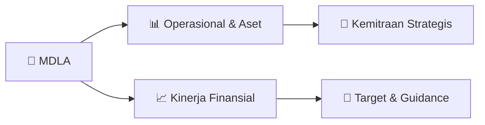

# 📊 Materi Public Expose: [MDLA]

🏢 **Emiten**: `MDLA` | 📅 **Tanggal Pelaksanaan**: `2026-09-03` | 📑 **Total Slide**: `14 Slide`
⬅️ [[knowledge-base/daily-digests/MDLA_20260903|Kembali ke Daily Digest]] | 🎛️ [[Dashboard/MDLA|Ke Dashboard Emiten]]

> [!NOTE]
> Ringkasan materi presentasi resmi Public Expose MDLA yang disampaikan oleh manajemen kepada investor dan bursa. Seluruh poin strategis, matriks operasional, dan angka kinerja diekstrak langsung dari slide deck resmi.

---

## 📅 1. Jadwal & Metadata Penyelenggaraan

| Parameter | Detail Informasi |
|---|---|
| **Nomor Surat Pengantar** | 049/VIII/DIR/MP/2026-E |
| **Perihal Pengumuman** | Penyampaian Materi Public Expose Tahunan |
| **Waktu Pelaksanaan** | 2026-09-03 03-09-2026 10:09 |
| **Lokasi / Media** | Aplikasi Zoom / Daring |
| **Lampiran Resmi** | `1` |

## 📋 2. Agenda Paparan Publik

- Pemaparan Profil & Struktur Bisnis Perseroan
- Kinerja Operasional & Keuangan
- Arah Strategi Usaha & Target Pertumbuhan
- Sesi Tanya Jawab (Q&A)

## 🏢 3. Profil & Pilar Portofolio Bisnis

## 🏗️ 4. Kinerja Operasional & Portofolio Aset

*Detail aset operasional terlampir pada dokumen slide resmi.*

## 📈 5. Kinerja Keuangan & Posisi Finansial

## 🧭 6. Inisiatif Strategis, Kolaborasi, & Kemitraan

*Strategi usaha difokuskan pada penguatan fundamental dan ekspansi operasional.*

## 🎯 7. Target Pertumbuhan & Guidance Manajemen

*Target pertumbuhan ditetapkan mengacu pada prospek industri dan kondisi makroekonomi terkini.*

## 🗺️ 8. Peta Jalur Strategis & Eksekusi

## 📑 9. Daftar Indeks Slide Presentasi

| Slide # | Judul / Topik Slide | Ringkasan Konten |
|---|---|---|
| Slide 1 | **PRIVATE & CONFIDENTIAL** | Company Update 1H 2026 |
| Slide 2 | **PRIVATE & CONFIDENTIAL** | 2 Company Structure 8,99% |
| Slide 3 | **PRIVATE & CONFIDENTIAL** | 3 With over 45 years of expertise, Medela Potentia has transformed into one of Indonesia’s premier integrated distribution platforms, delivering a div |
| Slide 4 | **PRIVATE & CONFIDENTIAL** | 4 Management team with extensive experience, deep knowledge, and strong relationships with key principals and customers​ |
| Slide 5 | **PRIVATE & CONFIDENTIAL** | 5 Nationwide, Interconnected Distribution Network Supporting the Growth of Indonesia's Healthcare System Our Infrastructure1 |
| Slide 6 | **PRIVATE & CONFIDENTIAL** | 6 ✔Strengthen own product business ✔Government implemented a national health transformation to increase |
| Slide 7 | **PRIVATE & CONFIDENTIAL** | 7 External Awards and Recognitions Indonesia Digital Marketing |
| Slide 8 | **PRIVATE & CONFIDENTIAL** | 8 S1 2026 Summary: Sustain Growth Amid Current Uncertainties |
| Slide 9 | **PRIVATE & CONFIDENTIAL** | 9 200 226 |
| Slide 10 | **PRIVATE & CONFIDENTIAL** | 10 New Principals System Development |
| Slide 11 | **PRIVATE & CONFIDENTIAL** | 11 Medical Device Manufacturing Update Growing Total Sales and |
| Slide 12 | **PRIVATE & CONFIDENTIAL** | 12 S1 2026 Results Hospital |
| Slide 13 | **PRIVATE & CONFIDENTIAL** | 13 Environmental EV Implementation |
| Slide 14 | **PRIVATE & CONFIDENTIAL** | 14 • New Principal Exploration: Existing & New Segments |

---

*Dokumen diolah otomatis oleh **Swarm Intelijen Pasar Modal Indonesia** pada 2026-10-12 16:46 WIB.*