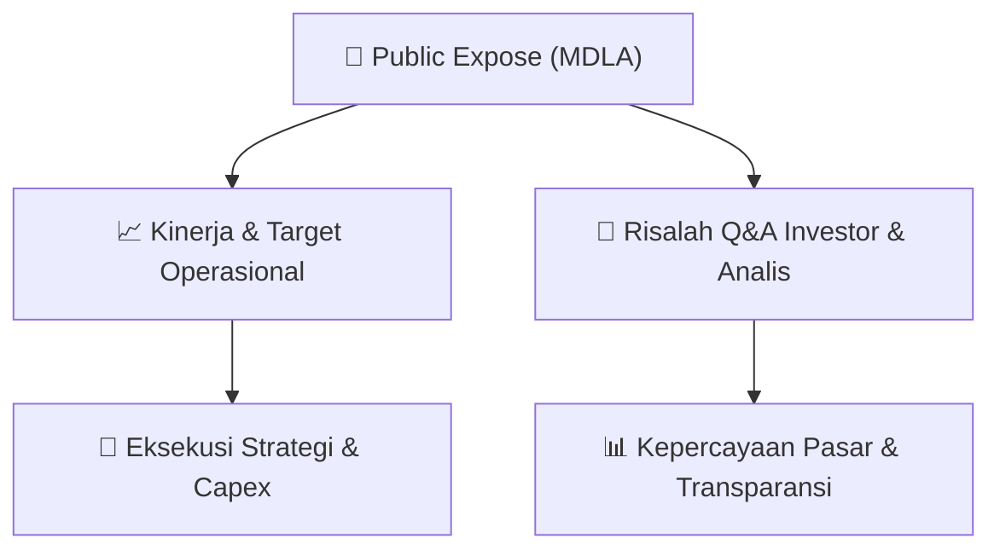

# 📢 Laporan Intelijen Paparan Publik (Public Expose) - [[MDLA]]
🏢 **Emiten**: `[[MDLA]]` | 📅 **Tanggal Pelaksanaan**: `2026-09-11` | 📑 **Dokumen**: `Public Expose`
⬅️ [[knowledge-base/daily-digests/Daily_Digest_20260911|Kembali ke Daily Digest]] | 🎛️ [[Dashboard|Ke Dashboard Utama]]

---

## 📌 1. Ringkasan Eksekutif & Paparan Direksi
> [!NOTE]
> PT Medela Potentia Tbk (MDLA) menyelenggarakan Public Expose Tahunan pada tanggal 03 September 2026, berdasarkan surat pengajuan materi No. 049/VIII/DIR/MP/2026-E. Acara ini dihadiri oleh 68 peserta (tidak termasuk manajemen dan karyawan). Hasil paparan publik disampaikan melalui surat No. 050/IX/DIR/MP/2026-E yang diterbitkan pada 11 September 2026. Paparan ini merupakan agenda tahunan perusahaan untuk mengkomunikasikan kinerja, strategi, dan rencana ke depan kepada pemegang saham dan pemangku kepentingan. Dokumen yang disampaikan hanya berisi laporan administratif penyelenggaraan acara, tanpa detail materi paparan atau sesi tanya jawab yang tercantum dalam lampiran.

#### 🎯 Guidance Operasional & Target Strategis
- Dokumen yang tersedia tidak memuat rincian target kinerja, ekspansi, atau capex perusahaan. Informasi yang tersedia hanya sebatas konfirmasi penyelenggaraan Public Expose Tahunan dengan 68 peserta. Untuk mendapatkan detail guidance operasional dan katalis, diperlukan akses ke materi paparan (lampiran MDLA- Lap Hasil PUBEX 2026.pdf) yang tidak disertakan dalam teks ini.

## 📊 2. Matriks Indikator Operasional & Parameter Kunci
| Parameter Utama | Nilai / Keterangan Resmi |
| :--- | :--- |
| **Tanggal Penyelenggaraan Public Expose** | `03 September 2026` |
| **Nomor Surat Pengajuan Materi** | `049/VIII/DIR/MP/2026-E` |
| **Nomor Surat Hasil Public Expose** | `050/IX/DIR/MP/2026-E` |
| **Jumlah Peserta Hadir** | `68 orang (tidak termasuk manajemen dan karyawan)` |
| **Tanggal Pelaporan Hasil** | `11 September 2026` |
| **Penanggung Jawab / Penandatangan** | `Juliwaty, Direktur Utama` |
| **Jenis Paparan** | `Public Expose Tahunan` |

---

## 💬 3. Risalah Tanya Jawab (Q&A Session)
### ❓ Pertanyaan 1 (Tidak tersedia dalam dokumen)
**Pertanyaan**: Tidak ada sesi tanya jawab yang tercantum dalam dokumen yang disediakan. Dokumen hanya berisi konfirmasi administratif penyelenggaraan acara.

**Jawaban Manajemen**: Tidak tersedia - Manajemen tidak memberikan jawaban apapun dalam dokumen ini karena hanya berisi laporan hasil penyelenggaraan acara.

> [!TIP]
> **Implikasi Bagi Investor**: Investor perlu mengakses materi paparan lengkap (lampiran) untuk mendapatkan informasi kinerja dan prospek perusahaan. Dokumen ini tidak memberikan wawasan fundamental baru.

## 📌 4. Peta Jalur Strategis & Roadmap

---

## 🔗 Knowledge Graph
- [[knowledge-base/daily-digests/Daily_Digest_20260911|📄 Daily Digest 2026-09-11]]
- [[knowledge-base/calendars/Action_Calendar|🗓️ Kalender Terpusat Aksi Korporasi]]
- [[Dashboard|🎛️ Kembali ke Dashboard Utama]]