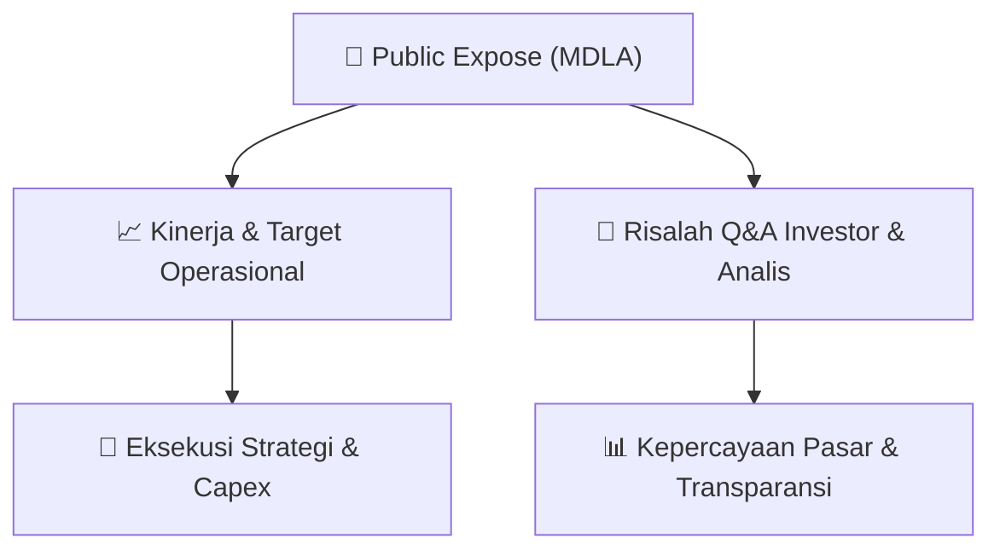

# 📢 Laporan Intelijen Paparan Publik (Public Expose) - [[MDLA]]
🏢 **Emiten**: `[[MDLA]]` | 📅 **Tanggal Pelaksanaan**: `2026-09-14` | 📑 **Dokumen**: `Public Expose`
⬅️ [[knowledge-base/daily-digests/Daily_Digest_20260914|Kembali ke Daily Digest]] | 🎛️ [[Dashboard|Ke Dashboard Utama]]

---

## 📌 1. Ringkasan Eksekutif & Paparan Direksi
> [!NOTE]
> PT Medela Potentia Tbk (MDLA) menyelenggarakan Public Expose Tahunan pada tanggal 03 September 2026, berdasarkan surat pengajuan materi No. 049/VIII/DIR/MP/2026-E. Acara ini dihadiri oleh 68 peserta (tidak termasuk manajemen dan karyawan). Laporan hasil Public Expose disampaikan melalui surat No. 050a/IX/DIR/MP/2026-E tertanggal 14 September 2026, yang merupakan koreksi dari surat sebelumnya No. 050/IX/DIR/MP/2026-E tanggal 11 September 2026. Dokumen ini merupakan laporan resmi yang disampaikan oleh Direktur Utama, Juliwaty, dan memuat lampiran berupa laporan hasil Public Expose serta daftar hadir peserta.

#### 🎯 Guidance Operasional & Target Strategis
- Dokumen yang tersedia hanya berisi informasi administratif penyelenggaraan Public Expose Tahunan, termasuk jumlah peserta (68 orang) dan jadwal acara. Tidak terdapat rincian target kinerja, ekspansi, capex, atau guidance operasional dalam teks yang disediakan. Informasi material mengenai kinerja dan rencana perusahaan kemungkinan terdapat dalam lampiran laporan hasil Public Expose (file MDLA- Lap Hasil PUBEX 2026.pdf) yang tidak disertakan dalam teks ini.

## 📊 2. Matriks Indikator Operasional & Parameter Kunci
| Parameter Utama | Nilai / Keterangan Resmi |
| :--- | :--- |
| **Tanggal Penyelenggaraan Public Expose** | `03 September 2026` |
| **Jumlah Peserta Hadir (di luar manajemen/karyawan)** | `68 orang` |
| **Nomor Surat Pengajuan Materi** | `049/VIII/DIR/MP/2026-E` |
| **Nomor Surat Laporan Hasil Public Expose** | `050a/IX/DIR/MP/2026-E (koreksi dari 050/IX/DIR/MP/2026-E)` |
| **Tanggal Penyampaian Laporan** | `14 September 2026` |
| **Penanggung Jawab / Penandatangan** | `Juliwaty, Direktur Utama` |

---

## 💬 3. Risalah Tanya Jawab (Q&A Session)
### ❓ Pertanyaan 1 (Tidak tersedia dalam dokumen)
**Pertanyaan**: Tidak ada sesi tanya jawab yang tercantum dalam teks dokumen yang disediakan.

**Jawaban Manajemen**: Tidak ada jawaban manajemen yang tercantum dalam teks dokumen yang disediakan.

> [!TIP]
> **Implikasi Bagi Investor**: Tidak ada implikasi investasi yang dapat dianalisis karena dokumen hanya berisi informasi administratif. Investor disarankan merujuk pada lampiran laporan Public Expose untuk mendapatkan detail Q&A dan informasi material.

## 📌 4. Peta Jalur Strategis & Roadmap

---

## 🔗 Knowledge Graph
- [[knowledge-base/daily-digests/Daily_Digest_20260914|📄 Daily Digest 2026-09-14]]
- [[knowledge-base/calendars/Action_Calendar|🗓️ Kalender Terpusat Aksi Korporasi]]
- [[Dashboard|🎛️ Kembali ke Dashboard Utama]]