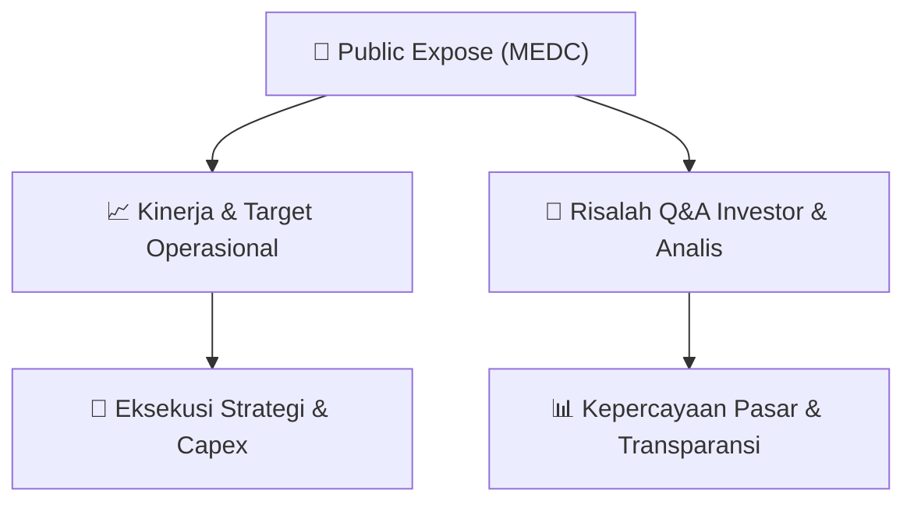

# 📢 Laporan Intelijen Paparan Publik (Public Expose) - [[MEDC]]
🏢 **Emiten**: `[[MEDC]]` | 📅 **Tanggal Pelaksanaan**: `2026-08-26` | 📑 **Dokumen**: `Public Expose`
⬅️ [[knowledge-base/daily-digests/Daily_Digest_20260826|Kembali ke Daily Digest]] | 🎛️ [[Dashboard|Ke Dashboard Utama]]

---

## 📌 1. Ringkasan Eksekutif & Paparan Direksi
> [!NOTE]
> PT Medco Energi Internasional Tbk (MEDC) mengumumkan rencana penyelenggaraan Public Expose Tahunan untuk Tahun Buku 2026. Acara akan diselenggarakan pada 09 September 2026 pukul 10:00 melalui platform Public Expose Live 2026 di website idx.co.id. Agenda acara meliputi: (1) Laporan Kinerja Kuartal I Tahun 2026, (2) Prospek dan Strategi Usaha, dan (3) Lain-lain. Dokumen ini merupakan pengumuman resmi dari Corporate Secretary dan tidak memuat rincian kinerja keuangan, proyeksi, atau tanya jawab.

#### 🎯 Guidance Operasional & Target Strategis
- Tidak ada rincian target kinerja, ekspansi, atau belanja modal (capex) yang diungkapkan dalam dokumen ini. Dokumen hanya berisi pengumuman jadwal dan agenda Public Expose, sehingga guidance operasional belum tersedia.

## 💬 3. Risalah Tanya Jawab (Q&A Session)
`Materi presentasi Public Expose / Risalah Q&A terlampir dalam dokumen resmi bursa.`

## 📌 4. Peta Jalur Strategis & Roadmap

---

## 🔗 Knowledge Graph
- [[knowledge-base/daily-digests/Daily_Digest_20260826|📄 Daily Digest 2026-08-26]]
- [[knowledge-base/calendars/Action_Calendar|🗓️ Kalender Terpusat Aksi Korporasi]]
- [[Dashboard|🎛️ Kembali ke Dashboard Utama]]