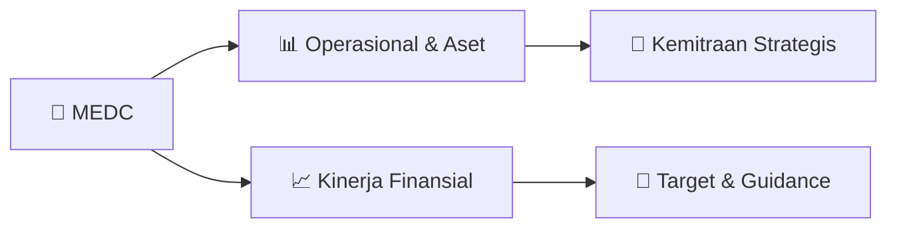

# 📊 Materi Public Expose: [MEDC]

🏢 **Emiten**: `MEDC` | 📅 **Tanggal Pelaksanaan**: `2026-08-26` | 📑 **Total Slide**: `2 Slide`
⬅️ [[knowledge-base/daily-digests/MEDC_20260826|Kembali ke Daily Digest]] | 🎛️ [[Dashboard/MEDC|Ke Dashboard Emiten]]

> [!NOTE]
> Ringkasan materi presentasi resmi Public Expose MEDC yang disampaikan oleh manajemen kepada investor dan bursa. Seluruh poin strategis, matriks operasional, dan angka kinerja diekstrak langsung dari slide deck resmi.

---

## 📅 1. Jadwal & Metadata Penyelenggaraan

| Parameter | Detail Informasi |
|---|---|
| **Nomor Surat Pengantar** | EXT-007/LEGC/INA/MEDC/VIII/2026 |
| **Perihal Pengumuman** | Rencana Penyelenggaraan Public Expose Tahunan |
| **Waktu Pelaksanaan** | 09 September 2026 10:00 |
| **Lokasi / Media** | Public Expose Live 2026 |
| **Lampiran Resmi** | `0` |

## 📋 2. Agenda Paparan Publik

1. Nama Perusahaan
2. Kode Emiten
3. Lampiran
4. Perihal
5. EXT-007/LEGC/INA/MEDC/VIII/2026
6. PT Medco Energi Internasional Tbk
7. Rencana Penyelenggaraan Public Expose Tahunan
8. Go To English Page
9. Perseroan melaporkan rencana Public Expose Tahunan sebagai berikut:
10. Rencana Penyelenggaraan Public Expose
11. Tahun Buku yang Berakhir pada
12. Tempat
13. : Public Expose Live 2026
14. yang tercantum pada website idx.co.id
15. Hari/Tanggal
16. : 09 September 2026
17. Waktu
18. 10:00
19. Agenda
20. : 1. Laporan Kinerja Kuartal I Tahun 2026
21. 2. Prospek dan Startegi Usaha
22. 3. Lain-lain
23. Hormat Kami,
24. Demikian untuk diketahui.
25. Gedung The Energy, Lantai 52 SCBD Lot, 11A, Jl. Jend. Sudirman Kav. 52-53,
26. Corporate Secretary
27. Nama Pengirim
28. Telepon : (021) 2995-3000, Fax : (021) 2995-3001, www.medcoenergi.com
29. PT Medco Energi Internasional Tbk
30. Siendy K. Wisandana
31. PT Medco Energi Internasional Tbk
32. Siendy K. Wisandana
33. Jabatan
34. Corporate Secretary
35. Tanggal dan Waktu
36. 26-08-2026 10:48
37. Dokumen ini merupakan dokumen resmi PT Medco Energi Internasional Tbk yang tidak memerlukan tanda tangan
38. karena dihasilkan secara elektronik oleh sistem pelaporan elektronik. PT Medco Energi Internasional Tbk
39. bertanggung jawab penuh atas informasi yang tertera didalam dokumen ini.
40. Issuer Name
41. Issuer Code
42. Attachment
43. Subject
44. EXT-007/LEGC/INA/MEDC/VIII/2026
45. PT Medco Energi Internasional Tbk
46. General Announcement Public Expose
47. Go To Indonesian Page
48. Company announces public expose plan Annual as follows:
49. Public Expose Announcement
50. Fiscal Year
51. Place
52. : Public Expose Live 2026
53. yang tercantum pada website idx.co.id
54. : 09 September 2026
55. 10:00
56. Agenda
57. : 1. Performance Report I  2026
58. 2. Business Prospects and Strategies
59. 3. Other Matters
60. Respectfully,
61. Thus to be informed accordingly.
62. PT Medco Energi Internasional Tbk
63. Siendy K. Wisandana
64. Corporate Secretary
65. Siendy K. Wisandana
66. Sender Name
67. PT Medco Energi Internasional Tbk
68. Gedung The Energy, Lantai 52 SCBD Lot, 11A, Jl. Jend. Sudirman Kav. 52-53,
69. Phone : (021) 2995-3000, Fax : (021) 2995-3001, www.medcoenergi.com
70. Corporate Secretary
71. Function
72. Date and Time
73. 26-08-2026 10:48
74. This is an official document of PT Medco Energi Internasional Tbk that does not require a signature as it was
75. generated electronically by the electronic reporting system. PT Medco Energi Internasional Tbk is fully responsible

## 🏢 3. Profil & Pilar Portofolio Bisnis

## 🏗️ 4. Kinerja Operasional & Portofolio Aset

*Detail aset operasional terlampir pada dokumen slide resmi.*

## 📈 5. Kinerja Keuangan & Posisi Finansial

## 🧭 6. Inisiatif Strategis, Kolaborasi, & Kemitraan

*Strategi usaha difokuskan pada penguatan fundamental dan ekspansi operasional.*

## 🎯 7. Target Pertumbuhan & Guidance Manajemen

*Target pertumbuhan ditetapkan mengacu pada prospek industri dan kondisi makroekonomi terkini.*

## 🗺️ 8. Peta Jalur Strategis & Eksekusi

## 📑 9. Daftar Indeks Slide Presentasi

| Slide # | Judul / Topik Slide | Ringkasan Konten |
|---|---|---|
| Slide 1 | **Nomor Surat** | Nama Perusahaan Kode Emiten Lampiran |
| Slide 2 | **Letter / Announcement No.** | Issuer Name Issuer Code Attachment |

---

*Dokumen diolah otomatis oleh **Swarm Intelijen Pasar Modal Indonesia** pada 2026-10-12 16:46 WIB.*