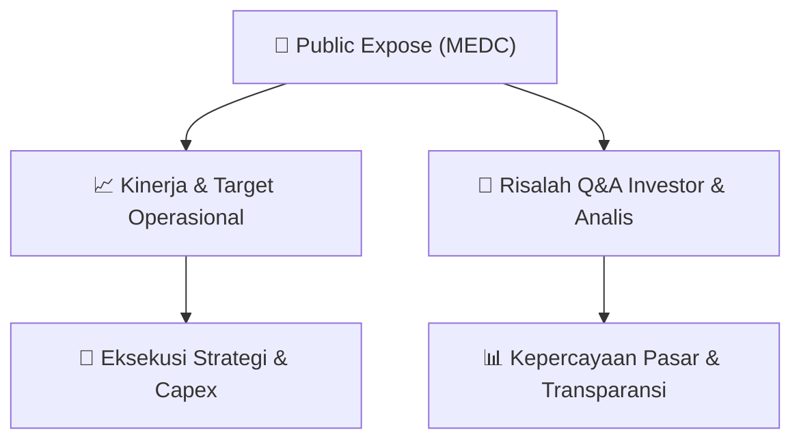

# 📢 Laporan Intelijen Paparan Publik (Public Expose) - [[MEDC]]
🏢 **Emiten**: `[[MEDC]]` | 📅 **Tanggal Pelaksanaan**: `2026-09-04` | 📑 **Dokumen**: `Public Expose`
⬅️ [[knowledge-base/daily-digests/Daily_Digest_20260904|Kembali ke Daily Digest]] | 🎛️ [[Dashboard|Ke Dashboard Utama]]

---

## 📌 1. Ringkasan Eksekutif & Paparan Direksi
> [!NOTE]
> Dokumen yang tersedia merupakan surat resmi PT Medco Energi Internasional Tbk (MEDC) perihal penyampaian materi Public Expose Tahunan 2026, bukan materi presentasi itu sendiri. Tidak terdapat informasi kinerja, strategi, atau data operasional dalam teks.

#### 🎯 Guidance Operasional & Target Strategis
- Tidak tersedia dalam dokumen. Surat hanya mengacu pada rencana Public Expose Tahunan yang diumumkan sebelumnya melalui Surat No EXT-007/LEGC/INA/MEDC/VIII/2026 tanggal 26 Agustus 2026 dan melampirkan materi public expose.

## 💬 3. Risalah Tanya Jawab (Q&A Session)
`Materi presentasi Public Expose / Risalah Q&A terlampir dalam dokumen resmi bursa.`

## 📌 4. Peta Jalur Strategis & Roadmap

---

## 🔗 Knowledge Graph
- [[knowledge-base/daily-digests/Daily_Digest_20260904|📄 Daily Digest 2026-09-04]]
- [[knowledge-base/calendars/Action_Calendar|🗓️ Kalender Terpusat Aksi Korporasi]]
- [[Dashboard|🎛️ Kembali ke Dashboard Utama]]