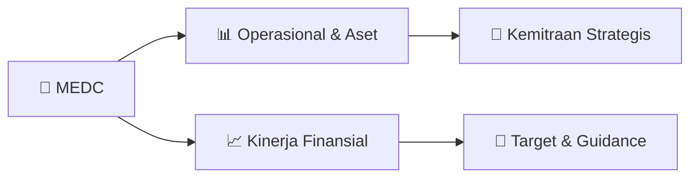

# 📊 Materi Public Expose: [MEDC]

🏢 **Emiten**: `MEDC` | 📅 **Tanggal Pelaksanaan**: `2026-09-04` | 📑 **Total Slide**: `2 Slide`
⬅️ [[knowledge-base/daily-digests/MEDC_20260904|Kembali ke Daily Digest]] | 🎛️ [[Dashboard/MEDC|Ke Dashboard Emiten]]

> [!NOTE]
> Ringkasan materi presentasi resmi Public Expose MEDC yang disampaikan oleh manajemen kepada investor dan bursa. Seluruh poin strategis, matriks operasional, dan angka kinerja diekstrak langsung dari slide deck resmi.

---

## 📅 1. Jadwal & Metadata Penyelenggaraan

| Parameter | Detail Informasi |
|---|---|
| **Nomor Surat Pengantar** | EXT-001/LEGC/INA/MEDC/IX/2026 |
| **Perihal Pengumuman** | Penyampaian Materi Public Expose Tahunan |
| **Waktu Pelaksanaan** | 2026-09-04 04-09-2026 15:11 |
| **Lokasi / Media** | Aplikasi Zoom / Daring |
| **Lampiran Resmi** | `1` |

## 📋 2. Agenda Paparan Publik

- Pemaparan Profil & Struktur Bisnis Perseroan
- Kinerja Operasional & Keuangan
- Arah Strategi Usaha & Target Pertumbuhan
- Sesi Tanya Jawab (Q&A)

## 🏢 3. Profil & Pilar Portofolio Bisnis

## 🏗️ 4. Kinerja Operasional & Portofolio Aset

*Detail aset operasional terlampir pada dokumen slide resmi.*

## 📈 5. Kinerja Keuangan & Posisi Finansial

## 🧭 6. Inisiatif Strategis, Kolaborasi, & Kemitraan

- Letter / Announcement No.
Issuer Name Issuer Code Attachment Subject EXT-001/LEGC/INA/MEDC/IX/2026
PT Medco Energi Internasional Tbk
MEDC
Public Expose Material Submission
Go To Indonesian Page
Public Expose Material Submission
Reffering to Company's public expose announcement Annual in Letter No. EXT-007/LEGC/INA/MEDC/VIII/2026
date 26 August 2026 Company submitted public expose material as attached.
Respectfully,
Thus to be informed accordingly.
PT Medco Energi Internasional Tbk
Siendy K. Wisandana
Corporate Secretary
Siendy K. Wisandana
Sender Name
PT Medco Energi Internasional Tbk
Gedung The Energy, Lantai 52 SCBD Lot, 11A, Jl. Jend. Sudirman Kav. 52-53,
Phone : (021) 2995-3000, Fax : (021) 2995-3001, www.medcoenergi.com
Corporate Secretary Function
Date and Time
04-09-2026 15:11 Attachment
1. MEDC Public Expose 2026.pdf
This is an official document of PT Medco Energi Internasional Tbk that does not require a signature as it was
generated electronically by the electronic reporting system. PT Medco Energi Internasional Tbk is fully responsible

## 🎯 7. Target Pertumbuhan & Guidance Manajemen

*Target pertumbuhan ditetapkan mengacu pada prospek industri dan kondisi makroekonomi terkini.*

## 🗺️ 8. Peta Jalur Strategis & Eksekusi

## 📑 9. Daftar Indeks Slide Presentasi

| Slide # | Judul / Topik Slide | Ringkasan Konten |
|---|---|---|
| Slide 1 | **Nomor Surat** | Nama Perusahaan Kode Emiten Lampiran |
| Slide 2 | **Letter / Announcement No.** | Issuer Name Issuer Code Attachment |

---

*Dokumen diolah otomatis oleh **Swarm Intelijen Pasar Modal Indonesia** pada 2026-10-12 16:46 WIB.*