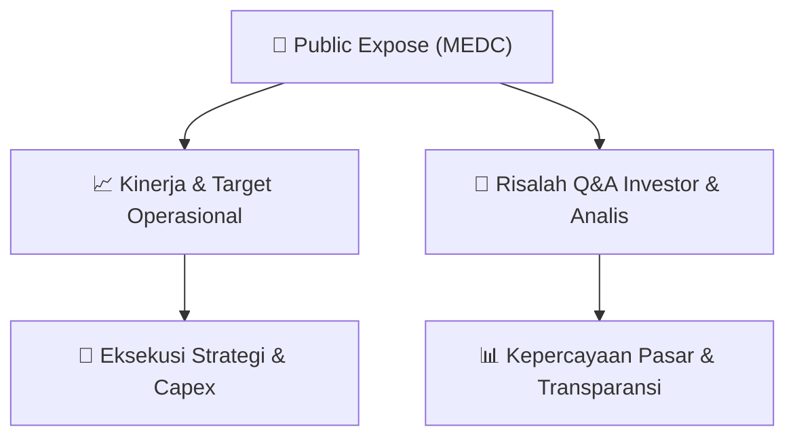

# 📢 Laporan Intelijen Paparan Publik (Public Expose) - [[MEDC]]
🏢 **Emiten**: `[[MEDC]]` | 📅 **Tanggal Pelaksanaan**: `2026-09-11` | 📑 **Dokumen**: `Public Expose`
⬅️ [[knowledge-base/daily-digests/Daily_Digest_20260911|Kembali ke Daily Digest]] | 🎛️ [[Dashboard|Ke Dashboard Utama]]

---

## 📌 1. Ringkasan Eksekutif & Paparan Direksi
> [!NOTE]
> PT Medco Energi Internasional Tbk (MEDC) menyelenggarakan Public Expose Tahunan pada 04 September 2026, dengan laporan hasil disampaikan ke Bursa Efek Indonesia pada 11 September 2026. Acara dihadiri oleh 211 peserta (tidak termasuk manajemen dan karyawan). Paparan ini merupakan agenda tahunan perusahaan untuk mengkomunikasikan kinerja, strategi, dan rencana ke depan kepada pemegang saham, investor, dan analis. Dokumen yang diunggah hanya berisi sampul laporan resmi tanpa notulen detail, sehingga informasi kunci operasional dan tanya jawab tidak tersedia dalam lampiran yang dipublikasikan.

#### 🎯 Guidance Operasional & Target Strategis
- Tidak tersedia dalam dokumen yang dipublikasikan. Dokumen hanya memuat informasi administratif penyelenggaraan Public Expose (surat pengantar, jumlah peserta, dan lampiran notulen). Rincian target kinerja, ekspansi, capex, dan guidance operasional tidak diungkapkan dalam file yang diakses.

## 📊 2. Matriks Indikator Operasional & Parameter Kunci
| Parameter Utama | Nilai / Keterangan Resmi |
| :--- | :--- |
| **Tanggal Penyelenggaraan Public Expose** | `04 September 2026` |
| **Tanggal Pelaporan Hasil Public Expose** | `11 September 2026` |
| **Jumlah Peserta Hadir** | `211 orang (tidak termasuk manajemen dan karyawan)` |
| **Nomor Surat Pengantar** | `EXT-003/LEGC/INA/MEDC/IX/2026` |
| **Nama Corporate Secretary** | `Siendy K. Wisandana` |
| **Lampiran Dokumen** | `Notulen Public Expose 2026_Final.pdf (tidak tersedia dalam file yang diunggah)` |

---

## 💬 3. Risalah Tanya Jawab (Q&A Session)
### ❓ Pertanyaan 1 (Tidak tersedia)
**Pertanyaan**: Tidak tersedia dalam dokumen yang dipublikasikan. Notulen Public Expose yang berisi sesi tanya jawab tidak dilampirkan secara lengkap pada file yang diakses.

**Jawaban Manajemen**: Tidak tersedia dalam dokumen yang dipublikasikan.

> [!TIP]
> **Implikasi Bagi Investor**: Investor perlu mengakses notulen lengkap melalui website resmi perusahaan atau menghubungi investor relations untuk mendapatkan detail sesi tanya jawab dan panduan manajemen.

## 📌 4. Peta Jalur Strategis & Roadmap

---

## 🔗 Knowledge Graph
- [[knowledge-base/daily-digests/Daily_Digest_20260911|📄 Daily Digest 2026-09-11]]
- [[knowledge-base/calendars/Action_Calendar|🗓️ Kalender Terpusat Aksi Korporasi]]
- [[Dashboard|🎛️ Kembali ke Dashboard Utama]]