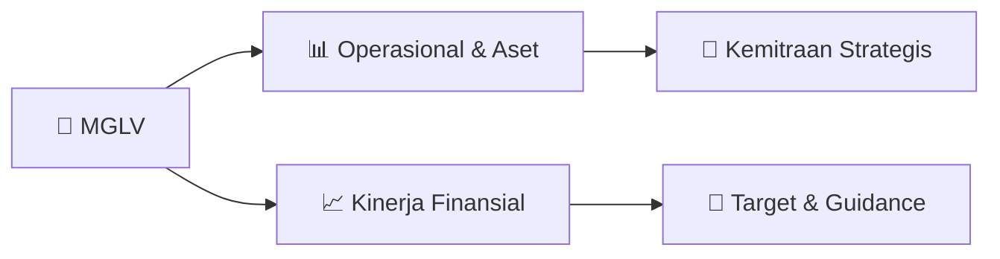

# 📊 Materi Public Expose: [MGLV]

🏢 **Emiten**: `MGLV` | 📅 **Tanggal Pelaksanaan**: `2026-09-15` | 📑 **Total Slide**: `8 Slide`
⬅️ [[knowledge-base/daily-digests/MGLV_20260915|Kembali ke Daily Digest]] | 🎛️ [[Dashboard/MGLV|Ke Dashboard Emiten]]

> [!NOTE]
> Ringkasan materi presentasi resmi Public Expose MGLV yang disampaikan oleh manajemen kepada investor dan bursa. Seluruh poin strategis, matriks operasional, dan angka kinerja diekstrak langsung dari slide deck resmi.

---

## 📅 1. Jadwal & Metadata Penyelenggaraan

| Parameter | Detail Informasi |
|---|---|
| **Nomor Surat Pengantar** | 013/NexAI/Corsec/IX/2026 |
| **Perihal Pengumuman** | Penyampaian Materi Public Expose Insidentil |
| **Waktu Pelaksanaan** | 2026-09-15 15-09-2026 14:33 |
| **Lokasi / Media** | Aplikasi Zoom / Daring |
| **Lampiran Resmi** | `1` |

## 📋 2. Agenda Paparan Publik

1. Perseroan telah melaksanakan tahapan keterbukaan informasi, persetujuan pemegang saham, dan pelaksanaan transaksi.
2. 3 Sep 2026
3. Keterbukaan Informasi
4. PMHMETD I, Transaksi Afiliasi
5. dan Transaksi Material, serta
6. Perubahan Kegiatan Usaha.
7. 7 Sep 2026
8. RUPSLB
9. Pemegang saham menyetujui
10. agenda transaksi dan
11. perubahan kegiatan usaha
12. Perseroan.
13. 7 Sep 2026
14. Akuisisi NAC & NGC
15. Perseroan menyelesaikan
16. akuisisi NAC dan NGC.
17. 8 Sep 2026
18. Divestasi dan Pengalihan
19. Divestasi 13 perusahaan anak
20. serta pengalihan aset dan
21. kewajiban.
22. 10 Sep 2026
23. Prospektus Ringkas
24. Perseroan mengumumkan
25. Prospektus Ringkas
26. PMHMETD I.
27. Perseroan telah menjalankan tahapan keterbukaan informasi dan aksi korporasi sesuai ketentuan yang berlaku. Sepanjang pengetahuan Perseroan,
28. tidak terdapat informasi atau fakta material lain yang belum diungkapkan kepada publik.
29. PT NexAI Digital Infrastruktur Tbk

## 🏢 3. Profil & Pilar Portofolio Bisnis

## 🏗️ 4. Kinerja Operasional & Portofolio Aset

> Posisi Keuangan Perseroan
PT NexAI Digital Infrastruktur Tbk
Dalam Rp juta
187.913 184.044 59.740 69.810 128.173 114.234
31 Desember 2025
30 Juni 2026
Total Aset Total Liabilitas Total Ekuitas Keterangan Pertumbuhan Total Aset (2,06%) Total Liabilitas 16,86% Total Ekuitas (10,88%) Catatan
Informasi keuangan di atas mencerminkan kondisi Perseroan sebelum pelaksanaan transaksi akuisisi dan persetujuan perubahan kegiatan usaha pada
September 2026.

## 📈 5. Kinerja Keuangan & Posisi Finansial

## 🧭 6. Inisiatif Strategis, Kolaborasi, & Kemitraan

*Strategi usaha difokuskan pada penguatan fundamental dan ekspansi operasional.*

## 🎯 7. Target Pertumbuhan & Guidance Manajemen

*Target pertumbuhan ditetapkan mengacu pada prospek industri dan kondisi makroekonomi terkini.*

## 🗺️ 8. Peta Jalur Strategis & Eksekusi

## 📑 9. Daftar Indeks Slide Presentasi

| Slide # | Judul / Topik Slide | Ringkasan Konten |
|---|---|---|
| Slide 1 | **PUBLIC EXPOSE INSIDENTIL** | PT NEXAI DIGITAL INFRASTRUKTUR TBK Jakarta, 16 September 2026 |
| Slide 2 | **Pendahuluan** | PT NexAI Digital Infrastruktur Tbk 2 Latar Belakang |
| Slide 3 | **Materi Public Expose Insidentil** | PT NexAI Digital Infrastruktur Tbk 3 1 |
| Slide 4 | **Posisi Keuangan Perseroan** | PT NexAI Digital Infrastruktur Tbk 4 Dalam Rp juta |
| Slide 5 | **Laba Rugi Perseroan** | 5 Dalam Rp juta PT NexAI Digital Infrastruktur Tbk |
| Slide 6 | **Kondisi Bisnis Terkini Perseroan** | 6 Perseroan telah melaksanakan tahapan keterbukaan informasi, persetujuan pemegang saham, dan pelaksanaan transaksi. 3 Sep 2026 |
| Slide 7 | **Perkembangan Terkini dan Keterbukaan Informasi** | 7 1 Kondisi Bisnis Terkini Perseroan |
| Slide 8 | **Terima Kasih** | PT NexAI Digital Infrastruktur Tbk Pacific Century Place Lantai 38, SCBD Lot 10 Jl. Jend. Sudirman Kav. 52–53, Jakarta Selatan |

---

*Dokumen diolah otomatis oleh **Swarm Intelijen Pasar Modal Indonesia** pada 2026-10-12 16:46 WIB.*