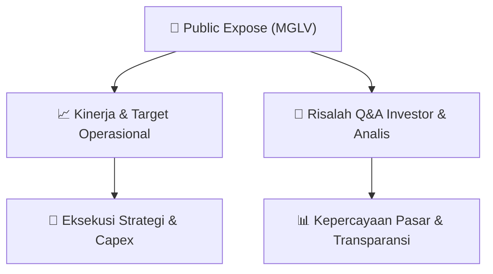

# 📢 Laporan Intelijen Paparan Publik (Public Expose) - [[MGLV]]
🏢 **Emiten**: `[[MGLV]]` | 📅 **Tanggal Pelaksanaan**: `2026-09-15` | 📑 **Dokumen**: `Public Expose`
⬅️ [[knowledge-base/daily-digests/Daily_Digest_20260915|Kembali ke Daily Digest]] | 🎛️ [[Dashboard|Ke Dashboard Utama]]

---

## 📌 1. Ringkasan Eksekutif & Paparan Direksi
> [!NOTE]
> PT NexAI Digital Infrastruktur Tbk (MGLV) menyelenggarakan Public Expose Insidentil secara sukarela pada 16 September 2026, dengan materi paparan yang disampaikan melalui surat No. 013/NexAI/Corsec/IX/2026 tertanggal 15 September 2026. Paparan ini merupakan tindak lanjut dari pengumuman rencana Public Expose pada surat No. 012/NexAI/Corsec/IX/2026. Dokumen yang tersedia hanya memuat halaman administratif pelaporan, sementara materi paparan inti (file 'Materi Pubex Insidentil MGLV 16 Sept 26.pdf') tidak disertakan dalam teks yang diberikan. Oleh karena itu, analisis terbatas pada informasi administratif dan tidak dapat mengungkap substansi kinerja atau strategi emiten.

#### 🎯 Guidance Operasional & Target Strategis
- Tidak tersedia informasi mengenai target kinerja, ekspansi, atau capex karena materi paparan inti tidak disertakan dalam dokumen yang dianalisis. Satu-satunya fakta yang dapat dikonfirmasi adalah penyelenggaraan Public Expose Insidentil secara sukarela (bukan permintaan Bursa/OJK) pada 16 September 2026, yang mengindikasikan adanya agenda strategis yang ingin dikomunikasikan manajemen kepada publik.

## 📊 2. Matriks Indikator Operasional & Parameter Kunci
| Parameter Utama | Nilai / Keterangan Resmi |
| :--- | :--- |
| **Jenis Pelaksanaan** | `Sukarela (Voluntary), bukan permintaan IDX/OJK` |
| **Tanggal Public Expose** | `16 September 2026` |
| **Tanggal Penyampaian Materi** | `15 September 2026` |
| **Nomor Surat Pengantar** | `013/NexAI/Corsec/IX/2026` |
| **Nama Emiten** | `PT NexAI Digital Infrastruktur Tbk (MGLV)` |
| **Kode Emiten** | `MGLV` |
| **Corporate Secretary** | `Putra Harianto Bate'e` |
| **Alamat Kantor** | `Pacific Century Place Lantai 38, SCBD Lot 10, Jl. Jend. Sudirman Kav. 52-53, Jakarta` |

---

## 💬 3. Risalah Tanya Jawab (Q&A Session)
### ❓ Pertanyaan 1 (Tidak tersedia (dokumen Q&A tidak disertakan))
**Pertanyaan**: Tidak tersedia - Materi paparan inti dan sesi tanya jawab tidak termasuk dalam teks dokumen yang diberikan.

**Jawaban Manajemen**: Tidak tersedia - Manajemen tidak memberikan jawaban apapun dalam dokumen administratif ini.

> [!TIP]
> **Implikasi Bagi Investor**: Investor perlu menunggu rilis materi paparan lengkap atau siaran pers resmi untuk mendapatkan substansi Public Expose. Ketidaklengkapan dokumen ini membatasi kemampuan analisis fundamental.

## 📌 4. Peta Jalur Strategis & Roadmap

---

## 🔗 Knowledge Graph
- [[knowledge-base/daily-digests/Daily_Digest_20260915|📄 Daily Digest 2026-09-15]]
- [[knowledge-base/calendars/Action_Calendar|🗓️ Kalender Terpusat Aksi Korporasi]]
- [[Dashboard|🎛️ Kembali ke Dashboard Utama]]