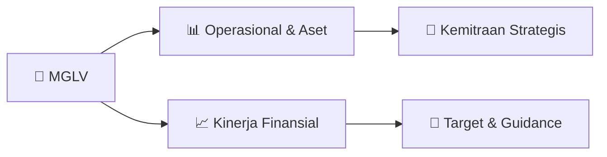

# 📊 Materi Public Expose: [MGLV]

🏢 **Emiten**: `MGLV` | 📅 **Tanggal Pelaksanaan**: `2026-09-16` | 📑 **Total Slide**: `4 Slide`
⬅️ [[knowledge-base/daily-digests/MGLV_20260916|Kembali ke Daily Digest]] | 🎛️ [[Dashboard/MGLV|Ke Dashboard Emiten]]

> [!NOTE]
> Ringkasan materi presentasi resmi Public Expose MGLV yang disampaikan oleh manajemen kepada investor dan bursa. Seluruh poin strategis, matriks operasional, dan angka kinerja diekstrak langsung dari slide deck resmi.

---

## 📅 1. Jadwal & Metadata Penyelenggaraan

| Parameter | Detail Informasi |
|---|---|
| **Nomor Surat Pengantar** | R013/NexAI/Corsec/IX/2026 |
| **Perihal Pengumuman** | Penyampaian Materi Public Expose Insidentil |
| **Waktu Pelaksanaan** | 2026-09-16 16-09-2026 11:13 |
| **Lokasi / Media** | Aplikasi Zoom / Daring |
| **Lampiran Resmi** | `1` |

## 📋 2. Agenda Paparan Publik

- Pemaparan Profil & Struktur Bisnis Perseroan
- Kinerja Operasional & Keuangan
- Arah Strategi Usaha & Target Pertumbuhan
- Sesi Tanya Jawab (Q&A)

## 🏢 3. Profil & Pilar Portofolio Bisnis

## 🏗️ 4. Kinerja Operasional & Portofolio Aset

*Detail aset operasional terlampir pada dokumen slide resmi.*

## 📈 5. Kinerja Keuangan & Posisi Finansial

## 🧭 6. Inisiatif Strategis, Kolaborasi, & Kemitraan

- Letter / Announcement No.
Issuer Name Issuer Code Attachment Subject R013/NexAI/Corsec/IX/2026
PT NexAI Digital Infrastruktur Tbk
MGLV
Public Expose Material Submission
Go To Indonesian Page
Mengoreksi surat kami nomor : 013/NexAI/Corsec/IX/2026 tanggal 15 September 2026 perihal Penyampaian
Materi Public Expose - Insidentil, dengan ini perseroan menyampaikan hal sebagai berikut:
Topic: Public Insidentil MGLV PT Nexai Digital Infrastruktur Tbk
Time: Sep 16, 2026 02:00 PM Jakarta
Join Zoom Meeting
https://us06web.zoom.us/j/89065434312?pwd=jvLS15Wjq4ITiTfbcha8NoMIYph7ku.1
Meeting chat link
https://us06web.zoom.us/launch/jc/89065434312
Meeting ID: 890 6543 4312
Passcode: 761841 Background Voluntary
Requested by IDX
Requested by OJK
Public Expose Material Submission
Reffering to Company's public expose announcement Incidental in Letter No. 012/NexAI/Corsec/IX/2026
date 16 September 2026 Company submitted public expose material as attached.
Respectfully,
Thus to be informed accordingly.
PT NexAI Digital Infrastruktur Tbk
Putra Harianto Bate'e
Corporate Secretary

## 🎯 7. Target Pertumbuhan & Guidance Manajemen

*Target pertumbuhan ditetapkan mengacu pada prospek industri dan kondisi makroekonomi terkini.*

## 🗺️ 8. Peta Jalur Strategis & Eksekusi

## 📑 9. Daftar Indeks Slide Presentasi

| Slide # | Judul / Topik Slide | Ringkasan Konten |
|---|---|---|
| Slide 1 | **Nomor Surat** | Nama Perusahaan Kode Emiten Lampiran |
| Slide 2 | **Pacific Century Place Lantai 38, SCBD Lot 10, Jl. Jend. Sudirman Kav. 52-53, Kel.** | Corporate Secretary Nama Pengirim Telepon : , Fax : , |
| Slide 3 | **Letter / Announcement No.** | Issuer Name Issuer Code Attachment |
| Slide 4 | **Putra Harianto Bate'e** | Sender Name PT NexAI Digital Infrastruktur Tbk Pacific Century Place Lantai 38, SCBD Lot 10, Jl. Jend. Sudirman Kav. 52-53, Kel. |

---

*Dokumen diolah otomatis oleh **Swarm Intelijen Pasar Modal Indonesia** pada 2026-10-12 16:46 WIB.*