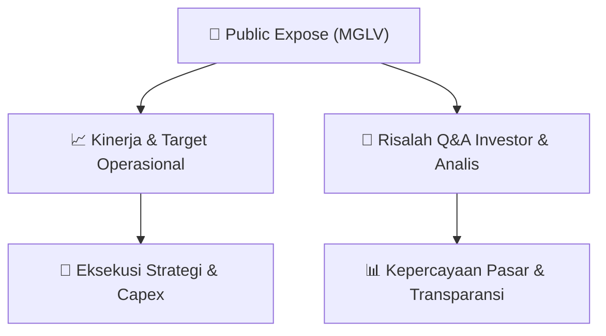

# 📢 Laporan Intelijen Paparan Publik (Public Expose) - [[MGLV]]
🏢 **Emiten**: `[[MGLV]]` | 📅 **Tanggal Pelaksanaan**: `2026-09-16` | 📑 **Dokumen**: `Public Expose`
⬅️ [[knowledge-base/daily-digests/Daily_Digest_20260916|Kembali ke Daily Digest]] | 🎛️ [[Dashboard|Ke Dashboard Utama]]

---

## 📌 1. Ringkasan Eksekutif & Paparan Direksi
> [!NOTE]
> PT NexAI Digital Infrastruktur Tbk (MGLV) menyelenggarakan Public Expose Insidentil pada 16 September 2026 pukul 14:00 WIB secara virtual melalui Zoom. Public expose ini bersifat sukarela namun juga merupakan tindak lanjut atas permintaan Bursa Efek Indonesia (BEI) dan Otoritas Jasa Keuangan (OJK). Acara ini dikoreksi dari surat sebelumnya bernomor 013/NexAI/Corsec/IX/2026 tanggal 15 September 2026. Materi paparan disampaikan oleh Corporate Secretary, Putra Harianto Bate'e. Dokumen yang diunggah hanya berisi pemberitahuan teknis penyelenggaraan acara dan lampiran materi (file PDF terpisah), tanpa memuat detail isi paparan, target kinerja, atau sesi tanya jawab dalam teks ini.

#### 🎯 Guidance Operasional & Target Strategis
- Tidak terdapat informasi mengenai target kinerja, ekspansi, capex, atau panduan operasional dalam dokumen teks yang disediakan. Dokumen ini hanya berisi pengumuman administratif penyelenggaraan Public Expose Insidentil. Materi paparan sesungguhnya (Materi Pubex Insidentil MGLV 16 Sept 26 - koreksi.pdf) disebut sebagai lampiran namun tidak disertakan dalam teks yang dianalisis.

## 📊 2. Matriks Indikator Operasional & Parameter Kunci
| Parameter Utama | Nilai / Keterangan Resmi |
| :--- | :--- |
| **Jenis Acara** | `Public Expose Insidentil` |
| **Tanggal Pelaksanaan** | `16 September 2026, 14:00 WIB` |
| **Sifat Pelaksanaan** | `Sukarela, namun juga atas permintaan BEI dan OJK` |
| **Media Pelaksanaan** | `Zoom Meeting (Meeting ID: 890 6543 4312, Passcode: 761841)` |
| **Narasumber / Penanggung Jawab** | `Putra Harianto Bate'e (Corporate Secretary)` |
| **Nomor Surat** | `R013/NexAI/Corsec/IX/2026 (koreksi dari 013/NexAI/Corsec/IX/2026)` |
| **Lampiran** | `Materi Pubex Insidentil MGLV 16 Sept 26 - koreksi.pdf (tidak tersedia dalam teks)` |

---

## 💬 3. Risalah Tanya Jawab (Q&A Session)
### ❓ Pertanyaan 1 (Tidak tersedia)
**Pertanyaan**: Tidak ada sesi tanya jawab yang tercantum dalam dokumen teks yang disediakan.

**Jawaban Manajemen**: Tidak ada jawaban manajemen yang tercantum dalam dokumen teks yang disediakan.

> [!TIP]
> **Implikasi Bagi Investor**: Investor perlu menunggu atau mengakses materi paparan terlampir (file PDF) dan rekaman acara untuk mendapatkan informasi fundamental, strategi, serta panduan manajemen. Dokumen ini hanya bersifat administratif.

## 📌 4. Peta Jalur Strategis & Roadmap

---

## 🔗 Knowledge Graph
- [[knowledge-base/daily-digests/Daily_Digest_20260916|📄 Daily Digest 2026-09-16]]
- [[knowledge-base/calendars/Action_Calendar|🗓️ Kalender Terpusat Aksi Korporasi]]
- [[Dashboard|🎛️ Kembali ke Dashboard Utama]]