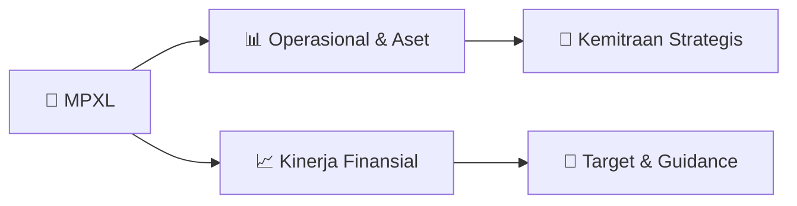

# 📊 Materi Public Expose: [MPXL]

🏢 **Emiten**: `MPXL` | 📅 **Tanggal Pelaksanaan**: `2026-08-21` | 📑 **Total Slide**: `1 Slide`
⬅️ [[knowledge-base/daily-digests/MPXL_20260821|Kembali ke Daily Digest]] | 🎛️ [[Dashboard/MPXL|Ke Dashboard Emiten]]

> [!NOTE]
> Ringkasan materi presentasi resmi Public Expose MPXL yang disampaikan oleh manajemen kepada investor dan bursa. Seluruh poin strategis, matriks operasional, dan angka kinerja diekstrak langsung dari slide deck resmi.

---

## 📅 1. Jadwal & Metadata Penyelenggaraan

| Parameter | Detail Informasi |
|---|---|
| **Nomor Surat Pengantar** | 002/SPeng/MPXL-SEC/VIII/2026 |
| **Perihal Pengumuman** | Rencana Penyelenggaraan Public Expose Tahunan |
| **Waktu Pelaksanaan** | 07 September 2026 16:00 |
| **Lokasi / Media** | Public Expose Live 2026, yang tercantum pada website |
| **Lampiran Resmi** | `1` |

## 📋 2. Agenda Paparan Publik

1. Gold Coast Office Tower Lt. 19, Jalan Pantai Indah Kapuk
2. Penjaringan, Jakarta Utara, DKI Jakarta
3. Telp 021-50111701 Email : corsec@mpxlogistic.com Web : www.mpxlogistic.com
4. Nomor : 002/SPeng/MPXL-SEC/VIII/2026
5. 21 Agustus 2026
6. Yth. Direksi Bursa Efek Indonesia
7. Indonesia Stock Exchange Building, Tower I, 6th Floor
8. Jl. Jend. Sudirman Kav. 52-53 Jakarta 12190- Indonesia
9. U.p.: Kepala Divisi Penilaian Perusahaan 2
10. Perihal: Rencana Penyelenggaraan Public Expose Tahunan  PT MPX Logistics International Tbk. / Plan
11. for the Annual Public Expose of PT MPX Logistics International Tbk
12. Dengan hormat,
13. Your Faithfully,
14. Menunjuk Surat Keputusan Direksi PT Bursa
15. Efek Indonesia Nomor Kep-00066/BEI/09-
16. 2022 tanggal 30 September 2022, Perihal
17. Perubahan Peraturan Nomor I-E tentang
18. Kewajiban
19. Penyampaian
20. Informasi
21. undangan Mengikuti Public Expose Live 2026
22. ("Pubex Live 2026") dalam Rangka 49 Tahun
23. Diaktifkannya Kembali Pasar Modal Indonesia.
24. Berikut kami sampaikan rencana Perseroan
25. untuk
26. menyelenggarakan
27. Paparan
28. Publik
29. (Public
30. Expose)
31. Logistics
32. International Tbk, yang akan diselenggarakan
33. secara virtual, pada :
34. Referring to the Decision of the Board of
35. Directors of PT Bursa Efek Indonesia Number
36. Kep-00066/BEI/09-2022 dated September 30,
37. 2022, regarding the Amendment to Regulation
38. Number I-E concerning the Obligation to
39. Submit Information, as well as the invitation to
40. participate in Public Expose Live 2026 (“Pubex
41. Live 2026”) in commemoration of the 49th
42. anniversary
43. reactivation
44. Indonesian Capital Market, we hereby inform
45. you of the Company’s plan to conduct the
46. Public
47. Expose
48. Logistics
49. International Tbk, which will be held virtually,
50. as follows.
51. Hari / Tanggal Day/Date
52. : Senin, 07 September 2026 / Monday, September 7, 2026
53. Waktu / Time
54. : 16:00 – 17:00 WIB
55. Tempat
56. : Public Expose Live 2026 yang tercantum pada situs website idx.co.id /
57. Public Expose Live 2026, as provided on the IDX website at idx.co.id
58. Agenda
59. : 1. Pemaparan Kinerja Perseroan Semester 1 2026
60. 2. Prospek dan Strategi Usaha /
61. 1. Presentation of the Company’s 1st Semester 2026 Performance
62. 2. Business Outlook and Strategies
63. Manajemen yang akan hadir  : Direksi Perseroan / The Company’s Board of Directors
64. Demikian kami sampaikan, terima kasih atas
65. perhatian dan kerjasamanya.
66. Thus we conveyed, thank you for your kind
67. attention.

## 🏢 3. Profil & Pilar Portofolio Bisnis

## 🏗️ 4. Kinerja Operasional & Portofolio Aset

*Detail aset operasional terlampir pada dokumen slide resmi.*

## 📈 5. Kinerja Keuangan & Posisi Finansial

## 🧭 6. Inisiatif Strategis, Kolaborasi, & Kemitraan

*Strategi usaha difokuskan pada penguatan fundamental dan ekspansi operasional.*

## 🎯 7. Target Pertumbuhan & Guidance Manajemen

*Target pertumbuhan ditetapkan mengacu pada prospek industri dan kondisi makroekonomi terkini.*

## 🗺️ 8. Peta Jalur Strategis & Eksekusi

## 📑 9. Daftar Indeks Slide Presentasi

| Slide # | Judul / Topik Slide | Ringkasan Konten |
|---|---|---|
| Slide 1 | **PT MPX LOGISTICS INTERNATIONAL Tbk** | Gold Coast Office Tower Lt. 19, Jalan Pantai Indah Kapuk Penjaringan, Jakarta Utara, DKI Jakarta Telp 021-50111701 Email : corsec@mpxlogistic.com Web  |

---

*Dokumen diolah otomatis oleh **Swarm Intelijen Pasar Modal Indonesia** pada 2026-10-12 16:47 WIB.*