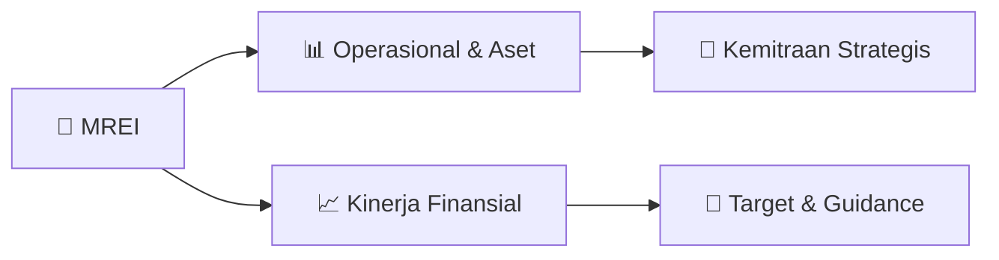

# 📊 Materi Public Expose: [MREI]

🏢 **Emiten**: `MREI` | 📅 **Tanggal Pelaksanaan**: `2026-08-11` | 📑 **Total Slide**: `8 Slide`
⬅️ [[knowledge-base/daily-digests/MREI_20260811|Kembali ke Daily Digest]] | 🎛️ [[Dashboard/MREI|Ke Dashboard Emiten]]

> [!NOTE]
> Ringkasan materi presentasi resmi Public Expose MREI yang disampaikan oleh manajemen kepada investor dan bursa. Seluruh poin strategis, matriks operasional, dan angka kinerja diekstrak langsung dari slide deck resmi.

---

## 📅 1. Jadwal & Metadata Penyelenggaraan

| Parameter | Detail Informasi |
|---|---|
| **Nomor Surat Pengantar** | 136/SEKPER/RUPS/082026 |
| **Perihal Pengumuman** | Penyampaian Materi Public Expose Insidentil |
| **Waktu Pelaksanaan** | 2026-08-11 11-08-2026 17:03 |
| **Lokasi / Media** | Aplikasi Zoom / Daring |
| **Lampiran Resmi** | `2` |

## 📋 2. Agenda Paparan Publik

1. Sekilas Perseroan
2. Perubahan Pengurus Perseroan
3. Informasi atas Keterlambatan Laporan Keuangan
4. Audit dan Laporan Tahunan Perseroan untuk
5. Tahun Buku 2025
6. AGENDA
7. PUBLIC EXPOSE
8. Informasi Keterlambatan Laporan Keuangan Audit dan Laporan Tahunan Perseroan untuk
9. Tahun Buku 2025
10. • Telah dilaksanakan RUPSLB Perseroan pada 14 Agustus 2026, dimana mata acara pertamanya adalah Penyampaian
11. informasi atas keterlambatan Laporan Keuangan Audit dan Laporan Tahunan Perseroan untuk Tahun Buku 2025,
12. dengan pembagian pembahasan yang meliputi terjadinya insiden siber, proses penanganan yang dilakukan dan
13. pemulihan paska insiden serta timeline penyelesaian laporan keuangan tahunan 2025.
14. • Berdasarkan hasil monitoring dark web yang dilakukan oleh pihak independen hingga saat ini tidak ditemukan adanya
15. kebocoran data.
16. • Perseroan telah menyampaikan keterbukaan informasi kepada OJK dan Bursa Efek Indonesia  atas Keterlambatan
17. Penyampaian Laporan Keuangan Audited Tahun Buku 2025, Laporan Tahunan dan Laporan Keberlanjutan Tahun Buku
18. 2025.
19. • Laporan keuangan versi IFRS17 diperkirakan akan siap diaudit pada bulan September 2026.
20. PERUBAHAN PENGURUS PERSEROAN
21. *berlaku efektif terhitung sejak diperolehnya persetujuan dari OJK atas penilaian kemampuan dan kepatutan (fit & proper test) dan dengan memenuhi peraturan perundang-
22. undangan yang berlaku.
23. Direksi
24. Sebelumnya
25. Hasil RUPSLB
26. Presiden Direktur
27. Robby Loho
28. Robby Loho
29. Direktur Keuangan
30. Lukcimo Jahja
31. Lukcimo Jahja
32. Direktur
33. Trinita Situmeang
34. Anwar Cipto Syamsul*

## 🏢 3. Profil & Pilar Portofolio Bisnis

> Nama Perusahaan
PT Maskapai Reasuransi Indonesia Tbk.
Akronim Marein Kode Saham MREI Tanggal Pendirian
4 Juni 1953
Bidang Usaha
Reasuransi Konvensional dan Syariah
Dasar Hukum Pendirian
Akta Pendirian Perseroan No. 15 di hadapan Notaris Anton Frederik Schut
(pengganti dari Meester Karel Eduard Krijgsman) di Jakarta dan telah disahkan
oleh Menteri Kehakiman RI No. J.A5/108/3 pada tanggal 17 Desember 1953.
Pemegang Saham
per Juli 2026
• PT Graha Sentosa Persada*
• AJB Bumiputera 1912
• Bank of Singapore Limited
• Publik (<5%)
20,53% 14,84% 6,53% 58,10%
*) pemegang saham pengendali
Media Sosial marein.re
PT Maskapai Reasuransi Indonesia Tbk.
SEKILAS PERSEROAN

## 🏗️ 4. Kinerja Operasional & Portofolio Aset

*Detail aset operasional terlampir pada dokumen slide resmi.*

## 📈 5. Kinerja Keuangan & Posisi Finansial

## 🧭 6. Inisiatif Strategis, Kolaborasi, & Kemitraan

*Strategi usaha difokuskan pada penguatan fundamental dan ekspansi operasional.*

## 🎯 7. Target Pertumbuhan & Guidance Manajemen

*Target pertumbuhan ditetapkan mengacu pada prospek industri dan kondisi makroekonomi terkini.*

## 🗺️ 8. Peta Jalur Strategis & Eksekusi

## 📑 9. Daftar Indeks Slide Presentasi

| Slide # | Judul / Topik Slide | Ringkasan Konten |
|---|---|---|
| Slide 1 | **PUBLIC EXPOSE** | PT Maskapai Reasuransi Indonesia Tbk. Jakarta, 14 Agustus 2026 |
| Slide 2 | **TATA CARA PUBLIC EXPOSE 2026** | Seluruh peserta wajib melakukan pendaftaran dengan mengisi formulir pendaftaran melalui link https://bit.ly/pendaftaranPE selambat-lambatnya hari Rabu |
| Slide 3 | **01 03** | 03 02 Sekilas Perseroan |
| Slide 4 | **Nama Perusahaan** | PT Maskapai Reasuransi Indonesia Tbk. Akronim Marein |
| Slide 5 | **Work with** | Heart Excellence in Quality |
| Slide 6 | **AGENDA 2** | Informasi Keterlambatan Laporan Keuangan Audit dan Laporan Tahunan Perseroan untuk Tahun Buku 2025 • Telah dilaksanakan RUPSLB Perseroan pada 14 Agust |
| Slide 7 | **AGENDA 3** | PERUBAHAN PENGURUS PERSEROAN *berlaku efektif terhitung sejak diperolehnya persetujuan dari OJK atas penilaian kemampuan dan kepatutan (fit & proper t |
| Slide 8 | **Informasi lebih lanjut:** | https://marein-re.com/hubungan-investor cosec@marein-re.com marein.re |

---

*Dokumen diolah otomatis oleh **Swarm Intelijen Pasar Modal Indonesia** pada 2026-10-12 16:47 WIB.*