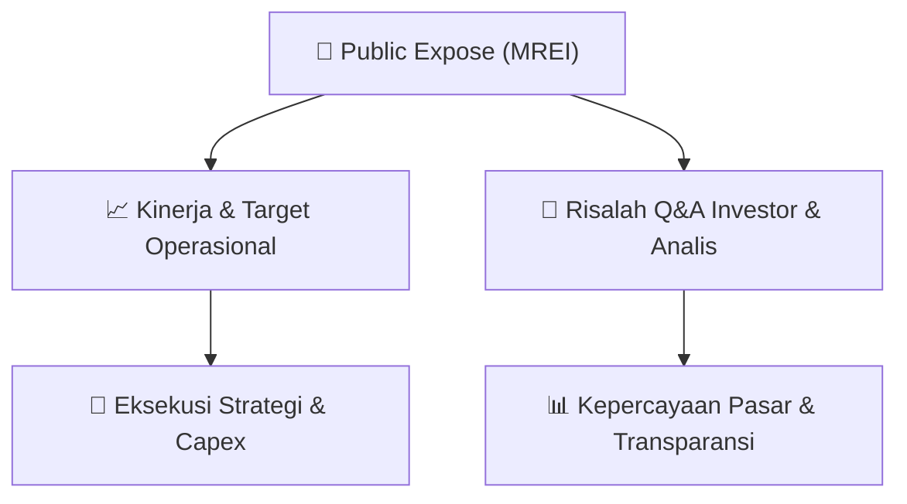

# 📢 Laporan Intelijen Paparan Publik (Public Expose) - [[MREI]]
🏢 **Emiten**: `[[MREI]]` | 📅 **Tanggal Pelaksanaan**: `2026-08-20` | 📑 **Dokumen**: `Public Expose`
⬅️ [[knowledge-base/daily-digests/Daily_Digest_20260820|Kembali ke Daily Digest]] | 🎛️ [[Dashboard|Ke Dashboard Utama]]

---

## 📌 1. Ringkasan Eksekutif & Paparan Direksi
> [!NOTE]
> Dokumen merupakan surat penyampaian laporan hasil Public Expose Insidentil Maskapai Reasuransi Indonesia Tbk (MREI) kepada otoritas/bursa. Teks yang diberikan hanya memuat metadata surat dan konfirmasi pelaksanaan public expose, tanpa paparan materi kinerja, strategi, atau operasional. Peserta eksternal yang hadir sebanyak 4 orang.

#### 🎯 Guidance Operasional & Target Strategis
- Tidak tersedia dalam teks dokumen. Tidak ada target kinerja, ekspansi, belanja modal, atau guidance operasional yang diungkapkan.

## 📊 2. Matriks Indikator Operasional & Parameter Kunci
| Parameter Utama | Nilai / Keterangan Resmi |
| :--- | :--- |
| **Nama Perusahaan** | `Maskapai Reasuransi Indonesia Tbk` |
| **Kode Emiten** | `MREI` |
| **Jenis Public Expose** | `Insidentil` |
| **Tanggal Rencana Penyelenggaraan Public Expose** | `11 Agustus 2026` |
| **Jumlah Peserta Eksternal** | `4 orang` |
| **Tanggal Penyampaian Laporan** | `20 Agustus 2026` |
| **Nomor Surat** | `142/SEKPER/RUPS/082026` |

---

## 💬 3. Risalah Tanya Jawab (Q&A Session)
`Materi presentasi Public Expose / Risalah Q&A terlampir dalam dokumen resmi bursa.`

## 📌 4. Peta Jalur Strategis & Roadmap

---

## 🔗 Knowledge Graph
- [[knowledge-base/daily-digests/Daily_Digest_20260820|📄 Daily Digest 2026-08-20]]
- [[knowledge-base/calendars/Action_Calendar|🗓️ Kalender Terpusat Aksi Korporasi]]
- [[Dashboard|🎛️ Kembali ke Dashboard Utama]]