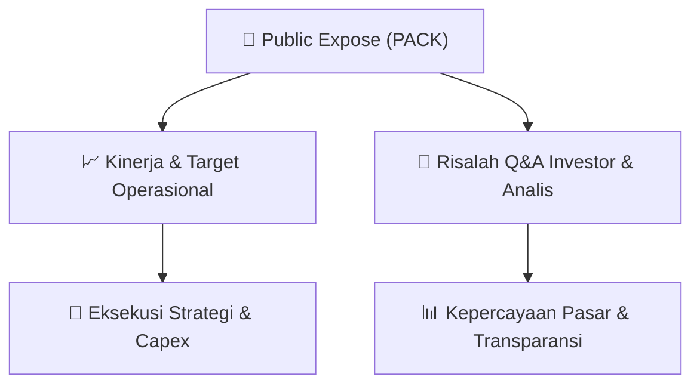

# 📢 Laporan Intelijen Paparan Publik (Public Expose) - [[PACK]]
🏢 **Emiten**: `[[PACK]]` | 📅 **Tanggal Pelaksanaan**: `2026-09-09` | 📑 **Dokumen**: `Public Expose`
⬅️ [[knowledge-base/daily-digests/Daily_Digest_20260909|Kembali ke Daily Digest]] | 🎛️ [[Dashboard|Ke Dashboard Utama]]

---

## 📌 1. Ringkasan Eksekutif & Paparan Direksi
> [!NOTE]
> PT Abadi Nusantara Hijau Investama Tbk (PACK) akan menyelenggarakan Public Expose Insidentil pada 11 September 2026 pukul 10:00 WIB secara virtual melalui Zoom. Public Expose ini bersifat sukarela namun berdasarkan permintaan Bursa Efek Indonesia (BEI) melalui surat Peng-SPT-00159/BEI.WAS/08-2026. Agenda utama meliputi pemaparan kinerja keuangan dan kondisi bisnis terkini, rencana bisnis ke depan, serta analisis manajemen terkait pergerakan harga saham dan suspensi bursa yang sedang dialami emiten. Acara akan dipimpin oleh Direktur Donnie Holman Partogi Manurung.

#### 🎯 Guidance Operasional & Target Strategis
- Tidak ada target kinerja, ekspansi, atau capex spesifik yang diungkapkan dalam dokumen pengumuman ini. Namun, agenda public expose mencakup pemaparan rencana bisnis masa mendatang dan analisis manajemen atas pergerakan harga saham serta suspensi bursa, yang mengindikasikan adanya isu signifikan yang perlu dijelaskan kepada investor. Katalis utama yang dapat diamati adalah penjelasan manajemen mengenai penyebab suspensi dan prospek pemulihan bisnis perusahaan.

## 📊 2. Matriks Indikator Operasional & Parameter Kunci
| Parameter Utama | Nilai / Keterangan Resmi |
| :--- | :--- |
| **Jenis Public Expose** | `Insidentil (Sukarela atas permintaan BEI)` |
| **Referensi Surat BEI** | `Peng-SPT-00159/BEI.WAS/08-2026` |
| **Tanggal Pelaksanaan** | `11 September 2026` |
| **Waktu Pelaksanaan** | `10:00 WIB` |
| **Tempat Pelaksanaan** | `Live Event via Aplikasi Zoom` |
| **Agenda 1** | `Kinerja keuangan dan kondisi bisnis terkini Perseroan` |
| **Agenda 2** | `Rencana bisnis Perseroan di masa mendatang` |
| **Agenda 3** | `Analisa Manajemen terkait pergerakan harga saham dan suspensi bursa` |
| **Nama Direktur Pelapor** | `Donnie Holman Partogi Manurung` |
| **Tanggal Pengumuman** | `09 September 2026` |

---

## 💬 3. Risalah Tanya Jawab (Q&A Session)
### ❓ Pertanyaan 1 (Belum tersedia (dokumen hanya berisi pengumuman rencana, bukan risalah pelaksanaan))
**Pertanyaan**: Belum tersedia - dokumen ini adalah pengumuman rencana public expose, bukan risalah Q&A yang sudah berlangsung.

**Jawaban Manajemen**: Belum tersedia - jawaban manajemen akan diberikan pada saat acara berlangsung tanggal 11 September 2026.

> [!TIP]
> **Implikasi Bagi Investor**: Investor perlu menunggu pelaksanaan acara untuk mendapatkan informasi detail. Namun, adanya agenda khusus mengenai analisis pergerakan harga saham dan suspensi bursa mengindikasikan bahwa manajemen akan memberikan klarifikasi penting terkait kondisi fundamental dan prospek perusahaan. Investor disarankan untuk menghadiri acara atau memantau hasil risalahnya.

## 📌 4. Peta Jalur Strategis & Roadmap

---

## 🔗 Knowledge Graph
- [[knowledge-base/daily-digests/Daily_Digest_20260909|📄 Daily Digest 2026-09-09]]
- [[knowledge-base/calendars/Action_Calendar|🗓️ Kalender Terpusat Aksi Korporasi]]
- [[Dashboard|🎛️ Kembali ke Dashboard Utama]]