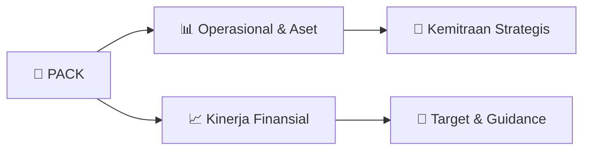

# 📊 Materi Public Expose: [PACK]

🏢 **Emiten**: `PACK` | 📅 **Tanggal Pelaksanaan**: `2026-09-09` | 📑 **Total Slide**: `2 Slide`
⬅️ [[knowledge-base/daily-digests/PACK_20260909|Kembali ke Daily Digest]] | 🎛️ [[Dashboard/PACK|Ke Dashboard Emiten]]

> [!NOTE]
> Ringkasan materi presentasi resmi Public Expose PACK yang disampaikan oleh manajemen kepada investor dan bursa. Seluruh poin strategis, matriks operasional, dan angka kinerja diekstrak langsung dari slide deck resmi.

---

## 📅 1. Jadwal & Metadata Penyelenggaraan

| Parameter | Detail Informasi |
|---|---|
| **Nomor Surat Pengantar** | 002/DIR-ANHI/IX/2026 |
| **Perihal Pengumuman** | Rencana Penyelenggaraan Public Expose Insidentil |
| **Waktu Pelaksanaan** | 11 September 2026 10:00 |
| **Lokasi / Media** | Live Event via Aplikasi Zoom |
| **Lampiran Resmi** | `1` |

## 📋 2. Agenda Paparan Publik

1. PT Bursa Efek Indonesia
2. Gedung Bursa Efek Indonesia, Tower I, Lantai 6
3. Jl. Jend. Sudirman Kav. 52-53
4. Jakarta 12190
5. Dengan hormat,
6. Merujuk kepada Surat Keputusan Direksi Bursa Efek
7. Indonesia (“BEI”) Nomor Kep-00087/BEI/12-2025
8. Pasal III.2 tentang Perubahan Peraturan Nomor I-E
9. tentang
10. Kewajiban
11. Penyampaian
12. Informasi,
13. bersama ini kami sampaikan rencana Perseroan
14. untuk menyelenggarakan Paparan Publik Insidentil
15. (“Paparan Publik”) yang akan diselenggarakan pada:
16. Dear Sir,
17. Referring to the Decree of the Board of Directors of the
18. Indonesia Stock Exchange (“IDX”) Number Kep-
19. 00087/BEI/12-2025
20. Article
21. III.2
22. concerning
23. Amendments to Regulation Number I-E on the
24. Obligation to Submit Information, we hereby convey
25. the Company’s plan to hold the Insidentil Public Expose
26. (“Public Expose”), which will be held on:
27. Nomor : 002/DIR-ANHI/IX/2026
28. Jakarta, 9 September 2026
29. Up. Yth
30. Bapak Aditya Nugraha
31. Pelaksana Harian Kepala Divisi Penilai Perusahaan 1
32. Perihal
33. Penyampaian Rencana Penyelenggaraan Public Expose Insidentil
34. Hari / Tanggal
35. Day / Date
36. Jumat, 11 September 2026
37. Friday, September, 11th, 2026
38. Waktu
39. 10:00 AM – Selesai
40. 10:00 AM – Finish
41. Tempat
42. Location
43. Live Event via Aplikasi Zoom dengan tautan sebagai
44. berikut:  https://us06web.zoom.us/j/81029043340
45. Live Event via Zoom Application using the following
46. link:  https://us06web.zoom.us/j/81029043340
47. Manajemen Yang Hadir
48. Management Attendees
49. Manajemen Perusahaan
50. Company’s Management
51. Agenda
52. Agenda
53. 1. Kinerja keuangan dan kondisi bisnis terkini
54. Perseroan
55. 2. Rencana bisnis Perseroan di masa mendatang
56. 3. Analisa Manajemen terkait dengan pergerakan
57. harga saham Perseroan dan Suspensi Bursa

## 🏢 3. Profil & Pilar Portofolio Bisnis

## 🏗️ 4. Kinerja Operasional & Portofolio Aset

*Detail aset operasional terlampir pada dokumen slide resmi.*

## 📈 5. Kinerja Keuangan & Posisi Finansial

### 📊 Ringkasan Finansial
```text
Materi Paparan Publik akan kami sampaikan kepada
PT Bursa Efek Indonesia pada tanggal 10 September
2026.
The Public Expose materials will be submitted to PT
Indonesia Stock Exchange on September, 10th, 2026.
Demikian pelaporan ini kami sampaikan. Atas perhatiannya, kami ucapkan terima kasih.
Thus, we submit this report. Thank you for your kind attention.
Hormat kami / Regards,
PT Abadi Nusantara Hijau Investama Tbk
Donnie Holman Partogi Manurung
Direktur / Director
1. Financial performance and Company’s updates
2. The Company’s future strategies
3. Management analysis regarding the Company's
share price movements and the stock exchange
suspension.
```

## 🧭 6. Inisiatif Strategis, Kolaborasi, & Kemitraan

*Strategi usaha difokuskan pada penguatan fundamental dan ekspansi operasional.*

## 🎯 7. Target Pertumbuhan & Guidance Manajemen

*Target pertumbuhan ditetapkan mengacu pada prospek industri dan kondisi makroekonomi terkini.*

## 🗺️ 8. Peta Jalur Strategis & Eksekusi



## 📑 9. Daftar Indeks Slide Presentasi

| Slide # | Judul / Topik Slide | Ringkasan Konten |
|---|---|---|
| Slide 1 | **Kepada Yth. / To:** | PT Bursa Efek Indonesia Gedung Bursa Efek Indonesia, Tower I, Lantai 6 Jl. Jend. Sudirman Kav. 52-53 |
| Slide 2 | **Materi Paparan Publik akan kami sampaikan kepada** | PT Bursa Efek Indonesia pada tanggal 10 September 2026. The Public Expose materials will be submitted to PT |

---

*Dokumen diolah otomatis oleh **Swarm Intelijen Pasar Modal Indonesia** pada 2026-10-12 16:47 WIB.*