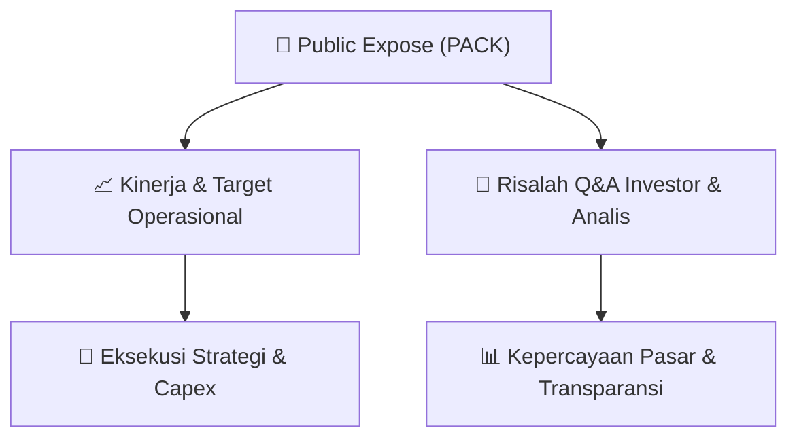

# 📢 Laporan Intelijen Paparan Publik (Public Expose) - [[PACK]]
🏢 **Emiten**: `[[PACK]]` | 📅 **Tanggal Pelaksanaan**: `2026-09-12` | 📑 **Dokumen**: `Public Expose`
⬅️ [[knowledge-base/daily-digests/Daily_Digest_20260912|Kembali ke Daily Digest]] | 🎛️ [[Dashboard|Ke Dashboard Utama]]

---

## 📌 1. Ringkasan Eksekutif & Paparan Direksi
> [!NOTE]
> PT Abadi Nusantara Hijau Investama Tbk (PACK) menyelenggarakan Public Expose Insidentil pada 10 September 2026 secara sukarela, berdasarkan surat penyampaian materi No. 003/DIR-ANHI/IX/2026. Acara dihadiri 258 peserta (tidak termasuk manajemen dan karyawan). Laporan hasil paparan publik disampaikan melalui surat No. 004/CORSEC-ANHI/IX/2026 tertanggal 12 September 2026, ditandatangani Direktur Donnie Holman Partogi Manurung. Dokumen ini merupakan laporan resmi yang dihasilkan secara elektronik melalui sistem pelaporan BEI.

#### 🎯 Guidance Operasional & Target Strategis
- Dokumen laporan ini tidak memuat rincian target kinerja, ekspansi, atau capex secara spesifik. Informasi yang tersedia hanya mencakup penyelenggaraan Public Expose Insidentil secara sukarela dengan 258 peserta hadir. Tidak ada panduan operasional atau katalis yang dapat diekstraksi dari dokumen ini.

## 📊 2. Matriks Indikator Operasional & Parameter Kunci
| Parameter Utama | Nilai / Keterangan Resmi |
| :--- | :--- |
| **Jenis Paparan Publik** | `Insidentil (Sukarela)` |
| **Tanggal Penyelenggaraan** | `10 September 2026` |
| **Jumlah Peserta Hadir** | `258 orang (tidak termasuk manajemen dan karyawan)` |
| **Nomor Surat Laporan** | `004/CORSEC-ANHI/IX/2026` |
| **Tanggal Laporan** | `12 September 2026` |
| **Penandatangan Laporan** | `Donnie Holman Partogi Manurung (Direktur)` |
| **Alamat Kantor** | `Noble House Lantai 31, Kawasan Mega Kuningan Nomor 1-2, Jalan Doktor Ide Anak` |
| **Kontak** | `Telepon: 021-29783061, Website: www.anhinvt.com` |

---

## 💬 3. Risalah Tanya Jawab (Q&A Session)
`Materi presentasi Public Expose / Risalah Q&A terlampir dalam dokumen resmi bursa.`

## 📌 4. Peta Jalur Strategis & Roadmap

---

## 🔗 Knowledge Graph
- [[knowledge-base/daily-digests/Daily_Digest_20260912|📄 Daily Digest 2026-09-12]]
- [[knowledge-base/calendars/Action_Calendar|🗓️ Kalender Terpusat Aksi Korporasi]]
- [[Dashboard|🎛️ Kembali ke Dashboard Utama]]