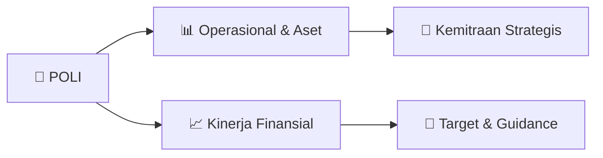

# 📊 Materi Public Expose: [POLI]

🏢 **Emiten**: `POLI` | 📅 **Tanggal Pelaksanaan**: `2026-10-05` | 📑 **Total Slide**: `38 Slide`
⬅️ [[knowledge-base/daily-digests/POLI_20261005|Kembali ke Daily Digest]] | 🎛️ [[Dashboard/POLI|Ke Dashboard Emiten]]

> [!NOTE]
> Ringkasan materi presentasi resmi Public Expose POLI yang disampaikan oleh manajemen kepada investor dan bursa. Seluruh poin strategis, matriks operasional, dan angka kinerja diekstrak langsung dari slide deck resmi.

---

## 📅 1. Jadwal & Metadata Penyelenggaraan

| Parameter | Detail Informasi |
|---|---|
| **Nomor Surat Pengantar** | 003/PHG-CS/OJK-IDX/X/2026 |
| **Perihal Pengumuman** | Penyampaian Materi Public Expose Tahunan |
| **Waktu Pelaksanaan** | 2026-10-05 05-10-2026 15:07 |
| **Lokasi / Media** | Aplikasi Zoom / Daring |
| **Lampiran Resmi** | `1` |

## 📋 2. Agenda Paparan Publik

1. Strategi Usaha dan Target
2. Tahun
3. Kinerja
4. Operasional
5. dan Keuangan
6. Informasi
7. Perseroan

## 🏢 3. Profil & Pilar Portofolio Bisnis

### 🏛️ Pilar Usaha & Aset Utama
- 5 Pilar Pollux Hotels Group
Hotels Shopping Malls Industrial Parks Apartments Landed Housing

- Aset Pollux Hotels Group
6 Operating Hotels & Resorts
- ±1500 Rooms
4 Operating Shopping Malls
- ±100,000 sqm of Nett Leasable Area
4 Industrial Parks
- Total Land Area of
±80 ha
5 Residential High Rise
- ±10,000 Units
3 Landed Housing Projects
- ±1000 Units

- Shopping Malls

- Industrial Parks

- Landed Housing

## 🏗️ 4. Kinerja Operasional & Portofolio Aset

> Sekilas Perseroan PT Pollux Hotels Group Tbk merupakan perubahan nama dari PT Pollux Investasi Internasional Tbk (“POLI”) berdasarkan Akta Pernyataan Keputusan Rapat Pemegang Saham Tahunan No
. 85 tanggal
31 Agustus 2021 , yang dibuat dihadapan Fathiah Helmi,
S . H
. , Notaris di Jakarta . Berdasarkan Anggaran Perseroan, bidang usaha POLI adalah mengembangkan proyek properti termasuk di dalamnya adalah pembangunan , pengembangan , investasi , perdagangan dan jasa penyewaan properti (Hotel, Apartemen dan Pusat Perbelanjaan ) Pada tanggal 31 Desember 2018 , telah memperoleh pernyataan efektif dari Otoritas Jasa Keuangan (OJK) dengan kode POLI, untuk melakukan Penawaran Umum Perdana Saham (IPO) kepada masyarakat sebanyak 402 . 105 . 300 saham dengan nilai nominal Rp 100
, - per
saham dengan harga penawaran Rp
1 . 635
, - per
saham . Saham
- saham
tersebut dicatatkan pada Bursa
Efek Indonesia (BEI) pada
tanggal
10 Januari 2019.

> Kinerja Operasional Perseroan bersama Entitas Anak terus menjalankan kegiatan usaha di bidang pengembangan properti dan real estat , mencakup pusat perbelanjaan , apartemen dan hotel . Hingga periode penyusunan Annual Report, Perseroan mengelola portofolio proyek yang terdiri dari aset yang telah beroperasi , proyek yang sedang berjalan , serta pengembangan yang berada pada tahap perencanaan . Setiap proyek dipantau melalui evaluasi berkala untuk memastikan tingkat hunian , trafik pengunjung , dan kontribusi pendapatan tetap optimal . Perseroan juga berfokus pada peningkatan efisiensi operasional melalui digitalisasi proses, penguatan manajemen gedung , serta optimalisasi kerja sama dengan tenant dan mitra strategis . Upaya ini dilakukan untuk menjaga daya saing aset dan mendukung pertumbuhan pendapatan yang berkelanjutan .

> Kinerja Operasional
No.
Nama Proyek Paragon Mall
MallJl. Pemuda Semarang
Operasi sejak 2010 PO Hotel
HotelJl. Pemuda Semarang
Operasi sejak 2012
The Pinnacle dan Louis Kienne Pandanaran
Apartemen, Kondotel dan Hotel Jl. Pandanaran, Semarang
Operasi sejak 2017
W/R Residence dan Louis Kienne Simpang Lima
Apartemen dan Hotel Jl. Ahmad Yani, Semarang
Operasi sejak 2016 Tipe dan Lokasi Proyek Status Proyek

> Kinerja Operasional No . Nama Proyek
Central City Mall
MallJl. Brigjend Sudiarto, Semarang
Operasi sejak 2009
Marquis de Lafayette dan Louis Kienne Pemuda
Apartemen, Kondotel dan Hotel Jl. Pemuda, Semarang
Operasi sejak Q3 2018
Pollux Mall Cikarang
MallJl. Raya Cibarusah, Bekasi
Operasi sejak Q3 2022
Louis Kienne Resort Senggigi
ResortJl. Raya Senggigi Malimbu, NTB
Operasi sejak 2014 Tipe dan Lokasi Proyek Status Proyek

> -
50.00 100.00 150.00 200.00 250.00 300.00 Pusat Perbelanjaan Hotel Pengembang Lainnya
Kinerja Operasional Pendapatan Per Segmen
Jun 26 Des 25 Des 24

> Laporan Posisi Keuangan
Statement of Financial Position
Jun
- 26
Aset LancarCurrent Assets
1.119.366,57
1.193.077.86
1.360.495,02
Aset Tidak Lancar Non
-current Assets
Total AsetTotal AssetsLiabilitas
Jangka Pendek Short
-term Liabilities
Liabilitas Jangka Panjang Long
-term Liabilities
Total Liabilitas Total Liabilities Total Ekuitas Total Equity
3.027.324,85
4.146.691,42
603.763,78
1.380.548,11
1.984.311,89
2.162.379,53
3.054.183.03
4.247.260.89
4.466.077,68
3.105.582,65
724.849.52
1.047.636.42
1.417.820.23
1.381.499,43
2.142.669.75
2.429.135,86
2.104.591.15
2.036.941,82
Dec
- 25
Dec
- 24
Kinerja Keuangan
(Dalam Jutaan Rupiah / In Millions of Rupiah)

> Kinerja Keuangan Rasio Keuangan Financial Ratio Jun
- 26
Rasio Laba Bersih terhadap Aset
Return on Asset RatioRasio
Laba Bersih terhadap Ekuitas
Return on Equity RatioRasio
Margin Laba BrutoGross Profit Margin RatioRasio
Margin Laba UsahaOperating Profit Margin RatioRasio Margin Laba Tahun Berjalan terhadap PendapatanCurrent Financial Year Profit Margin to Income RatioRasio
Laba Komprehensif terhadap Aset
Comprehensive Profit to Asset RatioRasio
Laba Komprehensif terhadap Ekuitas
Comprehensive Profit to Equity RatioRasio
Laba Komprehensif terhadap Pendapatan
Comprehensive Profit to Revenue RatioRasio
Lancar Current RatioRasio Liabilitas terhadap Ekuitas
Liability to Equity RatioRasio
Liabilitas terhadap Total Aset
Liability to Total Asset RatioRasio
Ekuitas terhadap Aset
Equity to Asset Ratio
1,39% 2,67% 47,29% 19,46% 19,46% 1,39% 2,67% 19,46% 1,85 0,92 0,48 0,52 1,57% 3,16% 45,80% 10,82% 10,99% 1,59% 3,21% 10,99% 1,65 1,.02 0,50 0,50 0,76 % 1,66 % 49,69 % 6,95 % 7,46 % 0,81 % 1,78 % 7,46 % 1,30 1,19 0,54 0,46 Dec
- 25
Dec
- 24

> PERKUAT EKOSISTEM INDUSTRI MEETING INCENTIVE CONVENTION AND EXHIBITION (MICE) BERSAMA MITRA STRATEGIS
Q2
Pollux Hotels Group terus memperkuat ekosistem industri MICE melalui kolaborasi
bersama Wedding Organizer, Event Organizer, corporate planner, serta berbagai
mitra strategis dalam gelaran Pollux Hotels Group Appreciation Lunch 2026 bertajuk
“Kembali ke Semarang”
Melalui sinergi yang dibangun oleh PO Hotel Semarang dan jaringan Louis Kienne
Hotel, Pollux Hotels Group menegaskan komitmennya untuk membangun kemitraan
jangka panjang, membuka peluang kolaborasi baru, serta menghadirkan pilihan
venue dan layanan yang semakin lengkap bagi para mitra.
Bersama, kami optimistis kolaborasi ini akan memperkuat industri MICE dan
wedding di Jawa Tengah, sekaligus mendorong pertumbuhan sektor pariwisata dan
ekonomi kreatif.

> SIGNING CEREMONY WITH IFORTE ENERGI NUSANTARA
Q2
Pollux Hotels Group dengan bangga menjalin kerja sama dengan iForte Energi
Nusantara melalui pemasangan Pembangkit Listrik Tenaga Surya (PLTS) di Pollux
Mall Paragon, salah satu properti Perseroan di Semarang, dengan kapasitas 522
kWp. Pada tahun pertama, inisiatif ini diproyeksikan setara dengan:
•Pengurangan emisi CO₂ sebesar 620 ton
•Pengurangan emisi yang setara dengan 264.000 liter bensin
•Setara dengan penanaman 28.500 pohon
•Produksi energi sebesar 730.276 kWh
Kerja sama ini menjadi salah satu langkah nyata dalam strategi keberlanjutan
Perseroan melalui pemanfaatan energi terbarukan pada properti Perseroan,
sekaligus mendukung operasional yang lebih efisien dan bertanggung jawab
terhadap lingkungan.

## 📈 5. Kinerja Keuangan & Posisi Finansial

### 📊 Ringkasan Finansial
```text
Kinerja Keuangan
(Dalam JutaanRupiah / In Millions of Rupiah)
Hasil
- hasil
Operasional Operational Results Jun
- 26
PendapatanRevenue 297.002,95 615.563,48 486.591,22
Laba BrutoGross Profit
Laba Tahun Berjalan
Current Year Net Income
Laba yang dapat diatribusikan kepada :
Profit Attributable ToPemilik
Perusahaan
Owners of The CompanyKepentingan
non pengendali Non
-controlling Interests
Total Laba Komprehensif
Total Comprehensive Income
Total Laba yang
dapat diatribusikan kepada :
Comprehensive Income Attributable ToPemilik
Perusahaan
Owners of The CompanyKepentingan
non pengendali Non
-controlling Interests
140.461,42 57.788,38 58.115,01 (326.62) 57.788,38 58.115,01 (326.62) 28,74
Laba per Saham (
dalam Rupiah)
Basic Earnings per Share (in IDR)
281.944,24 241.764,85 66.583,33 33.818,55 69.655,01 35.255,76 (3.071,68) (1.437,21) 67.649,33 36.309,06 70.712,52 37.722,27 (3.063,19) (1.413,22) 33,12 16,82 Dec
- 25
Dec
- 24
```

## 🧭 6. Inisiatif Strategis, Kolaborasi, & Kemitraan

- SIGNING CEREMONY HOTEL MANAGEMENT AGREEMENT
BETWEEN
POLLUX HOTELS GROUP AND ACCOR
Q2
Pollux Hotels Group resmi menjalin kemitraan strategis jangka panjang
dengan Accor. Acara Hotel Management Agreement Signing Ceremony
berlangsung di World Capital Tower, Jakarta. Momen ini menjadi langkah
penting bagi Pollux Hotels Group dalam memperkuat komitmen untuk
mendukung kemajuan industri perhotelan dan pariwisata Indonesia.
Penandatanganan MoU dihadiri oleh Bapak Handojo Koentoro Setyadi selaku
President Director Pollux Hotels Group, Mr. Andrew Langdon selaku Chief
Development Officer Asia Accor, serta Mr. Rio Kondo selaku Independent
Commissioner, Development Indonesia Accor.
Rangkaian acara juga menghadirkan Exclusive CNN Interview, Executive
Dialogue, dan prosesi penandatanganan resmi sebagai bentuk visi bersama
dalam menciptakan nilai jangka panjang serta meningkatkan standar layanan
perhotelan di Indonesia.
Melalui kolaborasi ini, Pollux Hotels Group dan Accor siap memperluas
jangkauan pasar internasional, meningkatkan pengalaman tamu, serta
mendukung pertumbuhan pariwisata Indonesia secara berkelanjutan.
2 9

- SIGNING CEREMONY HOTEL MANAGEMENT AGREEMENT
BETWEEN
POLLUX HOTELS GROUP AND MARRIOTT INTERNATIONAL
Q2
PT Pollux Hotels Group Tbk resmi menandatangani kerja sama strategis
dengan Marriott International, membuka babak baru dalam perjalanan Pollux
Hotels Group untuk memperluas jejak hospitality Indonesia ke pasar global.
Kolaborasi ini menggabungkan local expertise dan global hospitality excellence
memperluas konektivitas, membuka akses ke jaringan global Marriott, serta
menghadirkan peluang pertumbuhan baru bagi bisnis hospitality Indonesia.
Bagi Pollux Hotels Group, langkah ini bukan hanya tentang bertumbuh lebih
besar, tetapi tentang membawa hospitality Indonesia melangkah lebih jauh,
dengan standar yang semakin tinggi dan jangkauan yang semakin luas.

- Strategi Usaha Tahun 2026 ini PT Pollux Hotels Group Tbk (POLI ) terus mendorong ekspansi bisnis hospitality melalui pengembangan dan perluasan portofolio hotel di berbagai lokasi strategis . Strategi ini diperkuat melalui kerja sama dengan international hotel management seperti Accor, Wyndham Hotels & Resorts, dan Marriott International . Pollux Hotels Group terus memanfaatkan jaringan , standar pelayanan , serta pengalaman global masing
- masing
operator . Langkah ini diharapkan dapat meningkatkan daya saing , memperluas jangkauan pasar, serta mendukung pertumbuhan bisnis hospitality Perseroan secara berkelanjutan . Di sisi lain, Perseroan juga berkomitmen untuk mempertahankan peringkat kredit Triple A (AAA) dari PEFINDO sebagai bentuk konsistensi dalam menjaga kinerja keuangan , kredibilitas , dan kepercayaan stakeholders .

## 🎯 7. Target Pertumbuhan & Guidance Manajemen

> 003
Strategi Usaha dan Target 2026

## 🗺️ 8. Peta Jalur Strategis & Eksekusi



## 📑 9. Daftar Indeks Slide Presentasi

| Slide # | Judul / Topik Slide | Ringkasan Konten |
|---|---|---|
| Slide 1 | **PT Pollux Hotels Group Tbk. (“POLI”)** | Selasa, 8 Oktober 2026 |
| Slide 2 | **Daftar Isi** | Strategi Usaha dan Target Tahun 2026 |
| Slide 3 | **001 Informasi** | Informasi Perseroan 2 |
| Slide 4 | **Sekilas** | Perseroan PT Pollux |
| Slide 5 | **Direktur** | dan Komisaris Komisaris |
| Slide 6 | **Struktur** | Kepemilikan Saham 5 |
| Slide 7 | **5 Pilar Pollux Hotels Group** | Hotels Shopping Malls Industrial Parks |
| Slide 8 | **Aset Pollux Hotels Group** | 6 Operating Hotels & Resorts - ±1500 Rooms 4 Operating Shopping Malls |
| Slide 9 | **Hotels** | 8 |
| Slide 10 | **Shopping Malls** | 9 |
| Slide 11 | **Apartments** | 10 |
| Slide 12 | **Industrial Parks** | 11 |
| Slide 13 | **Landed Housing** | 12 |
| Slide 14 | **002 Kinerja** | Kinerja Operasional dan Keuangan |
| Slide 15 | **Kinerja** | Operasional Perseroan bersama |
| Slide 16 | **Kinerja** | Operasional No. Nama |
| Slide 17 | **Kinerja** | Operasional No . |
| Slide 18 | **Kinerja** | Operasional Penjualan & Pemasaran |
| Slide 19 | **- 50.00** | 50.00 100.00 150.00 |
| Slide 20 | **Kinerja** | Keuangan (Dalam JutaanRupiah / In Millions of Rupiah) Hasil |
| Slide 21 | **Laporan** | Posisi Keuangan Statement of Financial Position |
| Slide 22 | **Laporan** | Arus Kas Statement of Cash Flows |
| Slide 23 | **Kinerja** | Keuangan Rasio Keuangan |
| Slide 24 | **003 Strategi Usaha dan Target 2026** | Strategi Usaha dan Target 2026 23 |
| Slide 25 | **PUBLIC EXPOSE INSIDENTILPT POLLUX HOTELS GROUP TBK** | Pada Januari 2026, PT Pollux Hotels Group Tbk menyelenggarakan Public Expose Insidentil. Kegiatan ini dilaksanakan atas permintaan Bursa Efek Indonesi |
| Slide 26 | **THE BEST CEO 2025 DARI SWA MEDIA GROUP** | Pada bulan Maret tahun 2026 Bpk Handojo Koentoro Setyadi, Presiden Direktur PT Pollux Hotels Group Tbk, meraih penghargaan “The Best CEO 2025” dari SW |
| Slide 27 | **RAPAT UMUM PEMEGANG SAHAMPT POLLUX HOTELS GROUP TBK** | PT Pollux Hotels Group Tbk menyelenggarakan Rapat Umum Pemegang Saham (RUPS) pada 23 April 2026 di Pollux HQ, World Capital Tower, Jakarta. RUPS menja |
| Slide 28 | **PERKUAT EKOSISTEM INDUSTRI MEETING INCENTIVE CONVENTION AND EXHIBITION (MICE) BERSAMA MITRA STRATEGIS** | Q2 Pollux Hotels Group terus memperkuat ekosistem industri MICE melalui kolaborasi bersama Wedding Organizer, Event Organizer, corporate planner, sert |
| Slide 29 | **SIGNING CEREMONY WITH IFORTE ENERGI NUSANTARA** | Q2 Pollux Hotels Group dengan bangga menjalin kerja sama dengan iForte Energi Nusantara melalui pemasangan Pembangkit Listrik Tenaga Surya (PLTS) di P |
| Slide 30 | **SIGNING CEREMONY HOTEL MANAGEMENT AGREEMENT** | BETWEEN POLLUX HOTELS GROUP AND ACCOR Q2 |
| Slide 31 | **SIGNING CEREMONY HOTEL MANAGEMENT AGREEMENT** | BETWEEN POLLUX HOTELS GROUP AND MARRIOTT INTERNATIONAL Q2 |
| Slide 32 | **SIGNING AGREEMENTS BAYMOND BY WYNDHAM** | Q2 PT Pollux Hotels Group Tbk |
| Slide 33 | **PROUD TO MAINTAIN AAA RATING 2026** | PT Pollux Hotels Group Tbk kembali |
| Slide 34 | **Target** | Pertumbuhan 2026 PT Pollux Hotels Group |
| Slide 35 | **Produk** | unggulan kami yaitu Hotel dan Pusat |
| Slide 36 | **Strategi Usaha** | Tahun 2026 ini |
| Slide 37 | **Q&A Session** | ? 36 |
| Slide 38 | **Thank you** |  |

---

*Dokumen diolah otomatis oleh **Swarm Intelijen Pasar Modal Indonesia** pada 2026-10-12 16:47 WIB.*