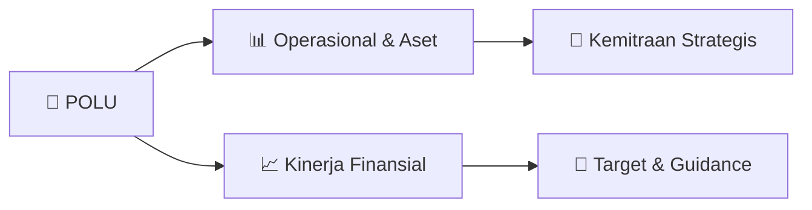

# 📊 Materi Public Expose: [POLU]

🏢 **Emiten**: `POLU` | 📅 **Tanggal Pelaksanaan**: `2026-10-05` | 📑 **Total Slide**: `16 Slide`
⬅️ [[knowledge-base/daily-digests/POLU_20261005|Kembali ke Daily Digest]] | 🎛️ [[Dashboard/POLU|Ke Dashboard Emiten]]

> [!NOTE]
> Ringkasan materi presentasi resmi Public Expose POLU yang disampaikan oleh manajemen kepada investor dan bursa. Seluruh poin strategis, matriks operasional, dan angka kinerja diekstrak langsung dari slide deck resmi.

---

## 📅 1. Jadwal & Metadata Penyelenggaraan

| Parameter | Detail Informasi |
|---|---|
| **Nomor Surat Pengantar** | 81/LGL/GFU/X/2026 |
| **Perihal Pengumuman** | Penyampaian Materi Public Expose Tahunan |
| **Waktu Pelaksanaan** | 2026-10-05 05-10-2026 16:10 |
| **Lokasi / Media** | Aplikasi Zoom / Daring |
| **Lampiran Resmi** | `1` |

## 📋 2. Agenda Paparan Publik

- Pemaparan Profil & Struktur Bisnis Perseroan
- Kinerja Operasional & Keuangan
- Arah Strategi Usaha & Target Pertumbuhan
- Sesi Tanya Jawab (Q&A)

## 🏢 3. Profil & Pilar Portofolio Bisnis

> PROFIL PERUSAHAAN KINERJA PERUSAHAAN PANDANGAN BISNIS KONTEN

> PROFIL PERUSAHAAN

## 🏗️ 4. Kinerja Operasional & Portofolio Aset

> TOTAL ASET, LIABILITAS, & EKUITAS
POSISI KEUANGAN HINGGA KUARTAL II 2026
(dalam jutaan Rupiah)

## 📈 5. Kinerja Keuangan & Posisi Finansial

## 🧭 6. Inisiatif Strategis, Kolaborasi, & Kemitraan

*Strategi usaha difokuskan pada penguatan fundamental dan ekspansi operasional.*

## 🎯 7. Target Pertumbuhan & Guidance Manajemen

> PANDANGAN BISNIS
1.
Perseroan berupaya meningkatkan penjualan dengan
perluasan pasar dan mewujudkan diversifikasi
2.
Perseroan secara bertahap akan meningkatkan kapasitas
produksi seiring dengan adanya rencana perluasan pasar
3.
Perseroan akan terus menerapkan adaptive
strategy, mengingat situasi bisnis yang sulit untuk diprediksi
Perseroan menetapkan target pertumbuhan 2026 dengan beberapa
strategi yang telah diterapkan secara konsisten, yaitu:
Perseroan optimis bahwa industri garmen di Indonesia masih
memiliki ruang untuk terus bertumbuh dan dapat bersaing secara
global.

## 🗺️ 8. Peta Jalur Strategis & Eksekusi

## 📑 9. Daftar Indeks Slide Presentasi

| Slide # | Judul / Topik Slide | Ringkasan Konten |
|---|---|---|
| Slide 1 | **PAPARAN PUBLIK 2026** | PT GOLDEN FLOWER TBK Kamis, 8 Oktober 2026 1 |
| Slide 2 | **PROFIL PERUSAHAAN** | KINERJA PERUSAHAAN PANDANGAN BISNIS KONTEN |
| Slide 3 | **PROFIL PERUSAHAAN** | 3 |
| Slide 4 | **PROFIL** | 4 |
| Slide 5 | **PRODUK** | L a d i e s B l o u s e D r e s s |
| Slide 6 | **PANGSA PASAR** | 6 |
| Slide 7 | **PELANGGAN UTAMA** | 7 |
| Slide 8 | **SERTIFIKASI** | 8 |
| Slide 9 | **KINERJA PERUSAHAAN** | 9 |
| Slide 10 | **KINERJA SAHAM** | PERGERAKAN SAHAM HINGGA AGUSTUS 2026 10 |
| Slide 11 | **LAPORAN LABA RUGI** | PENDAPATAN HINGGA KUARTAL II 2026 (dalam jutaan Rupiah) 11 |
| Slide 12 | **TOTAL ASET, LIABILITAS, & EKUITAS** | POSISI KEUANGAN HINGGA KUARTAL II 2026 (dalam jutaan Rupiah) 12 |
| Slide 13 | **PANDANGAN BISNIS** | 13 |
| Slide 14 | **PANDANGAN BISNIS** | 14 1. Perseroan berupaya meningkatkan penjualan dengan |
| Slide 15 | **15 TERIMA KASIH** | TERIMA KASIH |
| Slide 16 | **SESI TANYA JAWAB** | 16 |

---

*Dokumen diolah otomatis oleh **Swarm Intelijen Pasar Modal Indonesia** pada 2026-10-12 16:47 WIB.*