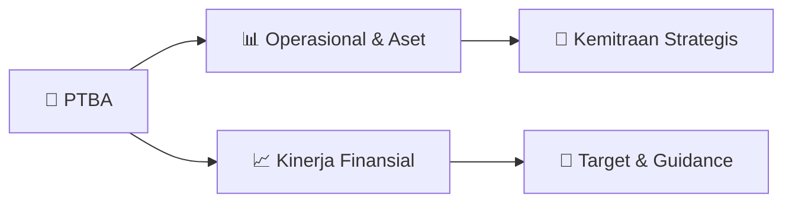

# 📊 Materi Public Expose: [PTBA]

🏢 **Emiten**: `PTBA` | 📅 **Tanggal Pelaksanaan**: `2026-09-02` | 📑 **Total Slide**: `27 Slide`
⬅️ [[knowledge-base/daily-digests/PTBA_20260902|Kembali ke Daily Digest]] | 🎛️ [[Dashboard/PTBA|Ke Dashboard Emiten]]

> [!NOTE]
> Ringkasan materi presentasi resmi Public Expose PTBA yang disampaikan oleh manajemen kepada investor dan bursa. Seluruh poin strategis, matriks operasional, dan angka kinerja diekstrak langsung dari slide deck resmi.

---

## 📅 1. Jadwal & Metadata Penyelenggaraan

| Parameter | Detail Informasi |
|---|---|
| **Nomor Surat Pengantar** | B/803/111000/KS.03/IX/2026 |
| **Perihal Pengumuman** | Penyampaian Materi Public Expose Tahunan |
| **Waktu Pelaksanaan** | 2026-09-02 02-09-2026 16:42 |
| **Lokasi / Media** | Aplikasi Zoom / Daring |
| **Lampiran Resmi** | `2` |

## 📋 2. Agenda Paparan Publik

1. Company Overview
2. Performance Highlight
3. Sustainability Performance
4. Business Development

## 🏢 3. Profil & Pilar Portofolio Bisnis

> Company Overview 1H2026
Results and Updates

## 🏗️ 4. Kinerja Operasional & Portofolio Aset

*Detail aset operasional terlampir pada dokumen slide resmi.*

## 📈 5. Kinerja Keuangan & Posisi Finansial

## 🧭 6. Inisiatif Strategis, Kolaborasi, & Kemitraan

- Operating Strategic Initiative Notes: Maximizing Value Through Downstream Energy Business Development Accelerate Monetization
by Expanding Capacity
Business Development Themes
2.88*
Billion ton Coal Reserves
Coal Business                             Existing Facilities & Initiatives
Tanjung Enim - Kertapati
Tanjung Enim - Tarahan
Tanjung Enim – Kramasan
1.736
Million ton Coal Logistic
CFPP Banjarsari 2 x 110 MW
CFPP Sumsel-8 2 x 620 MW
CFPP Aluminum Smelter
303 Million ton
Coal to Energy
Coal to SNG
Coal Downstream
New Logistic Facility to North & South
End Sumatra
Coal to Chemical (Potassium Humate)
– to Support Agriculture
842 Million ton
Post-Mining Solar PV
Bukit Asam Coal Based Industrial Estate
Green Business Infrastructure Allocation of low-rank coal reserves dedicated to downstream development
Distributing Solar PV in total 1.02 MWp
Corporate Strategic Focus
Coal Allocation by Business Stream
Non Coal Business
On Going
Hybrid CFPP in Sumatra
Coal to DME
*As of December 31, 2025

## 🎯 7. Target Pertumbuhan & Guidance Manajemen

> Operational and Financial Key Figures
1H-2026 Net Profit Revenue Production Sales 19.45 MT
2% - 1H25 21.62 MT
10% - 1H25 21.73 MT
Stripping Ratio
2026 Guidance: 5.63x
6% - 1H25 19.27 MT
Cash Cost Average Selling Price
*) including transportation other than railways
21.10 MT 18.15 MT
5.26 x
Rp22.03 T Rp1.03Jt/Ton Rp2.65 T Rp0.88Jt/Ton Operational Financial Coal Transportation*
8% - 1H25 Rp20.45 T
218% - 1H25 Rp0.83 T
10% - 1H25 Rp0.93Jt/Ton
1% - 1H25 Rp0.87Jt/Ton

> Production & Stripping Ratio
Production Recovery Accelerated in 2Q26 with Stripping Ratio Ahead of Full-Year Guidance
21.73 19.45 1H2025 1H2026
-10%
•
2Q26 production recovered strongly (+94% QoQ) after
seasonal disruptions. 1H26 production was lower (-10%
YoY) due to heavy rainfall in 1Q26.
6.62 12.83 1Q2026 2Q2026 +94%
•
Stripping ratio improved materially (6.17x → 5.26x) and is
ahead of FY2026 guidance (5.63x), indicating better
mining efficiency. QoQ YoY 6.17
5.26
1H2025 1H2026
5.63
FY2026 Production
(in million tons)
Stripping Ratio (x) YoY Guidance

## 🗺️ 8. Peta Jalur Strategis & Eksekusi

## 📑 9. Daftar Indeks Slide Presentasi

| Slide # | Judul / Topik Slide | Ringkasan Konten |
|---|---|---|
| Slide 1 | **CORPORATE  PRESENTATION** | PT Bukit Asam (Persero) Tbk 1H2026 Results & Updates |
| Slide 2 | **Agenda** | Company Overview Performance Highlight Sustainability Performance |
| Slide 3 | **Company Overview** | 1H2026 Results and Updates |
| Slide 4 | **4 BOARD OF COMMISSIONER** | BOARD OF COMMISSIONER IDA BAGUS PUTU DUNIA President Commissioner - |
| Slide 5 | **5 BAMBANG ISMAWAN** | BAMBANG ISMAWAN President Director UNA LINDASARI |
| Slide 6 | **6 Key Facts** | Key Facts • PT Bukit Asam (Persero) Tbk (PTBA) was established on |
| Slide 7 | **7 Our Operational Area** | Our Operational Area Each IUP’s details and port location Coal Resources* |
| Slide 8 | **8 8** | 8 Direct 7 |
| Slide 9 | **Our Business Process** | End-to-end coal supply chain and logistics network PTBA Scope Non-PTBA Scope |
| Slide 10 | **Performance Highlight** | 1H2026 Results and Updates |
| Slide 11 | **Operational and Financial Key Figures** | 1H-2026 11 Net Profit |
| Slide 12 | **13 Production & Stripping Ratio** | Production & Stripping Ratio Production Recovery Accelerated in 2Q26 with Stripping Ratio Ahead of Full-Year Guidance 21.73 |
| Slide 13 | **14 Coal Transportation & Sales** | Coal Transportation & Sales Transportation Volumes Moderated as Logistics Efficiency Improved, Supporting Resilient Sales Performance 1.46 |
| Slide 14 | **15 Sales Area & Portion** | Sales Area & Portion In response to the improvement in ICI prices, the company is pursuing market share expansion, with Pakistan as one of its new tar |
| Slide 15 | **16 Revenue & Average Selling Price** | Revenue & Average Selling Price Revenue Rise Driven by Optimal Sales Mix and Stronger ICI Prices Both QoQ and YoY performance increased, driven by |
| Slide 16 | **11.35** | 21.70 11.51 10.56 |
| Slide 17 | **Net Profit & EBITDA** | Production recovery and successful market optimization, backed by price improvements, drove positive performance 833 |
| Slide 18 | **Sustainability Performance** | 1H2026 Results and Updates |
| Slide 19 | **21 Sustainability Performance Highlights** | Sustainability Performance Highlights 1H-2026 Female Employee |
| Slide 20 | **Business Development** | 1H2026 Results and Updates |
| Slide 21 | **BUSINESS TRANSFORMATION JOURNEY** | Towards World Class-Sustainable Energy Company Coal 1876-1996 |
| Slide 22 | **OUR FOCUS STRATEGIC THEME FOR GROWTH** | Theme 1: Expansion of Coal Transportation Tanjung Enim to Keramasan (Progress: 93.45%)* COD: 2H2026 |
| Slide 23 | **OUR FOCUS STRATEGIC THEME FOR GROWTH** | Theme 2: Consolidated Energy Business Development CFPP Sumsel-8 Location    : Tanjung Lalang, South Sumatera |
| Slide 24 | **OUR FOCUS STRATEGIC THEME FOR GROWTH** | Theme 2: Consolidated Energy Business Development Capacity: 303 kWp COD: June 2025 |
| Slide 25 | **Coal Downstreaming Project:** | Coal to Artificial Graphite and Anode Sheet Production Target (Pilot Plant) |
| Slide 26 | **Operating** | Strategic Initiative Notes: Maximizing Value |
| Slide 27 | **For further information:** | Contact : Aldy Pratama Iswardi Position : Head of Investor Relations Office |

---

*Dokumen diolah otomatis oleh **Swarm Intelijen Pasar Modal Indonesia** pada 2026-10-12 16:47 WIB.*