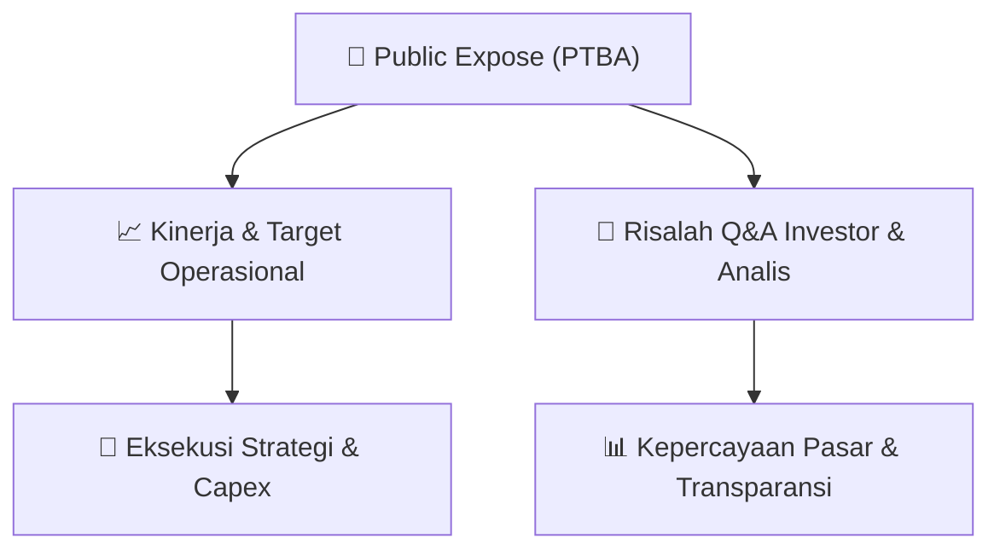

# 📢 Laporan Intelijen Paparan Publik (Public Expose) - [[PTBA]]
🏢 **Emiten**: `[[PTBA]]` | 📅 **Tanggal Pelaksanaan**: `2026-09-10` | 📑 **Dokumen**: `Public Expose`
⬅️ [[knowledge-base/daily-digests/Daily_Digest_20260910|Kembali ke Daily Digest]] | 🎛️ [[Dashboard|Ke Dashboard Utama]]

---

## 📌 1. Ringkasan Eksekutif & Paparan Direksi
> [!NOTE]
> PT Bukit Asam (Persero) Tbk (PTBA) menyelenggarakan Public Expose Tahunan pada tanggal 02 September 2026, dengan laporan hasil disampaikan pada 10 September 2026. Acara dihadiri oleh 210 peserta (tidak termasuk manajemen dan karyawan). Paparan ini merupakan bagian dari kepatuhan pelaporan kepada Otoritas Jasa Keuangan (OJK) dan Bursa Efek Indonesia (BEI), serta menjadi sarana komunikasi antara manajemen dengan investor, analis, dan publik mengenai kinerja, strategi, dan prospek perusahaan. Dokumen yang disampaikan mencakup laporan hasil public expose dan daftar hadir peserta.

#### 🎯 Guidance Operasional & Target Strategis
- Dokumen yang tersedia hanya berisi informasi administratif penyelenggaraan Public Expose (surat pengantar, jumlah peserta, dan lampiran). Tidak terdapat rincian spesifik mengenai target kinerja, rencana ekspansi, belanja modal (capex), atau panduan operasional (guidance) dalam teks yang disediakan. Informasi material tersebut kemungkinan besar terdapat dalam lampiran '850 Laporan Public Expose.pdf' yang tidak disertakan dalam teks mentah ini.

## 📊 2. Matriks Indikator Operasional & Parameter Kunci
| Parameter Utama | Nilai / Keterangan Resmi |
| :--- | :--- |
| **Tanggal Penyelenggaraan Public Expose** | `02 September 2026` |
| **Tanggal Pelaporan Hasil Public Expose** | `10 September 2026` |
| **Jumlah Peserta Public Expose** | `210 orang (tidak termasuk manajemen dan karyawan)` |
| **Nomor Surat Pengantar Materi** | `B/803/111000/KS.03/IX/2026` |
| **Nomor Surat Laporan Hasil** | `B/850/111000/KS.03/IX/2026` |
| **Jabatan Penandatangan** | `Corporate Secretary Division Head (Eko Prayitno)` |

---

## 💬 3. Risalah Tanya Jawab (Q&A Session)
### ❓ Pertanyaan 1 (Tidak tersedia dalam dokumen)
**Pertanyaan**: Tidak tersedia dalam dokumen. Teks yang diberikan hanya berisi informasi administratif penyelenggaraan Public Expose, tanpa memuat transkrip sesi tanya jawab.

**Jawaban Manajemen**: Tidak tersedia dalam dokumen. Jawaban manajemen atas pertanyaan investor/analis tidak tercantum dalam teks mentah yang disediakan.

> [!TIP]
> **Implikasi Bagi Investor**: Tidak dapat ditentukan dari dokumen ini. Investor perlu merujuk pada lampiran '850 Laporan Public Expose.pdf' untuk mendapatkan detail Q&A dan informasi material lainnya.

## 📌 4. Peta Jalur Strategis & Roadmap

---

## 🔗 Knowledge Graph
- [[knowledge-base/daily-digests/Daily_Digest_20260910|📄 Daily Digest 2026-09-10]]
- [[knowledge-base/calendars/Action_Calendar|🗓️ Kalender Terpusat Aksi Korporasi]]
- [[Dashboard|🎛️ Kembali ke Dashboard Utama]]