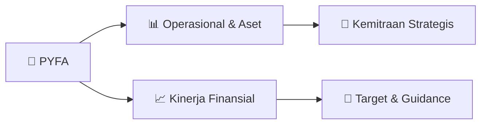

# 📊 Materi Public Expose: [PYFA]

🏢 **Emiten**: `PYFA` | 📅 **Tanggal Pelaksanaan**: `2026-08-18` | 📑 **Total Slide**: `22 Slide`
⬅️ [[knowledge-base/daily-digests/PYFA_20260818|Kembali ke Daily Digest]] | 🎛️ [[Dashboard/PYFA|Ke Dashboard Emiten]]

> [!NOTE]
> Ringkasan materi presentasi resmi Public Expose PYFA yang disampaikan oleh manajemen kepada investor dan bursa. Seluruh poin strategis, matriks operasional, dan angka kinerja diekstrak langsung dari slide deck resmi.

---

## 📅 1. Jadwal & Metadata Penyelenggaraan

| Parameter | Detail Informasi |
|---|---|
| **Nomor Surat Pengantar** | - |
| **Perihal Pengumuman** | Materi Public Expose |
| **Waktu Pelaksanaan** | 2026-08-18  |
| **Lokasi / Media** | Aplikasi Zoom / Daring |
| **Lampiran Resmi** | `Materi Presentasi Slide Deck` |

## 📋 2. Agenda Paparan Publik

1. Daftar Isi
2. Konteks Pasar
3. Makroekonomi Indonesia · nilai tukar dan biaya bahan baku · pasar farmasi dan Contract Development and Manufacturing Organization (“CDMO”)
4. Sorotan Utama & Kinerja Semester I 2026
5. Aksi korporasi dan tata kelola · PMHMETD II · Dewan Komisaris · Lini 3 Ethica · sorotan keuangan
6. Pilar Pertumbuhan & Strategi
7. Tiga pilar pertumbuhan · CDMO · strategi 2026 · produk baru yang diluncurkan
8. Sumber: Ringkasan eksekutif mendahului ketiga bagian di atas.
9. Paparan Publik PYFA 2026  ·  03

## 🏢 3. Profil & Pilar Portofolio Bisnis

> RINGKASAN EKSEKUTIF
PYFA adalah grup farmasi terintegrasi dengan fasilitas manufaktur di Indonesia dan
Australia serta sertifikasi mutu internasional.
Manufaktur
Bentuk sediaan padat, cair, dan injeksi
steril di fasilitas Indonesia maupun
Australia. Distribusi
Jaringan distribusi nasional yang melayani
rumah sakit, apotek, dan program
kesehatan pemerintah. CDMO
Layanan pengembangan dan manufaktur
kontrak bagi prinsipal domestik dan
internasional.
PT Pyridam Farma Tbk
Entitas induk tercatat; manufaktur
dan distribusi, Cianjur.
PT Holi Pharma
Fasilitas manufaktur oral, Cimahi.
PT Ethica Industri Farmasi
Injeksi steril, Cikarang.
Probiotec Pty Ltd
Australia; fasilitas bersertifikat
TGA. KREDENSIAL MUTU
CPOB / GMP (Indonesia)      ·      Sertifikasi TGA (Australia) — pembeda bagi klien CDMO dan pembeli ekspor
Sumber: Profil perusahaan PYFA; laporan tahunan dan keterbukaan informasi.
Paparan Publik PYFA 2026  ·  05

> PI LAR PERTUMBUHAN
CDMO adalah mesin pertumbuhan utama untuk memonetisasi kapasitas manufaktur
dan mutu bersertifikat TGA ke pasar global ±USD 275 miliar.
PASAR CDMO GLOBAL, 2026
USD 275 bio.
Tumbuh 6–10% per tahun, dengan Asia-Pasifik sebagai kawasan
tercepat KREDENSIAL MUTU
TGA — Probiotec, Australia
CPOB / GMP — fasilitas Indonesia
ISO 45001:2018 dan ISO 14001:2015
Kapasitas injeksi steril global tergolong ketat, sehingga
memperkuat posisi negosiasi penyedia kapasitas yang kredibel.
Peran
Layanan pengembangan dan manufaktur kontrak merupakan penggerak pertumbuhan struktural
Grup, yang memaksimalkan kapasitas terpasang menjadi pendapatan yang berkelanjutan.
Yang membedakan PYFA
Penambahan kapasitas manufaktur, termasuk lini injeksi steril di Ethica; fasilitas bersertifikat TGA
di Australia sebagai bukti mutu internasional bagi investor, klien CDMO, dan pembeli ekspor;
serta kapabilitas lintas negara APAC yang menghasilkan pendapatan valuta asing.
Mengapa sekarang
Pelemahan rupiah dan dorongan kemandirian bahan baku nasional membuat manufaktur kontrak
domestik semakin relevan bagi prinsipal yang melayani pasar Indonesia.
CDMO mengubah kapasitas dan sertifikasi dari aset yang telah dimiliki PYFA menjadi jalur utama menuju profitabilitas yang berkelanjutan.
Sumber: Mordor Intelligence untuk pasar CDMO global, 2026; profil perusahaan dan keterbukaan informasi PYFA.
Paparan Publik PYFA 2026  ·  20
Sertfikasi Halal – Probiotec & Indonesia

### 🏛️ Pilar Usaha & Aset Utama
- RINGKASAN EKSEKUTIF
Di tengah ekonomi yang Resilien dan pelemahan rupiah, PYFA mencatat titik balik
operasional dan memperkuat pilar pertumbuhan.
01 Makro 5,45%
Pertumbuhan PDB Indonesia,
kumulatif Semester I 2026
2,88%
Inflasi Juli 2026, di dalam rentang
sasaran Bank Indonesia
17.900
Rupiah per dolar AS, Agustus 2026
02 Kinerja +16,8%
Penjualan bersih menjadi Rp1,62
triliun 23,1%
Marjin laba bruto, dari 21,3%
+83%
EBITDA disesuaikan menjadi Rp160
miliar; marjin 6% ke 10%
03 Pilar
—CDMO: mesin pertumbuhan utama
Perseroan
—Produk berlisensi : portofolio
bernilai tambah
—Injeksi steril: Lini 3 Ethica telah
diresmikan dan akan mulai
komersial pada tahun 2027
—Sertifikasi TGA: bukti mutu
berstandar internasional 04 Arah —Mempercepat profitabilitas
melalui efisiensi biaya
—Menjajaki penambahan kapasitas
Lini 4 dan Lini 5
—Memperdalam bisnis kesehatan
yang terintegrasi
—Menjaga disiplin struktur
permodalan
Rugi usaha menyusut 99,4% hingga mendekati titik impas perbaikan operasional telah nya

- BAGIAN TIGA Pilar Pertumbuhan
Strategi pertumbuhan berkelanjutan 2026

- PI LAR PERTUMBUHAN
Tiga pilar yang saling menguatkan menjadi penggerak pertumbuhan PYFA: CDMO,
produk berlisensi, dan injeksi steril.
CDMO
Mesin pertumbuhan utama — layanan
pengembangan dan manufaktur kontrak bagi
prinsipal domestik dan internasional.
— Penambahan kapasitas manufaktur di seluruh Grup
— Fasilitas bersertifikat TGA sebagai bukti mutu
internasional
— Pasar CDMO global ±USD 275 miliar pada 2026
Produk Berlisensi
Portofolio bernilai tambah yang memperkuat
bauran produk dan memperdalam kemitraan
dengan prinsipal.
— Fokus pada molekul berlisensi bernilai tambah lebih
tinggi
— Mendukung perbaikan marjin laba bruto melalui bauran
— Tujuh peluncuran terlaksana atau siap luncur pada 2026
Injeksi Steril
Kapasitas bernilai tinggi melalui PT Ethica Industri
Farmasi, dengan Lini 3 yang akan komersial pada
tahun 2027.
— Lini 3 diresmikan Kepala BPOM pada Juni 2026
— Lini 4 dan Lini 5 dalam penjajakan, sediaan berbeda
— Kapasitas injeksi steril global tetap ketat
Setiap pilar menjawab 

- STRATEGI 2026
Empat pilar strategi diarahkan pada enam area terapi dengan pasar besar dan
pertumbuhan dua digit.
Inovasi Produk &
Pertumbuhan Pasar
— Target lebih dari 15 peluncuran SKU baru
pada 2026
— Fokus pada area terapi bertumbuh tinggi
— Beralih ke portofolio bernilai tambah lebih
tinggi
— Pertumbuhan melalui perluasan listing
dan adopsi Manufaktur & Penambahan Kapasitas
— Lini 3 injeksi steril Ethica beroperasi —
kapasitas hingga 2×
— Lini 4 dan Lini 5 dalam pipeline untuk
permintaan mendatang
— Peningkatan operasional fasilitas Kemps
Creek
— Penguatan kapabilitas layanan CDMO
Diversifikasi Geografis &
Kanal
— Perluasan akses rumah sakit dan
distribusi, memprioritaskan jaringan
rumah sakit swasta
— Ekspansi regional ke Asia Tenggara
melalui kemitraan dengan distributor lokal
Keunggulan Operasional
— Kolaborasi lintas negara: memanfaatkan
kapabilitas Australia dan Indonesia
— Percepatan otomatisasi proses berbasis AI
di seluruh Grup untuk efisiensi dan
produktivitas
Area Fokus P

## 🏗️ 4. Kinerja Operasional & Portofolio Aset

> SANGGAHAN TANPA PENGANDALAN
Presentasi ini telah disiapkan oleh PT Pyridam Farma Tb
(“Perseroan”) semata mata dan secara eksklusif untuk
tujuan Paparan Publik Semester I 2026. Kecuali dituliskan
secara berbeda, data yang disajikan dalam materi ini
berdasarkan Laporan Keuangan Semester I Perseroan
Tahun 2024. Semua atau sebagian dari presentasi ini tidak
boleh direproduksi diungkapkan atau digunakan tanpa
persetujuan tertulis sebelumnya dari Perseroan. Informasi
yang terkandung di dalam presentasi ini belum diverifikasi
secara independen dan tidak ada pernyataan jaminan atau
usaha yang dibuat untuk, dan tidak ada ketergantungan
yang harus ditempatkan pada, kewajaran keakuratan
kelengkapan atau kebenaran informasi atau pendapat
yang terkandung di dalemnya. Presentasi ini juga tidak
untuk ditafsirkan sebagai suatu penawaran atau ajakan
atas penawaran untuk membeli atau menjual saham atau
instrumen keuangan lain Perseroan. Perseroan atau
afiliasi, direktur, komisaris karyawan, penasihat atau
perwakilannya tidak memiliki kewajiban apa pun atas
kerugian yang timbul dari penggunaan materi presentasi
ini atau yang timbul sehubungan dengan presentasi ini.
PERNYATAAN BERWAWASAN KE DEPAN
Pres

> SOROTAN UTAMA
PMHMETD II ditunda karena pertimbangan kondisi pasar modal tanpa dampak
material terhadap operasional maupun kelangsungan usaha.
APR-26
RUPSLB menyetujui rencana PMHMETD II untuk mendanai akuisisi dan memperkuat struktur permodalan — namun
pelaksanaannya ditunda karena kondisi pasar.
Ikhtisar
PT Pyridam Farma Tbk (PYFA) menunda rencana Penambahan Modal dengan Hak Memesan Efek
Terlebih Dahulu II (PMHMETD II) yang sebelumnya diungkapkan sebagai aksi korporasi
mendatang. Alasan penundaan
Keputusan mempertimbangkan kondisi pasar modal dan makroekonomi yang dinilai belum
kondusif untuk mendukung pelaksanaan. Perseroan akan terus memantau pasar dan meninjau
kembali waktu pelaksanaan setelah kondisi stabil.
Dampak bagi Perseroan
Tidak terdapat dampak material terhadap kegiatan operasional, posisi hukum, kondisi keuangan,
maupun kelangsungan usaha PYFA akibat penundaan ini.
KONTEKS PASAR MODAL
−26,7%
Indeks Harga Saham Gabungan sejak awal tahun, per 7 Agustus 2026
Pelemahan indeks sepanjang Semester I 2026 mendasari keputusan
menunda pelaksanaan penawaran, alih-alih menetapkan harga pada
pasar yang lemah.
Catatan kepatuhan: selama jendela aksi korporasi terbuka, pembahasan di

> SOROTAN UTAMA
Dewan Komisaris saat ini terdiri dari seorang Komisaris Utama dan dua Komisaris
Independen dengan latar belakang regulator, keuangan, dan farmasi.
Dr. Widjanarko Brotosaputro
Komisaris Utama PENGALAMAN UTAMA
— PT Pyridam Farma Tbk — Direktur (2019–2025)
— PT Ikapharmindo Putramas — Business Unit Director (2016)
— PT Meprofarm — VP Marketing & Business Development
(2014–2015)
— PT Combiphar — VP Sales & Marketing, anggota Direksi
(2007–2013)
— PT Yarindo Farmatama (Farenheit) — Sales & Marketing
Directo (2006-2007) PENDIDIKAN
M.M., Prasetiya Mulya (2002); Sarjana Kedokteran, Universitas
Tarumanagara (1991)
Charles D. Marpaung
Komisaris Independen PENGALAMAN UTAMA
— PT CMP Consulting — Managing Director (2002–2007)
— Staff Ahli Khusus Menteri Pertanian Republik Indonesia
(2001–2002)
— Bank Agroniaga — Direktur (1999–2000)
— Kamar Dagang dan Industri Indonesia — Wakil Ketua Divisi
Perbankan (1997–2000)
— Universitas Pelita Harapan — Pengajar, Sekolah Pascasarjana
Bisnis (1996–2021) PENDIDIKAN
Ph.D. Monetary & International Finance, Oklahoma State
University (1993); MBA, Pittsburg State University (1988)
Maura Linda Sitanggang
Komisaris Independen PENGALAMAN UTAMA
— Kemen

> STRATEGI 2026
Tujuh produk baru menopang bauran portofolio pada 2026, lima telah diluncurkan
dan dua siap luncur.
Produksi Sendiri PYTOCIN RT
Oxytocin — untuk perdarahan
pascapersalinan DILUNCURKAN FEB-26 DEXMETIF
Dexmedetomidine HCl untuk
anestesi — dengan
Dexmedetomidine Inj. DILUNCURKAN FEB-26 MUCOCIL
Acetylcysteine — antidot
overdosis parasetamol; dengan
Acetylcysteine Inj. SIAP LUNCUR Berlisensi BONFORFIX
Perbaikan tulang osteoinduktif rhBMP-
2, bersama Jiuyuan (Tiongkok)
SIAP LUNCUR X-COOL Gel
Pereda nyeri topikal, bersama Frescon
(Finlandia)
DILUNCURKAN JUL -26
WELPASS
Kit penghantar manajemen nyeri
pascaoperasi, bersama Genewel (Korea
Selatan)
DILUNCURKAN APR -26
COLLOST
Biostimulator kolagen untuk terapi anti-
penuaan, bersama Binnopharm Group
(Rusia)
DILUNCURKAN APR -26
Sumber: siaran pers dan keterbukaan informasi PYFA, 2026. Status produk siap luncur menunggu konfirmasi tanggal peluncuran.
Paparan Publik PYFA 2026  ·  22

## 📈 5. Kinerja Keuangan & Posisi Finansial

## 🧭 6. Inisiatif Strategis, Kolaborasi, & Kemitraan

*Strategi usaha difokuskan pada penguatan fundamental dan ekspansi operasional.*

## 🎯 7. Target Pertumbuhan & Guidance Manajemen

*Target pertumbuhan ditetapkan mengacu pada prospek industri dan kondisi makroekonomi terkini.*

## 🗺️ 8. Peta Jalur Strategis & Eksekusi

## 📑 9. Daftar Indeks Slide Presentasi

| Slide # | Judul / Topik Slide | Ringkasan Konten |
|---|---|---|
| Slide 1 | **PT PYRIDAM FARMA TBK   ·   IDX: PYFA** | Paparan Publik Semester I/2026 Kinerja dan Perkembangan Semester I 2026 |
| Slide 2 | **SANGGAHAN** | TANPA PENGANDALAN Presentasi ini telah disiapkan oleh PT Pyridam Farma Tb (“Perseroan”) semata mata dan secara eksklusif untuk |
| Slide 3 | **AGENDA** | Daftar Isi 01 Konteks Pasar |
| Slide 4 | **RINGKASAN EKSEKUTIF** | Di tengah ekonomi yang Resilien dan pelemahan rupiah, PYFA mencatat titik balik operasional dan memperkuat pilar pertumbuhan. 01 Makro |
| Slide 5 | **RINGKASAN EKSEKUTIF** | PYFA adalah grup farmasi terintegrasi dengan fasilitas manufaktur di Indonesia dan Australia serta sertifikasi mutu internasional. Manufaktur |
| Slide 6 | **BAGIAN SATU** | Konteks Pasar Makroekonomi, nilai tukar, dan industri farmasi 01 |
| Slide 7 | **KONTEKS PASAR** | Ekonomi Indonesia tumbuh 5,45% pada Semester I 2026 dengan inflasi terjaga di dalam rentang sasaran Bank Indonesia. PERTUMBUHAN PDB, YoY |
| Slide 8 | **KONTEKS PASAR** | Pelemahan rupiah ke ±Rp17.900 menaikkan biaya bahan baku impor menjadikan efisiensi pengadaan dan pendapatan valuta asing sebagai tuas marjin yang men |
| Slide 9 | **KONTEKS PASAR** | Sebagai pasar farmasi terbesar di ASEAN, Indonesia menawarkan permintaan struktural yang kuat dan peluang CDMO yang terus tumbuh. PASAR FARMASI INDONE |
| Slide 10 | **BAGIAN DUA** | Sorotan Utama & Kinerja Aksi korporasi, tata kelola, dan kinerja Semester I 2026 02 |
| Slide 11 | **Sorotan Kinerja Utama Semester I Tahun Buku 2026** | Aksi Korporasi & Kepatuhan April 2026 Rapat Umum Pemegang Saham Luar Biasa (RUPSLB) menyetujui rencana Hak |
| Slide 12 | **SOROTAN UTAMA** | PMHMETD II ditunda karena pertimbangan kondisi pasar modal tanpa dampak material terhadap operasional maupun kelangsungan usaha. APR-26 |
| Slide 13 | **SOROTAN UTAMA** | Dewan Komisaris saat ini terdiri dari seorang Komisaris Utama dan dua Komisaris Independen dengan latar belakang regulator, keuangan, dan farmasi. Dr. |
| Slide 14 | **DIRESMIKAN OLEH** | Kepala BPOM RI, Prof. dr. Taruna Ikrar, M.D., M.Biomed., Ph.D BENTUK SEDIAAN Ampul kaca : perluasan dari kapasitas Lini 1 dan Lini 2 |
| Slide 15 | **KINERJA SEMESTER I 2026** | Penjualan bersih tumbuh 17% dan marjin meningkat di seluruh tingkatan laba dengan EBITDA disesuaikan naik 83%. ■Sem. I 2025    ■Sem. I 2026    dalam R |
| Slide 16 | **KINERJA SEMESTER I 2026** | Operasional telah bergerak mendekati titik impas; rugi bersih yang tersisa mencerminkan beban keuangan, bukan kinerja operasi inti. DALAM Rp MILIAR —  |
| Slide 17 | **BAGIAN TIGA** | Pilar Pertumbuhan Strategi pertumbuhan berkelanjutan 2026 03 |
| Slide 18 | **PI LAR PERTUMBUHAN** | Tiga pilar yang saling menguatkan menjadi penggerak pertumbuhan PYFA: CDMO, produk berlisensi, dan injeksi steril. 01 |
| Slide 19 | **PI LAR PERTUMBUHAN** | CDMO adalah mesin pertumbuhan utama untuk memonetisasi kapasitas manufaktur dan mutu bersertifikat TGA ke pasar global ±USD 275 miliar. PASAR CDMO GLO |
| Slide 20 | **STRATEGI 2026** | Empat pilar strategi diarahkan pada enam area terapi dengan pasar besar dan pertumbuhan dua digit. 01 |
| Slide 21 | **STRATEGI 2026** | Tujuh produk baru menopang bauran portofolio pada 2026, lima telah diluncurkan dan dua siap luncur. Produksi Sendiri |
| Slide 22 | **Terima Kasih** | Sesi tanya jawab H E A D OFFI CE Sinar Mas Land Plaza Sudirman, 12th Floor, Jl. Jend. Sudirman Kav. 21, Jakarta 12920 – Indonesia   |   P +62-21-50991 |

---

*Dokumen diolah otomatis oleh **Swarm Intelijen Pasar Modal Indonesia** pada 2026-10-12 16:48 WIB.*