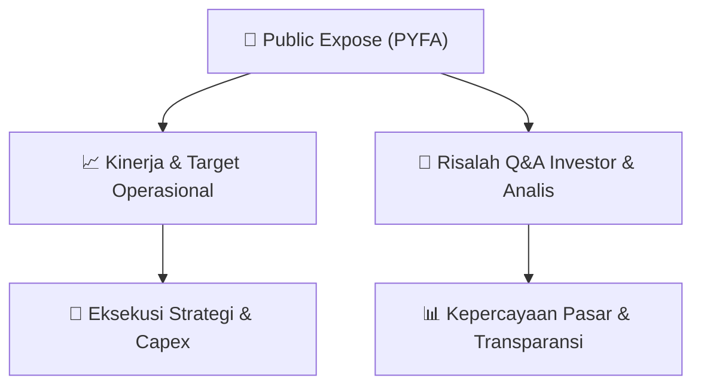

# 📢 Laporan Intelijen Paparan Publik (Public Expose) - [[PYFA]]
🏢 **Emiten**: `[[PYFA]]` | 📅 **Tanggal Pelaksanaan**: `2026-08-27` | 📑 **Dokumen**: `Public Expose`
⬅️ [[knowledge-base/daily-digests/Daily_Digest_20260827|Kembali ke Daily Digest]] | 🎛️ [[Dashboard|Ke Dashboard Utama]]

---

## 📌 1. Ringkasan Eksekutif & Paparan Direksi
> [!NOTE]
> PT Pyridam Farma Tbk (PYFA) menyampaikan Laporan Hasil Public Expose Tahunan kepada otoritas melalui surat No. 215/PYFA-CS/VIII/2026 tertanggal 27 Agustus 2026. Dalam laporan tersebut, Perseroan menyatakan bahwa public expose tahunan telah dilaksanakan merujuk pada surat penyampaian materi Public Expose No. 209/PYFA-CS/VIII/2026 tanggal 18 Agustus 2026. Jumlah peserta yang hadir dalam acara public expose, tidak termasuk manajemen dan karyawan Perseroan, adalah sebanyak 50 orang. Dokumen yang tersedia hanya berupa surat pengantar dan konfirmasi pelaksanaan, tanpa memuat rincian materi paparan, indikator kinerja, atau tanya jawab.

#### 🎯 Guidance Operasional & Target Strategis
- Tidak tersedia dalam dokumen. Dokumen yang diberikan hanya memuat informasi administratif pelaksanaan Public Expose Tahunan dan jumlah peserta, tanpa rincian target kinerja, ekspansi, belanja modal, atau panduan operasional dari manajemen.

## 📊 2. Matriks Indikator Operasional & Parameter Kunci
| Parameter Utama | Nilai / Keterangan Resmi |
| :--- | :--- |
| **Kode Emiten** | `PYFA` |
| **Nama Perusahaan** | `PT Pyridam Farma Tbk` |
| **Nomor Surat Laporan Hasil Public Expose** | `215/PYFA-CS/VIII/2026` |
| **Tanggal Surat Laporan Hasil Public Expose** | `27 Agustus 2026` |
| **Rujukan Surat Penyampaian Materi Public Expose** | `209/PYFA-CS/VIII/2026 tanggal 18 Agustus 2026` |
| **Jumlah Peserta Public Expose** | `50 orang` |
| **Jenis Public Expose** | `Tahunan` |
| **Pejabat Penandatangan** | `Herdiasti Anggitya Dwisani, Corporate Secretary` |

---

## 💬 3. Risalah Tanya Jawab (Q&A Session)
`Materi presentasi Public Expose / Risalah Q&A terlampir dalam dokumen resmi bursa.`

## 📌 4. Peta Jalur Strategis & Roadmap

---

## 🔗 Knowledge Graph
- [[knowledge-base/daily-digests/Daily_Digest_20260827|📄 Daily Digest 2026-08-27]]
- [[knowledge-base/calendars/Action_Calendar|🗓️ Kalender Terpusat Aksi Korporasi]]
- [[Dashboard|🎛️ Kembali ke Dashboard Utama]]