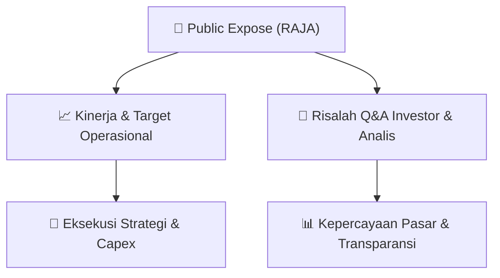

# 📢 Laporan Intelijen Paparan Publik (Public Expose) - [[RAJA]]
🏢 **Emiten**: `[[RAJA]]` | 📅 **Tanggal Pelaksanaan**: `2026-09-01` | 📑 **Dokumen**: `Public Expose`
⬅️ [[knowledge-base/daily-digests/Daily_Digest_20260901|Kembali ke Daily Digest]] | 🎛️ [[Dashboard|Ke Dashboard Utama]]

---

## 📌 1. Ringkasan Eksekutif & Paparan Direksi
> [!NOTE]
> Rukun Raharja Tbk (RAJA) menyampaikan pemberitahuan rencana penyelenggaraan Public Expose Tahunan untuk tahun buku yang berakhir pada 2026. Acara akan diselenggarakan secara live melalui platform Pubex Live 2026 pada 10 September 2026 pukul 16:00 WIB, dengan agenda pemaparan kinerja perseroan. Dokumen diterbitkan secara elektronik oleh Corporate Secretary Yuni Pattinasarani pada 1 September 2026.

#### 🎯 Guidance Operasional & Target Strategis
- Dokumen hanya berisi pemberitahuan jadwal Public Expose dan tidak memuat target kinerja, proyeksi keuangan, rencana ekspansi, belanja modal, atau guidance operasional. Katalis potensial baru dapat diperoleh setelah pelaksanaan Public Expose pada 10 September 2026.

## 📊 2. Matriks Indikator Operasional & Parameter Kunci
| Parameter Utama | Nilai / Keterangan Resmi |
| :--- | :--- |
| **Nama Perusahaan** | `Rukun Raharja Tbk` |
| **Kode Emiten** | `RAJA` |
| **Jenis Acara** | `Public Expose Tahunan` |
| **Tahun Buku** | `2026` |
| **Tempat** | `Pubex Live 2026` |
| **Hari/Tanggal** | `10 September 2026` |
| **Waktu** | `16:00 WIB` |
| **Agenda** | `Pemaparan Kinerja Perseroan` |
| **Corporate Secretary** | `Yuni Pattinasarani` |
| **Tanggal Pemberitahuan** | `01-09-2026 09:22` |
| **Nomor Surat** | `RR/CO/27.338/VIII/2026` |
| **Alamat Perseroan** | `Office Park Thamrin Residences Blok A. No. 01-05 Jl. Thamrin Boulevard, Kebon` |
| **Telepon** | `021 2929 1053` |
| **Fax** | `021 2357 9803` |
| **Situs Web** | `www.raja.co.id` |

---

## 💬 3. Risalah Tanya Jawab (Q&A Session)
`Materi presentasi Public Expose / Risalah Q&A terlampir dalam dokumen resmi bursa.`

## 📌 4. Peta Jalur Strategis & Roadmap

---

## 🔗 Knowledge Graph
- [[knowledge-base/daily-digests/Daily_Digest_20260901|📄 Daily Digest 2026-09-01]]
- [[knowledge-base/calendars/Action_Calendar|🗓️ Kalender Terpusat Aksi Korporasi]]
- [[Dashboard|🎛️ Kembali ke Dashboard Utama]]