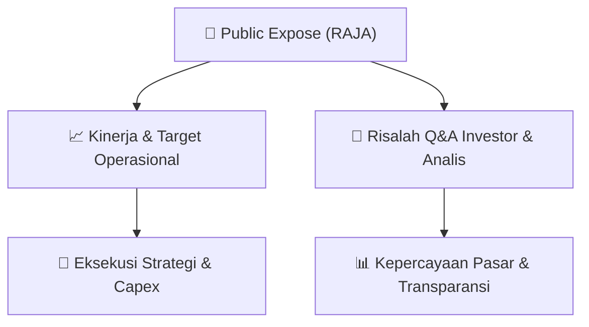

# 📢 Laporan Intelijen Paparan Publik (Public Expose) - [[RAJA]]
🏢 **Emiten**: `[[RAJA]]` | 📅 **Tanggal Pelaksanaan**: `2026-09-15` | 📑 **Dokumen**: `Public Expose`
⬅️ [[knowledge-base/daily-digests/Daily_Digest_20260915|Kembali ke Daily Digest]] | 🎛️ [[Dashboard|Ke Dashboard Utama]]

---

## 📌 1. Ringkasan Eksekutif & Paparan Direksi
> [!NOTE]
> Rukun Raharja Tbk (RAJA) mengumumkan rencana penyelenggaraan Public Expose Tahunan untuk Tahun Buku 2026 yang akan dilaksanakan secara online pada tanggal 10 September 2026 pukul 16:00 WIB. Agenda utama acara adalah penyampaian kinerja Perseroan. Pengumuman ini disampaikan oleh Corporate Secretary, Yuni Pattinasarani, melalui surat resmi bernomor RR/CO/14.360/IX/2026. Dokumen ini merupakan pengumuman resmi yang dihasilkan secara elektronik oleh sistem pelaporan BEI dan tidak memuat rincian kinerja keuangan atau operasional spesifik.

#### 🎯 Guidance Operasional & Target Strategis
- Dokumen ini hanya berisi pengumuman jadwal dan agenda Public Expose Tahunan. Tidak terdapat informasi mengenai target kinerja, panduan (guidance), rencana ekspansi, atau belanja modal (capex) dalam pengumuman ini. Informasi tersebut diharapkan akan dipaparkan oleh manajemen pada saat acara Public Expose berlangsung pada 10 September 2026.

## 📊 2. Matriks Indikator Operasional & Parameter Kunci
| Parameter Utama | Nilai / Keterangan Resmi |
| :--- | :--- |
| **Nama Emiten** | `Rukun Raharja Tbk` |
| **Kode Emiten** | `RAJA` |
| **Jenis Acara** | `Public Expose Tahunan (Tahun Buku 2026)` |
| **Tanggal Pelaksanaan** | `10 September 2026` |
| **Waktu Pelaksanaan** | `16:00 WIB` |
| **Tempat Pelaksanaan** | `Online` |
| **Agenda Acara** | `Penyampaian Kinerja Perseroan` |
| **Corporate Secretary** | `Yuni Pattinasarani` |
| **Nomor Surat Pengumuman** | `RR/CO/14.360/IX/2026` |
| **Tanggal Pengumuman** | `15 September 2026` |

---

## 💬 3. Risalah Tanya Jawab (Q&A Session)
### ❓ Pertanyaan 1 (Tidak Ada (Belum Terlaksana))
**Pertanyaan**: Belum ada sesi tanya jawab karena acara Public Expose baru akan dilaksanakan pada 10 September 2026.

**Jawaban Manajemen**: Belum tersedia. Manajemen akan memberikan paparan kinerja dan menjawab pertanyaan investor/analis pada saat acara berlangsung.

> [!TIP]
> **Implikasi Bagi Investor**: Investor dan analis diharapkan menunggu hingga acara Public Expose berlangsung untuk mendapatkan informasi detail mengenai kinerja keuangan, prospek bisnis, dan strategi perusahaan ke depan. Pengumuman ini hanya bersifat administratif dan tidak memiliki dampak langsung terhadap pergerakan harga saham.

## 📌 4. Peta Jalur Strategis & Roadmap

---

## 🔗 Knowledge Graph
- [[knowledge-base/daily-digests/Daily_Digest_20260915|📄 Daily Digest 2026-09-15]]
- [[knowledge-base/calendars/Action_Calendar|🗓️ Kalender Terpusat Aksi Korporasi]]
- [[Dashboard|🎛️ Kembali ke Dashboard Utama]]