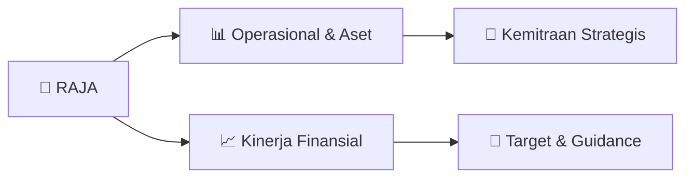

# 📊 Materi Public Expose: [RAJA]

🏢 **Emiten**: `RAJA` | 📅 **Tanggal Pelaksanaan**: `2026-09-15` | 📑 **Total Slide**: `2 Slide`
⬅️ [[knowledge-base/daily-digests/RAJA_20260915|Kembali ke Daily Digest]] | 🎛️ [[Dashboard/RAJA|Ke Dashboard Emiten]]

> [!NOTE]
> Ringkasan materi presentasi resmi Public Expose RAJA yang disampaikan oleh manajemen kepada investor dan bursa. Seluruh poin strategis, matriks operasional, dan angka kinerja diekstrak langsung dari slide deck resmi.

---

## 📅 1. Jadwal & Metadata Penyelenggaraan

| Parameter | Detail Informasi |
|---|---|
| **Nomor Surat Pengantar** | RR/CO/14.360/IX/2026 |
| **Perihal Pengumuman** | Rencana Penyelenggaraan Public Expose Tahunan |
| **Waktu Pelaksanaan** | 10 September 2026 16:00 |
| **Lokasi / Media** | Online |
| **Lampiran Resmi** | `1` |

## 📋 2. Agenda Paparan Publik

1. Nama Perusahaan
2. Kode Emiten
3. Lampiran
4. Perihal
5. RR/CO/14.360/IX/2026
6. Rukun Raharja Tbk
7. Rencana Penyelenggaraan Public Expose Tahunan
8. Go To English Page
9. Perseroan melaporkan rencana Public Expose Tahunan sebagai berikut:
10. Rencana Penyelenggaraan Public Expose
11. Tahun Buku yang Berakhir pada
12. Tempat
13. : Online
14. Hari/Tanggal
15. : 10 September 2026
16. Waktu
17. 16:00
18. Agenda
19. : Penyampaian Kinerja Perseroan
20. Hormat Kami,
21. Demikian untuk diketahui.
22. Office Park Thamrin Residences Blok A. No. 01-05 Jl. Thamrin Boulevard, Kebon.
23. Corporate Secretary
24. Nama Pengirim
25. Telepon : 021 2929 1053, Fax : 021 2357 9803, www.raja.co.id
26. Rukun Raharja Tbk
27. Yuni Pattinasarani
28. Rukun Raharja Tbk
29. Yuni Pattinasarani
30. Jabatan
31. Corporate Secretary
32. Tanggal dan Waktu
33. 15-09-2026 20:16
34. 1. Laporan Pubex Final.pdf
35. Lampiran
36. Dokumen ini merupakan dokumen resmi Rukun Raharja Tbk yang tidak memerlukan tanda tangan karena dihasilkan
37. secara elektronik oleh sistem pelaporan elektronik. Rukun Raharja Tbk bertanggung jawab penuh atas informasi
38. yang tertera didalam dokumen ini.
39. Issuer Name
40. Issuer Code
41. Attachment
42. Subject
43. RR/CO/14.360/IX/2026
44. Rukun Raharja Tbk
45. General Announcement Public Expose
46. Go To Indonesian Page
47. Company announces public expose plan Annual as follows:
48. Public Expose Announcement
49. Fiscal Year
50. Place
51. : Online
52. : 10 September 2026
53. 16:00
54. Agenda
55. Respectfully,
56. Thus to be informed accordingly.
57. Rukun Raharja Tbk
58. Yuni Pattinasarani
59. Corporate Secretary
60. Yuni Pattinasarani
61. Sender Name
62. Rukun Raharja Tbk
63. Office Park Thamrin Residences Blok A. No. 01-05 Jl. Thamrin Boulevard, Kebon.
64. Phone : 021 2929 1053, Fax : 021 2357 9803, www.raja.co.id
65. Corporate Secretary
66. Function
67. Date and Time
68. 15-09-2026 20:16
69. Attachment
70. 1. Laporan Pubex Final.pdf
71. This is an official document of Rukun Raharja Tbk that does not require a signature as it was generated
72. electronically by the electronic reporting system. Rukun Raharja Tbk is fully responsible for the information

## 🏢 3. Profil & Pilar Portofolio Bisnis

## 🏗️ 4. Kinerja Operasional & Portofolio Aset

*Detail aset operasional terlampir pada dokumen slide resmi.*

## 📈 5. Kinerja Keuangan & Posisi Finansial

## 🧭 6. Inisiatif Strategis, Kolaborasi, & Kemitraan

*Strategi usaha difokuskan pada penguatan fundamental dan ekspansi operasional.*

## 🎯 7. Target Pertumbuhan & Guidance Manajemen

*Target pertumbuhan ditetapkan mengacu pada prospek industri dan kondisi makroekonomi terkini.*

## 🗺️ 8. Peta Jalur Strategis & Eksekusi

## 📑 9. Daftar Indeks Slide Presentasi

| Slide # | Judul / Topik Slide | Ringkasan Konten |
|---|---|---|
| Slide 1 | **Nomor Surat** | Nama Perusahaan Kode Emiten Lampiran |
| Slide 2 | **Letter / Announcement No.** | Issuer Name Issuer Code Attachment |

---

*Dokumen diolah otomatis oleh **Swarm Intelijen Pasar Modal Indonesia** pada 2026-10-12 16:48 WIB.*