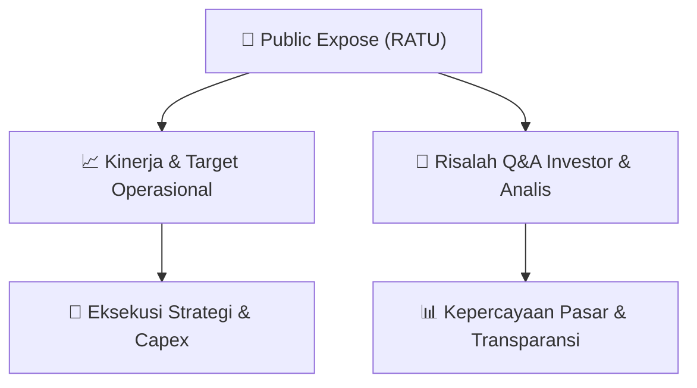

# 📢 Laporan Intelijen Paparan Publik (Public Expose) - [[RATU]]
🏢 **Emiten**: `[[RATU]]` | 📅 **Tanggal Pelaksanaan**: `2026-08-27` | 📑 **Dokumen**: `Public Expose`
⬅️ [[knowledge-base/daily-digests/Daily_Digest_20260827|Kembali ke Daily Digest]] | 🎛️ [[Dashboard|Ke Dashboard Utama]]

---

## 📌 1. Ringkasan Eksekutif & Paparan Direksi
> [!NOTE]
> PT Raharja Energi Cepu Tbk (RATU) menyampaikan rencana penyelenggaraan Public Expose Tahunan untuk Tahun Buku 2026. Acara akan diselenggarakan pada 10 September 2026 pukul 14:00 melalui platform Public Expose Live 2026. Agenda utama meliputi: (1) Laporan Kinerja Kuartal II Tahun 2026, (2) Rencana Bisnis Perseroan, dan (3) Fakta Material Lainnya. Pengumuman resmi disampaikan oleh Corporate Secretary & Legal, Supriyanti Priandini, pada 27 Agustus 2026.

#### 🎯 Guidance Operasional & Target Strategis
- Dokumen ini hanya merupakan pengumuman rencana Public Expose dan belum memuat rincian target kinerja, ekspansi, belanja modal, atau guidance operasional. Agenda menyebutkan akan dibahas Rencana Bisnis Perseroan dan Laporan Kinerja Kuartal II 2026, sehingga katalis dan guidance spesifik baru akan tersedia saat pelaksanaan public expose pada 10 September 2026.

## 📊 2. Matriks Indikator Operasional & Parameter Kunci
| Parameter Utama | Nilai / Keterangan Resmi |
| :--- | :--- |
| **Nama Perusahaan** | `PT Raharja Energi Cepu Tbk` |
| **Kode Emiten** | `RATU` |
| **Jenis Acara** | `Public Expose Tahunan` |
| **Tahun Buku** | `2026` |
| **Tempat** | `Public Expose Live 2026` |
| **Hari/Tanggal** | `10 September 2026` |
| **Waktu** | `14:00` |
| **Agenda 1** | `Laporan Kinerja Kuartal II Tahun 2026` |
| **Agenda 2** | `Rencana Bisnis Perseroan` |
| **Agenda 3** | `Fakta Material Lainnya` |
| **Corporate Secretary & Legal** | `Supriyanti Priandini` |
| **Kontak** | `(62-21) 23579812, www.rec.co.id` |
| **Tanggal Pengumuman** | `27 Agustus 2026` |
| **Nomor Surat** | `REC/CO/26.253/VIII/2026` |

---

## 💬 3. Risalah Tanya Jawab (Q&A Session)
`Materi presentasi Public Expose / Risalah Q&A terlampir dalam dokumen resmi bursa.`

## 📌 4. Peta Jalur Strategis & Roadmap

---

## 🔗 Knowledge Graph
- [[knowledge-base/daily-digests/Daily_Digest_20260827|📄 Daily Digest 2026-08-27]]
- [[knowledge-base/calendars/Action_Calendar|🗓️ Kalender Terpusat Aksi Korporasi]]
- [[Dashboard|🎛️ Kembali ke Dashboard Utama]]