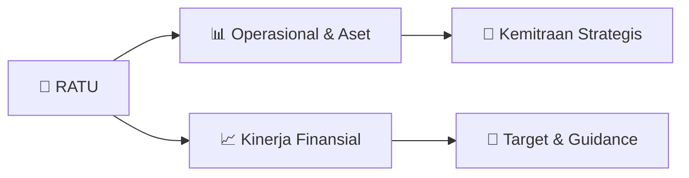

# 📊 Materi Public Expose: [RATU]

🏢 **Emiten**: `RATU` | 📅 **Tanggal Pelaksanaan**: `2026-09-08` | 📑 **Total Slide**: `24 Slide`
⬅️ [[knowledge-base/daily-digests/RATU_20260908|Kembali ke Daily Digest]] | 🎛️ [[Dashboard/RATU|Ke Dashboard Emiten]]

> [!NOTE]
> Ringkasan materi presentasi resmi Public Expose RATU yang disampaikan oleh manajemen kepada investor dan bursa. Seluruh poin strategis, matriks operasional, dan angka kinerja diekstrak langsung dari slide deck resmi.

---

## 📅 1. Jadwal & Metadata Penyelenggaraan

| Parameter | Detail Informasi |
|---|---|
| **Nomor Surat Pengantar** | REC/CO/08.271/IX/2026 |
| **Perihal Pengumuman** | Penyampaian Materi Public Expose Tahunan |
| **Waktu Pelaksanaan** | 2026-09-08 08-09-2026 15:48 |
| **Lokasi / Media** | Aplikasi Zoom / Daring |
| **Lampiran Resmi** | `1` |

## 📋 2. Agenda Paparan Publik

1. LANSKAP BISNIS
2. MIGAS 2026
3. PROFIL
4. PERUSAHAAN
5. RINGKASAN
6. PENCAPAIAN
7. KINERJA
8. PERUSAHAAN
9. Presenter:
10. Sumantri
11. Direktur Utama
12. KINERJA
13. KEBERLANJUTAN

## 🏢 3. Profil & Pilar Portofolio Bisnis

> Lanskap Bisnis Migas 2026 I
Lanskap Bisnis Migas 2026
II IV Pencapaian RATU V Kinerja Perusahaan Profil Perusahaan III VI Kinerja Keberlanjutan Ringkasan Aset

> PROFIL PERUSAHAAN I
Lanskap Bisnis Migas 2026
II IV Pencapaian RATU V Kinerja Perusahaan Profil Perusahaan III VI Kinerja Keberlanjutan Ringkasan Aset

> PT Raharja Energi Cepu Tbk (IDX: RATU)
Per Juni 2026
Profil Perusahaan RATU
RATU adalah perusahaan induk dengan investasi (Non-Operator) di sektor minyak dan gas. Saat ini perusahaan memegang
participating interest di Blok Cepu, Blok Jabung, Blok Madura, dan Blok Kasuri.
Sebagai bagian dari Grup Rukun Raharja (“RAJA”), visi dan misi RATU berfokus
pada investasi hulu minyak dan gas, diawali melalui kepemilikan minoritas pada
3–5 tahun pertama, dengan tujuan bertransformasi menjadi operator di masa
depan.
RATU mengelola investasinya melalui Participating Interest di Blok Cepu, Blok
Jabung, Blok Madura, dan yang terbaru Blok Kasuri.
Visi
Menjadi Perusahaan yang fokus pada eksplorasi dan produksi migas,
memberikan nilai tambah yang berkesinambungan bagi seluruh pemangku
kepentingan serta berkontribusi pada ketahanan energi nasional.
Misi
•
Menemukan dan mengembangkan cadangan minyak dan gas bumi baru
•
Mengoptimalkan aset dan sumber daya melalui inovasi teknologi
•
Meningkatkan produksi dan efisiensi operasi
•
Menerapkan pengelolaan investasi yang berkelanjutan
•
Membangun kemitraan yang strategis dengan berbagai pihak
•
Mengembangkan sumber daya manusia yang kompeten dan berdedikasi
•
Melaksanakan kegiatan bisnis secara bertanggung jawab dengan
menekankan aspek keselamatan, keamanan, dan lingkungan
PI (Indirect)
2.2423%
Blok Cepu PI (Direct) 8% Blok Jabung PI (Indirect) 20%
Blok Selat Madura
Jambi Pulau Sumatra Blok Jabung Kontrak PSC: 20 tahun Operator:
Per Juni 2026
Blok Cepu 

> Dewan Komisaris Direksi Taufik Ahmad Komisaris Independen
Orias Petrus Moedak
Komisaris Utama Merly Komisaris Sumantri Direktur Utama Alexandra Sinta Wahjudewanti Direktur Adrian Hartadi Direktur
(1) PT Petrogas Jatim Utama memiliki 51% saham di PT Petrogas Utama Cendana.
(1) RATU mengakuisisi SMSD melalui REM, yang memegang 20% kepemilikan di HCML, operator Blok Madura.
49.00% 99.00%
1.00%
PT Raharja Energi
Cepu Tbk (“RATU”)
PT Rukun Prima
Sarana (“RPS”) Saham Publik
PT Rukun Raharja Tbk
(“RAJA”)
2.24% PI
8%
PT Raharja Energi
Tanjung Jabung (“RETJ”) Blok Jabung
PT Petrogas Jatim
Utama Cendana (“PJUC”) Blok Cepu Operator: Operator:
PT Raharja Energi
Negeri (“REN”)
PT Raharja Energi
Indonesia (“REI”) 8.00%  PI 99.99% 99.00%
PT Raharja Energi
Madura3  (“REM”) 51.00% 0.004%
1.00%
Blok Madura Operator:
SMS Development Ltd
(“SMSD”) 1 Husky-CNOOC
Madura Ltd. (“HCML”)
100.00% 20.00% 100.00%
Struktur Korporasi Terkini (per Juni 2026)
Dewan Komisaris & Direksi
68.677% 31.319% 0.004%
*
*
Profil Perusahaan RATU
RATU dipimpin oleh Dewan Komisaris dan Direksi berpengalaman di bidang energi dan investasi, sehingga eksekusi strategi
berjalan efektif. Presenter: Sumantri Direktur Utama

> RINGKASAN ASET I
Lanskap Bisnis Migas 2026
II IV Pencapaian RATU V Kinerja Perusahaan Profil Perusahaan III VI Kinerja Keberlanjutan Ringkasan Aset

> PENCAPAIAN RATU I
Lanskap Bisnis Migas 2026
II IV Pencapaian RATU V Kinerja Perusahaan Profil Perusahaan III VI Kinerja Keberlanjutan Ringkasan Aset

> KINERJA PERUSAHAAN I
Lanskap Bisnis Migas 2026
II IV Pencapaian RATU V Kinerja Perusahaan Profil Perusahaan III VI Kinerja Keberlanjutan Ringkasan Aset

> KINERJA KEBERLANJUTAN I
Lanskap Bisnis Migas 2026
II IV Pencapaian RATU V Kinerja Perusahaan Profil Perusahaan III VI Kinerja Keberlanjutan Ringkasan Aset

### 🏛️ Pilar Usaha & Aset Utama
- Area Kerja Poin Utama Metrik Utama Lingkungan Sosial Tata Kelola
• Pada 2026, RATU masuk dalam cakupan Morningstar Sustainalytics;
• 43 tCO2e dan intensitas 0,86 (data FY2025) kini terlihat dari sumber independen;
• Detail risiko iklim dan taksonomi EU masih belum diterbitkan penuh di Sustainalytics.
Cakupan ESG Eksternal Morningstar Sustainalytics
43 tCO2e Scope 1+2
0,86 per USD juta
>
Tahun data 2025
• Pada 2026, RATU mulai menetapkan isu material ESG menggunakan standar IFRS SASB;
• 10 dari 26 kategori isu umum dinilai relevan dan dipetakan ke 10 topik pengungkapan;
• Mencakup emisi, udara, air dan limbah, ekologi, HAM, keselamatan, dan etika bisnis.
Isu Material ESG
SASB Materiality Finder
10 topik SASB
> Standar EM-EP
• 100% armada kendaraan operasional kini berbasis listrik, menekan pembakaran bahan
bakar fosil;
• Sebagai pemegang non-operating interest, emisi aset dan HSE berada pada operator blok;
• Total konsumsi energi 59,49 GJ dan konsumsi air 70,21 m³. Seluruh air limbah di

- Jaties Ngaruh 2026
Edukasi pengelolaan sampah dan penanaman
pohon bagi 65 penerima manfaat, dengan 145
bibit serta  pemberian tempat sampah.
Rumah Maggot Rancage
Sampah organik diolah menjadi protein maggot,
pupuk, dan telur. 34 penerima manfaat dilatih,
melayani kelompok PKK dan rumah tangga.
Sumur Bor Sumba
Tiga sumur bor di rumah ibadah warga, masing-
masing berkapasitas desain 250 hingga 500
orang.
Sumenep Eco School
Sepuluh tim siswa, 35 penerima manfaat dari
lima sekolah, didampingi menjalankan rencana
aksi termasuk penanaman mangrove.
Titian Scholarship
Beasiswa bagi lima penerima manfaat dari
keluarga berpenghasilan rendah, dengan verifikasi rumah, pendampingan, dan pemantauan.
Bojonegoro Future Ready Talent
Literasi bahasa Inggris dan AI bagi 33 penerima
manfaat, dengan empat sesi daring serta
asesmen baseline hingga endline.
Apresiasi Seni Difabel
Lomba lukis, pameran, dan pertunjukan bagi
seniman disabilitas. 60 penerima manfaat, 20
pemenang, enam karya akan ditampilkan di
k

## 🏗️ 4. Kinerja Operasional & Portofolio Aset

> Presenter: Sumantri Direktur Utama
Lanskap Bisnis Minyak & Gas
Kondisi Pasar Global Minyak & Gas 2026
Penutupan Selat Hormuz menempatkan pasar minyak global dalam kondisi kekurangan supply sepanjang 2026, dan harga bertahan tinggi hingga akhir tahun.
Harga Minyak & Gas
Perubahan Supply and Demand 2026 dibandingkan 2025
Sebelum konflik, sekitar 21,6 juta barel minyak per hari melewati Selat Hormuz. Setelah
penutupan pada akhir Februari 2026, arus turun menjadi 4,9 juta barel per hari, menyebabkan
defisit supply sekitar 1,8 juta barel per hari pada Q3 2026. Persediaan minyak dunia pun turun
69 juta barel pada Juli, sementara kapasitas tambahan OPEC+ hanya sekitar 1,09 juta barel per
hari, sehingga pasar tetap rentan terhadap gangguan supply.
Sumber: EIA Short-Term Energy Outlook Agustus 2026
82,40 80,70 69,00 86,81 0,00 20,00 40,00 60,00 80,00 100,00 2023 2024 2025 2026*
Harga Minyak Brent 2023 - 2026
Harga Minyak Brent
Harga minyak mentah Brent naik
tajam setelah Selat Hormuz ditutup
pada akhir Februari 2026. Brent
sempat menyentuh USD 105 per
barel pada 23 Juli 2026, lalu bergerak
turun dan bertahan di kisaran USD 95
per barel pada awal September 2026.
Untuk kuartal IV 2026, EIA
me

> Presenter: Sumantri Direktur Utama
Lanskap Bisnis Minyak & Gas
Kinerja dan Prospek Minyak & Gas Nasional 2026
Sumber: SKK Migas; Kementerian ESDM; APBN 2026
Lifting masih di bawah target APBN hingga pertengahan tahun, dengan tambahan produksi dari proyek baru diharapkan menopang pemulihan pada semester II.
Target lifting APBN 2026 sebesar 610 ribu BOPD, dengan outlook 600–610 ribu BOPD
atau 98–100% dari target.
Faktor Penentu Pencapaian 2026
Target lifting APBN 2026 sebesar 5.508 MMSCFD, dengan outlook 5.400 MMSCFD
atau 98% dari target.
Gangguan operasional semester I
menahan lifting nasional
Kebocoran pipa Grissik-Duri, gangguan listrik di Rokan, dan
penurunan produksi secara alami di lapangan utama
menahan lifting semester I 2026, sehingga pemulihannya
menentukan hasil kuartal IV.
Dua proyek baru dijadwalkan mulai
berproduksi kuartal IV
Tambahan produksi 2026 berasal dari 8 proyek hulu dengan
total 46.413 BOEPD dan investasi USD478 juta. 6 proyek
telah berproduksi sejak semester I, sementara 2 proyek
lainnya dijadwalkan mulai berproduksi pada Q4 2026.
Pengeboran dan perawatan sumur
menahan penurunan lapangan tua
Sebagian besar lapangan minyak Indonesia sudah berusia
tua, sehingga

> • Lokasi: Selat Madura, Jawa Timur
• Masa kontrak:
-
PSC ke-1: 30 tahun (1982 – 2012)
-
PSC ke-2: perpanjangan 20 tahun (2012 – 2032)
• Kontraktor Blok Selat Madura adalah 100% Husky –
CNOOC Madura Limited (“HCML”)
• Saham HCML dimiliki oleh Husky Oil Madura Partnership
(40%), CNOOC Southeast Asia Ltd (40%), dan SMS
Development Ltd. (20%) (“SMSD”).
Lapangan produksi:
• BD – mulai produksi 2017 (gas &
kondensat)
• MDA & MBH (“2M”) – 2022 (gas)
• MAC – 2023 (gas)
Cadangan Tersisa 2P(1) Rata-rata
Produksi YTD Juni 2026
Lapangan prospektif:
• MAX
• MBJ
• MBF – proyek eksklusif CNOOC-
Husky Jawa Timur Pulau Jawa Gas Gas 584 BCF 219 MMSCFD
2.9k
BCPD Kondensat Kondensat 6.7 MMBO (1)
Cadangan tersisa 2P (proven and probable) per Juni 2026
Ringkasan Blok Selat Madura
Pada Juni 2026, RATU menyelesaikan akuisisi SMS Development Limited (“SMSD”) sehingga memperoleh 20% participating
interest secara tidak langsung di PSC Selat Madura.
Gambaran Umum & Lokasi
Area Penemuan
Blok Selat Madura
Selat Madura merupakan produsen gas terbesar di Jawa
Timur dengan kontribusi sekitar 30% dari total produksi gas
di wilayah tersebut. Puncak produksi sales gas mencapai
250 MMSCFD dari tiga lapangan utama: BD,

> Neraca (dalam juta USD)
Total Aset, Liabilitas, dan Ekuitas
Total aset meningkat menjadi USD 231,8 juta setelah akuisisi SMS Development Ltd. (20% kepemilikan pada HCML), yang dibiayai melalui penerbitan obligasi dan
sukuk serta fasilitas perbankan. Total liabilitas meningkat menjadi USD 166,8 juta seiring dengan pembiayaan akuisisi, sementara ekuitas meningkat menjadi USD
65,0 juta seiring dengan akumulasi laba ditahan.  DER meningkat menjadi 2,42x, namun masih berada jauh di bawah covenant sebesar 4,0x.
52,8 76,0 231,8 25,4 19,4 166,8 27,4 56,6 65,0 2024 2025 1H 2026 Total Aset Total Liabilitas Total Ekuitas Total Aset Total Liabilitas Total Ekuitas Total Aset Total Liabilitas Total Ekuitas Ikhtisar Keuangan
Neraca RATU mengalami peningkatan yang signifikan pasca akuisisi Blok Madura, dengan tingkat leverage yang aman.
Presenter: Adrian Hartadi Direktur
Catatan: Data di atas merupakan data RATU konsolidasi

> EBITDA Margin
Net Profit Margin
Debt Service Coverage Ratio (DSCR)
49,52% 51,54% 65,71% 61,09% 62,29% 61,13% 63,51% 82,99%
Q3-2024 Q4-2024 Q1-2025 Q2-2025 Q3-2025 Q4-2025 Q1-2026 Q2-2026
21,35% 24,16% 45,08% 30,64% 31,51% 30,83% 44,00% 60,61%
Q3-2024 Q4-2024 Q1-2025 Q2-2025 Q3-2025 Q4-2025 Q1-2026 Q2-2026
Return on Assets (ROA)
Return on Equity (ROE)
Debt to Equity Ratio (DER)
23,74% 26,42% 33,53% 24,06% 23,83% 20,00% 14,69% 13,41%
Q3-2024 Q4-2024 Q1-2025 Q2-2025 Q3-2025 Q4-2025 Q1-2026 Q2-2026
54,26% 50,93% 51,40% 36,91% 34,44% 26,86% 31,15% 47,81%
Q3-2024 Q4-2024 Q1-2025 Q2-2025 Q3-2025 Q4-2025 Q1-2026 Q2-2026
RATU mencatatkan profitabilitas tertinggi pada Q2 2026, dengan EBITDA margin meningkat menjadi 82,99% dan net profit margin mencapai 60,61%, didukung oleh peningkatan equity income dari entitas
asosiasi serta keuntungan pembelian di bawah nilai wajar yang diakui dari akuisisi SMSD. Sementara itu, DSCR menurun menjadi 1,80x setelah penerbitan obligasi dan penarikan utang selanjutnya. Namun
demikian, kemampuan pembayaran utang tetap berada pada tingkat yang memadai, didukung oleh arus kas operasional yang solid.
ROA menurun menjadi 13,41% seiring dengan ekspansi Perseroan pas

> Pada tahap awal RATU berfokus
pada investasi non-operating dengan mengakuisisi PSC berskala besar tanpa mengoperasikan aset secara
langsung. Pada fase ini RATU
berperan sebagai pemegang participating interest untuk memperoleh kepemilikan
strategis di PSC besar dengan
tanggung jawab operasional minimal Setelah fase investasi non- operating, RATU beralih ke investasi operasional dengan
mengakuisisi participating interest
pada PSC produksi berskala lebih
kecil serta mulai mengelola dan
mengoperasikan aset secara langsung. RATU menargetkan perluasan
investasi operasional ke PSC dengan
skala produksi lebih besar. Tahapan
ini mencerminkan komitmen RATU
memperkuat kapabilitas operasional
dan meningkatkan kontribusinya
pada portofolio produksi
Tahapan Pengembangan RATU
1-3 Tahun Investasi Non-Operating
Transisi ke Investasi
Operasional 3-5 Tahun 6-10 Tahun Investasi Operasional
Roadmap Pengembangan Kami
Mendorong pertumbuhan melalui investasi energi yang strategis.
Presenter:
Alexandra Sinta Wahjudewanti
Direktur

## 📈 5. Kinerja Keuangan & Posisi Finansial

### 📊 Ringkasan Finansial
```text
Pada Semester I 2026, RATU
mencatatkan: Pendapatan USD 25,65 juta
↑ 2% YoY
Pendapatan stabil sejalan
dengan kinerja lifting minyak
dan gas Blok Jabung.
Semester I 2025:
USD 25,15 juta
Adj. EBITDA USD 21,28 juta
↑ 38% YoY
Semester I 2025:
USD 15,37 juta
Adj. EBITDA meningkat seiring
kenaikan harga crude oil yang
memperkuat margin. Laba Bersih USD 15,54 juta
↑ 102% YoY
Semester I 2025:
USD 7,71 juta
Didukung bargain purchase
dari akuisisi Blok Madura
dan kenaikan laba entitas
asosiasi.
Ikhtisar Kinerja Keuangan Utama Semester I 2026
Profitabilitas menguat: Adjusted EBITDA naik 38% dan laba bersih naik 102% YoY, sementara pendapatan tetap stabil (+2%).
Presenter: Adrian Hartadi Direktur
Catatan: Adj.EBITDA dihitung dari Laba Sebelum Pajak ditambah beban depresiasi & deplesi dan beban bunga, dikurangi pendapatan bunga serta keuntungan dari pembelian diskon (non-recurring).
```

## 🧭 6. Inisiatif Strategis, Kolaborasi, & Kemitraan

*Strategi usaha difokuskan pada penguatan fundamental dan ekspansi operasional.*

## 🎯 7. Target Pertumbuhan & Guidance Manajemen

> Q1 2025 Q3 2025 Q4 2025 Q4 2025
RATU masuk Indeks MSCI
Small Cap Mencerminkan kepercayaan
internasional terhadap pertumbuhan
kapitalisasi pasar dan likuiditas RATU.
Masuk Indeks IDX80
RATU masuk sebagai anggota baru
Indeks IDX80, menandai pengakuan
sebagai salah satu dari 80 saham teratas
di Bursa Efek Indonesia.
Pefindo Menetapkan Peringkat
Korporasi ‘idA’ untuk RATU
RATU memperoleh peringkat ‘idA’ dengan
outlook stabil dari Pefindo,
mencerminkan profil keuangan yang solid
& arus kas yang stabil.
Penawaran Umum Perdana
(IPO) RATU
RATU tercatat di Bursa Efek Indonesia
pada 8 Januari 2025 pada harga Rp1.150
per saham, menghimpun Rp624 miliar
dengan porsi publik 20%.
2025 2026
Pencapaian RATU: 2025–2026
Perjalanan pertumbuhan RATU dari IPO hingga masuk indeks, peringkat korporasi, akuisisi, dan pembagian dividen
Presenter: Adrian Hartadi Direktur Q2 2026 Q2 2026 Q2 2026
RUPS Tahun Buku 2025
& Pembagian Dividen
RATU menyelenggarakan RUPST pada 7 Mei
2026, dengan pemegang saham menyetujui


## 🗺️ 8. Peta Jalur Strategis & Eksekusi



## 📑 9. Daftar Indeks Slide Presentasi

| Slide # | Judul / Topik Slide | Ringkasan Konten |
|---|---|---|
| Slide 1 | **PUBLIC EXPOSE 2026** | PT RAHARJA ENERGI CEPU TBK (IDX: RATU) 10 September 2026 |
| Slide 2 | **AGENDA PUBLIC EXPOSE 2026** | 01 LANSKAP BISNIS MIGAS 2026 |
| Slide 3 | **3 Lanskap Bisnis** | Lanskap Bisnis Migas 2026 I |
| Slide 4 | **Presenter:** | Sumantri Direktur Utama Lanskap Bisnis Minyak & Gas |
| Slide 5 | **Presenter:** | Sumantri Direktur Utama Lanskap Bisnis Minyak & Gas |
| Slide 6 | **6 PROFIL** | PROFIL PERUSAHAAN I |
| Slide 7 | **PT Raharja Energi Cepu Tbk (IDX: RATU)** | Per Juni 2026 Profil Perusahaan RATU RATU adalah perusahaan induk dengan investasi (Non-Operator) di sektor minyak dan gas. Saat ini perusahaan memega |
| Slide 8 | **8 Dewan Komisaris** | Dewan Komisaris Direksi Taufik Ahmad |
| Slide 9 | **9 RINGKASAN** | RINGKASAN ASET I |
| Slide 10 | **10 Lapangan Banyu Urip – Blok Cepu** | Lapangan Banyu Urip – Blok Cepu Banyu Urip merupakan lapangan minyak pertama yang dikembangkan di Blok Cepu. Ditemukan pada 2001 dengan |
| Slide 11 | **11 Blok Jabung** | Blok Jabung Blok Jabung berperan penting dalam supply gas nasional. PCJL menegaskan komitmennya untuk mendukung target |
| Slide 12 | **12 • Lokasi: Selat Madura, Jawa Timur** | • Lokasi: Selat Madura, Jawa Timur • Masa kontrak: - |
| Slide 13 | **13 PENCAPAIAN** | PENCAPAIAN RATU I |
| Slide 14 | **14 Q1** | Q1 2025 Q3 |
| Slide 15 | **15 KINERJA** | KINERJA PERUSAHAAN I |
| Slide 16 | **16 Pada Semester I 2026, RATU** | Pada Semester I 2026, RATU mencatatkan: Pendapatan |
| Slide 17 | **17 49,3** | 49,3 25,2 25,6 |
| Slide 18 | **18 Neraca (dalam juta USD)** | Neraca (dalam juta USD) Total Aset, Liabilitas, dan Ekuitas Total aset meningkat menjadi USD 231,8 juta setelah akuisisi SMS Development Ltd. (20% kep |
| Slide 19 | **19 EBITDA Margin** | EBITDA Margin Net Profit Margin Debt Service Coverage Ratio (DSCR) |
| Slide 20 | **20 KINERJA** | KINERJA KEBERLANJUTAN I |
| Slide 21 | **21 Area Kerja** | Area Kerja Poin Utama Metrik Utama |
| Slide 22 | **22 Jaties Ngaruh 2026** | Jaties Ngaruh 2026 Edukasi pengelolaan sampah dan penanaman pohon bagi 65 penerima manfaat, dengan 145 |
| Slide 23 | **23 Pada tahap awal RATU berfokus** | Pada tahap awal RATU berfokus pada investasi |
| Slide 24 | **TERIMA KASIH** | PT RAHARJA ENERGI CEPU TBK 10 September 2026 |

---

*Dokumen diolah otomatis oleh **Swarm Intelijen Pasar Modal Indonesia** pada 2026-10-12 16:48 WIB.*