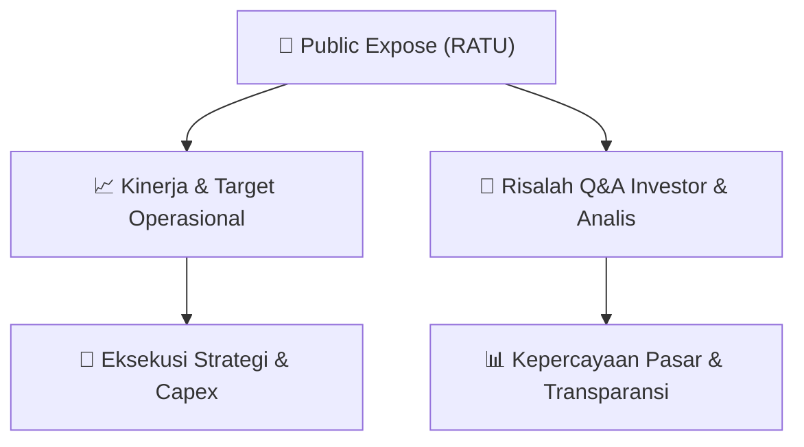

# 📢 Laporan Intelijen Paparan Publik (Public Expose) - [[RATU]]
🏢 **Emiten**: `[[RATU]]` | 📅 **Tanggal Pelaksanaan**: `2026-09-08` | 📑 **Dokumen**: `Public Expose`
⬅️ [[knowledge-base/daily-digests/Daily_Digest_20260908|Kembali ke Daily Digest]] | 🎛️ [[Dashboard|Ke Dashboard Utama]]

---

## 📌 1. Ringkasan Eksekutif & Paparan Direksi
> [!NOTE]
> PT Raharja Energi Cepu Tbk (RATU) menyampaikan materi Public Expose Tahunan yang akan diselenggarakan pada 10 September 2026. Dokumen ini merupakan koreksi atas surat sebelumnya (No. REC/CO/04.270/IX/2026 tanggal 07 September 2026) dan merujuk pada pengumuman rencana Public Expose melalui surat No. REC/CO/26.253/VIII/2026 tanggal 27 Agustus 2026. Materi paparan publik dilampirkan dalam dokumen terpisah (Materi Public Expose 10 Sep 2026.pdf). Dokumen ini hanya berisi pemberitahuan administratif penyampaian materi, tanpa memuat substansi kinerja atau strategi perusahaan.

#### 🎯 Guidance Operasional & Target Strategis
- Tidak terdapat informasi mengenai target kinerja, ekspansi, capex, atau panduan operasional dalam dokumen ini. Dokumen hanya berisi pemberitahuan administratif penyampaian materi Public Expose Tahunan. Informasi katalis dan guidance diperkirakan akan disampaikan pada saat acara Public Expose berlangsung pada 10 September 2026.

## 📊 2. Matriks Indikator Operasional & Parameter Kunci
| Parameter Utama | Nilai / Keterangan Resmi |
| :--- | :--- |
| **Nama Emiten** | `PT Raharja Energi Cepu Tbk` |
| **Kode Emiten** | `RATU` |
| **Jenis Acara** | `Public Expose Tahunan` |
| **Tanggal Pelaksanaan Public Expose** | `10 September 2026` |
| **Tanggal Penyampaian Materi** | `08 September 2026` |
| **Nomor Surat Penyampaian Materi** | `REC/CO/08.271/IX/2026` |
| **Nomor Surat Pengumuman Rencana Public Expose** | `REC/CO/26.253/VIII/2026 (tanggal 27 Agustus 2026)` |
| **Corporate Secretary & Legal** | `Supriyanti Priandini` |
| **Alamat Kantor** | `Office Park Thamrin Residences A01-05` |
| **Kontak** | `Telepon: (62-21) 23579812, Fax: (62-21) 23579812, www.rec.co.id` |

---

## 💬 3. Risalah Tanya Jawab (Q&A Session)
`Materi presentasi Public Expose / Risalah Q&A terlampir dalam dokumen resmi bursa.`

## 📌 4. Peta Jalur Strategis & Roadmap

---

## 🔗 Knowledge Graph
- [[knowledge-base/daily-digests/Daily_Digest_20260908|📄 Daily Digest 2026-09-08]]
- [[knowledge-base/calendars/Action_Calendar|🗓️ Kalender Terpusat Aksi Korporasi]]
- [[Dashboard|🎛️ Kembali ke Dashboard Utama]]