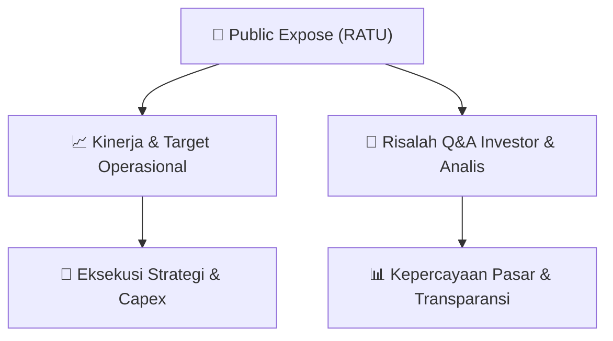

# 📢 Laporan Intelijen Paparan Publik (Public Expose) - [[RATU]]
🏢 **Emiten**: `[[RATU]]` | 📅 **Tanggal Pelaksanaan**: `2026-09-15` | 📑 **Dokumen**: `Public Expose`
⬅️ [[knowledge-base/daily-digests/Daily_Digest_20260915|Kembali ke Daily Digest]] | 🎛️ [[Dashboard|Ke Dashboard Utama]]

---

## 📌 1. Ringkasan Eksekutif & Paparan Direksi
> [!NOTE]
> PT Raharja Energi Cepu Tbk (RATU) menyelenggarakan Public Expose Tahunan pada 07 September 2026, dengan hasil paparan dilaporkan ke Bursa Efek Indonesia pada 15 September 2026. Acara dihadiri oleh 111 peserta (tidak termasuk manajemen dan karyawan). Paparan ini merupakan bagian dari kepatuhan keterbukaan informasi kepada publik dan investor, dengan fokus pada kinerja operasional dan prospek usaha perseroan di sektor energi.

#### 🎯 Guidance Operasional & Target Strategis
- Dokumen yang tersedia hanya berisi laporan administratif penyelenggaraan Public Expose, tanpa memuat rincian target kinerja, ekspansi, atau capex. Informasi guidance operasional tidak tersedia dalam dokumen ini. Investor disarankan merujuk pada materi paparan publik yang disampaikan terpisah (lampiran 'RATU Hasil Paparan Publik 2026.pdf') untuk mendapatkan detail kinerja dan rencana perseroan.

## 📊 2. Matriks Indikator Operasional & Parameter Kunci
| Parameter Utama | Nilai / Keterangan Resmi |
| :--- | :--- |
| **Tanggal Penyelenggaraan Public Expose** | `07 September 2026` |
| **Tanggal Pelaporan Hasil Public Expose** | `15 September 2026` |
| **Jumlah Peserta Public Expose** | `111 orang (tidak termasuk manajemen dan karyawan)` |
| **Nomor Surat Pemberitahuan** | `REC/CO/15.278/IX/2026` |
| **Nomor Surat Penyampaian Materi** | `REC/CO/04.270/IX/2026` |
| **Nama Emiten** | `PT Raharja Energi Cepu Tbk (RATU)` |
| **Jabatan Penandatangan** | `Corporate Secretary & Legal (Supriyanti Priandini)` |

---

## 💬 3. Risalah Tanya Jawab (Q&A Session)
### ❓ Pertanyaan 1 (Tidak tersedia dalam dokumen)
**Pertanyaan**: Dokumen ini hanya berisi laporan administratif penyelenggaraan Public Expose dan tidak memuat transkrip tanya jawab antara manajemen dengan investor/analis.

**Jawaban Manajemen**: Tidak tersedia dalam dokumen

> [!TIP]
> **Implikasi Bagi Investor**: Tidak ada implikasi yang dapat dianalisis dari dokumen ini. Investor perlu mengakses materi paparan publik atau risalah lengkap untuk mendapatkan informasi Q&A.

## 📌 4. Peta Jalur Strategis & Roadmap

---

## 🔗 Knowledge Graph
- [[knowledge-base/daily-digests/Daily_Digest_20260915|📄 Daily Digest 2026-09-15]]
- [[knowledge-base/calendars/Action_Calendar|🗓️ Kalender Terpusat Aksi Korporasi]]
- [[Dashboard|🎛️ Kembali ke Dashboard Utama]]