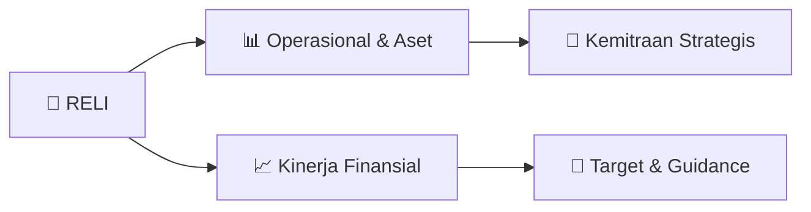

# 📊 Materi Public Expose: [RELI]

🏢 **Emiten**: `RELI` | 📅 **Tanggal Pelaksanaan**: `2026-08-21` | 📑 **Total Slide**: `2 Slide`
⬅️ [[knowledge-base/daily-digests/RELI_20260821|Kembali ke Daily Digest]] | 🎛️ [[Dashboard/RELI|Ke Dashboard Emiten]]

> [!NOTE]
> Ringkasan materi presentasi resmi Public Expose RELI yang disampaikan oleh manajemen kepada investor dan bursa. Seluruh poin strategis, matriks operasional, dan angka kinerja diekstrak langsung dari slide deck resmi.

---

## 📅 1. Jadwal & Metadata Penyelenggaraan

| Parameter | Detail Informasi |
|---|---|
| **Nomor Surat Pengantar** | 524/RSI/VIII/2026 |
| **Perihal Pengumuman** | Rencana Penyelenggaraan Public Expose Tahunan |
| **Waktu Pelaksanaan** | 08 September 2026 16:17 |
| **Lokasi / Media** | Public Expose Live 2026 yang tercantum pada website idx.co.id |
| **Lampiran Resmi** | `1` |

## 📋 2. Agenda Paparan Publik

1. Sekuritas Indonesia
2. No. 524/Rsl/Vlll/2026
3. §uO::yEL  rirfu±
4. Jakarta, 24 Agustus 2026
5. Jakarta, August 24th,  2026
6. Kepada Yth :
7. Direksi  PT Bursa Efek Indonesia
8. Gedung  Bursa Efek Indonesia Tower I
9. Jl. Jend.  Sudirman  Kav.  52-53
10. Jakarta  12190
11. Up   : Bpk. Saidu Solihin, Direktur Penilaian  Perusahaan
12. Plc :  My.   Saidu Solihin,  Director of Col'porate Assessment
13. Perihal    : Penyampaian lnformasi Mengenai Rencana Penyelenggaraan  Public Expose
14. Tahunan PT Reliance Sekuritas Indonesia Tbk ("Perseroan") Tahun 2026
15. Subject :  Submission of Information  Regarding  Plans for Organizing tlle Annual  Public
16. Expose of PT Reliance Sekuritas Indonesia Tbk ("Company") in  2026
17. Dengan hormat,
18. Yours faithfully,
19. Untuk memenuhi ketentuan  Peraturan Bursa No. I-E tentang Kewajiban Penyampaian
20. lnformasi khususnya pada angka Ill,3, mengenai Kewajiban  Public Expose.
21. To comply with the  provisions of Exchange Regulation  No.  I-i regarding the Obligation to
22. Submit lnformatiori,  especially in  number Ill.3.  regarding  Public  Expose Obligations.
23. Bersama surat ini, kami sampaikan bahwa Perseroan berencana menyelenggarakan Public
24. Expose Tahunan pada:
25. Together with this letter, we convey tl.at the Company plans to hold an Annual Public
26. Expose on:
27. Hari/ Tanggal
28. Day/Date
29. Tempat
30. Place
31. Waktu
32. Agenda
33. Agenda
34. : Selasa,  08 September 2026
35. : Tuesday,  September O8th,  2026
36. : Public  Expose  Live  2026 yang tercantum  pada website  idx.co.id
37. : Public Expose Live 2026 as stated on the IDX website  idx.co.id
38. :  16.00 WIB  -Selesai
39. : 04.00 PM -  End
40. :   I. Kinerj.a Perseroan hingga Semester I Tahun 2026
41. '   Company Performance through Semester I of 2026
42. 2. Strategi dan Prospek Perseroan hingga akhir Tahun 2026
43. Company Strategy and Prospects through the End of 2026
44. PT Reliance Sekuritas Indonesia Tbk
45. www.reliancesekuritas.com      I     www.relitrade.com      I     TeL.+62  212952 0558
46. SOHO West Point, Kota  Kedoya,Jalan Macan, KavLing 4-5, Kedoya  Utara, Kebon Jeruk, Jakarta  Barat 11520
47. your  reliable paLrtner

## 🏢 3. Profil & Pilar Portofolio Bisnis

## 🏗️ 4. Kinerja Operasional & Portofolio Aset

*Detail aset operasional terlampir pada dokumen slide resmi.*

## 📈 5. Kinerja Keuangan & Posisi Finansial

## 🧭 6. Inisiatif Strategis, Kolaborasi, & Kemitraan

*Strategi usaha difokuskan pada penguatan fundamental dan ekspansi operasional.*

## 🎯 7. Target Pertumbuhan & Guidance Manajemen

*Target pertumbuhan ditetapkan mengacu pada prospek industri dan kondisi makroekonomi terkini.*

## 🗺️ 8. Peta Jalur Strategis & Eksekusi

## 📑 9. Daftar Indeks Slide Presentasi

| Slide # | Judul / Topik Slide | Ringkasan Konten |
|---|---|---|
| Slide 1 | **Reliance** | Sekuritas Indonesia No. 524/Rsl/Vlll/2026 §uO::yEL  rirfu± |
| Slide 2 | **Yang akan hadir** | dalam  Public Expose tersebut adalah : Those who will |

---

*Dokumen diolah otomatis oleh **Swarm Intelijen Pasar Modal Indonesia** pada 2026-10-12 16:48 WIB.*