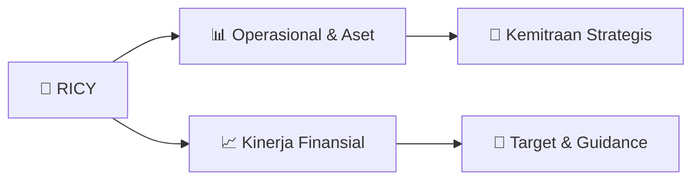

# 📊 Materi Public Expose: [RICY]

🏢 **Emiten**: `RICY` | 📅 **Tanggal Pelaksanaan**: `2026-08-27` | 📑 **Total Slide**: `23 Slide`
⬅️ [[knowledge-base/daily-digests/RICY_20260827|Kembali ke Daily Digest]] | 🎛️ [[Dashboard/RICY|Ke Dashboard Emiten]]

> [!NOTE]
> Ringkasan materi presentasi resmi Public Expose RICY yang disampaikan oleh manajemen kepada investor dan bursa. Seluruh poin strategis, matriks operasional, dan angka kinerja diekstrak langsung dari slide deck resmi.

---

## 📅 1. Jadwal & Metadata Penyelenggaraan

| Parameter | Detail Informasi |
|---|---|
| **Nomor Surat Pengantar** | 0044/RPG/CDR/VIII/2026 |
| **Perihal Pengumuman** | Penyampaian Materi Public Expose Tahunan |
| **Waktu Pelaksanaan** | 2026-08-27 27-08-2026 13:40 |
| **Lokasi / Media** | Aplikasi Zoom / Daring |
| **Lampiran Resmi** | `2` |

## 📋 2. Agenda Paparan Publik

1. Riwayat Singkat Perseroan
2. Peristiwa Penting 2025
3. Ikhtisar Data Keuangan
4. Posisi Pasca Homologasi
5. Outlook 2026
6. Strategi 2026
7. Agenda
8. ©2025 | PT Ricky Putra Globalindo Tbk

## 🏢 3. Profil & Pilar Portofolio Bisnis

## 🏗️ 4. Kinerja Operasional & Portofolio Aset

> Presentasi ini telah disiapkan oleh PT Ricky Putra Globalindo Tbk secara independen dan diedarkan untuk tujuan informasi umum
saja. Hal ini tidak dimaksudkan untuk orang tertentu yang mungkin menerima laporan ini. Informasi dalam laporan ini telah
diperoleh dari sumber-sumber yang kami anggap terpercaya. Tidak ada jaminan (tersurat maupun tersirat) dibuat untuk
keakuratan atau kelengkapan informasi. Semua pendapat dan estimasi di dalamnya merupakan penilaian kami pada tanggal ini
dan dapat berubah tanpa pemberitahuan sebelumnya.
Kami melepaskan setiap tanggung jawab atau kewajiban apapun yang timbul yang dapat dibawa atau diderita oleh setiap orang
sebagai akibat dari seluruh atau sebagian dari isi laporan ini dan PT Ricky Putra Globalindo Tbk dan / atau perusahaan afiliasinya
dan / atau karyawan dan atau agen masing-masing-masing tidak menerima tanggung jawab untuk kesalahan, kelalaian, atau
sebaliknya, dalam laporan ini, dan atas ketidaktepatan atau kelalaian yang dapat saja terjadi.
Catatan penting mengenai proyeksi di masa mendatang : Laporan ini mungkin berisi pernyataan mengenai usaha PT Ricky Putra
Globalindo Tbk dan anak perusahaan di masa mendatang dan didasarkan pada asum

> Laporan Posisi Keuangan Konsolidasian
Ikhtisar Data Keuangan
Aset Aset Lancar
Aset Tidak Lancar
Total Aset :
Liabilitas Jangka Pendek
Liabilitas Jangka Panjang
Ekuitas (Defisiensi Modal)
Modal Kerja Bersih :
Liabilitas & Ekuitas
Total Liabilitas & Ekuitas :
941,764 889,916 1,294,068 185,141 1,343,291 203,761 260,177 1,301,708 269,795 1,492,605 73,221 (86,617) 1,155,504 360,622 30,926 1,831,680 1,479,209 1,547,052 681,587 (198,537) 187,786 1,831,680 1,479,209 1,547,052 2025 2024 2023
** Dalam jutaan Rupiah, kecuali dinyatakan lain.

## 📈 5. Kinerja Keuangan & Posisi Finansial

### 🧮 Rasio Keuangan Utama
```text
Rasio Keuangan
Ikhtisar Data Keuangan
Rasio Keuangan 2025 2024 2023
Current Ratio (X)
3.62
0.87
1.16
Quick Ratio (X)
1.11
0.34 0.49
Cash Ratio (X)
0.07 0.01 0.02
Debt to Equity Ratio (X)
5.79
(18.07) 49.01
Debt Asset Ratio
0.85
1.05
0.98
```

## 🧭 6. Inisiatif Strategis, Kolaborasi, & Kemitraan

*Strategi usaha difokuskan pada penguatan fundamental dan ekspansi operasional.*

## 🎯 7. Target Pertumbuhan & Guidance Manajemen

> Tahun awal pemulihan
Fokus : Stabilitas operasional Perbaikan EBITDA Pengurangan tekanan kerugian
Pemulihan dilakukan secara
bertahap dan terukur.
Outlook2026 Kecepatan pemulihan
akan dipengaruhi oleh
kondisi pasar dan
disiplin keuangan Perseroan.

## 🗺️ 8. Peta Jalur Strategis & Eksekusi



## 📑 9. Daftar Indeks Slide Presentasi

| Slide # | Judul / Topik Slide | Ringkasan Konten |
|---|---|---|
| Slide 1 | **PUBLIC** | EXPOSE www.rpg.co.id PT Ricky Putra Globalindo Tbk |
| Slide 2 | **2 Presentasi ini telah disiapkan oleh PT Ricky Putra Globalindo Tbk secara independen dan diedarkan untuk tujuan informasi umum** | Presentasi ini telah disiapkan oleh PT Ricky Putra Globalindo Tbk secara independen dan diedarkan untuk tujuan informasi umum saja. Hal ini tidak dima |
| Slide 3 | ** Riwayat Singkat Perseroan** | Riwayat Singkat Perseroan  Peristiwa Penting 2025 |
| Slide 4 | **PT Ricky Putra Globalindo Tbk** | Nama Perseroan 1987 Tahun Berdiri |
| Slide 5 | **5 Menjadi perusahaan garmen yang tangguh dan** | Menjadi perusahaan garmen yang tangguh dan terpercaya, mampu |
| Slide 6 | **6 Perseroan** | Perseroan menerima permohonan |
| Slide 7 | **7 Komposisi Penjualan Bersih per Divisi** | Komposisi Penjualan Bersih per Divisi Ikhtisar Data Keuangan 2023 |
| Slide 8 | **8 Laporan Posisi Keuangan Konsolidasian** | Laporan Posisi Keuangan Konsolidasian Ikhtisar Data Keuangan Aset |
| Slide 9 | **9 Keterangan** | Keterangan 2025 2024 |
| Slide 10 | **10 Rasio Keuangan** | Rasio Keuangan Ikhtisar Data Keuangan Rasio Keuangan |
| Slide 11 | **11 Risiko** | Risiko Mitigasi Penurunan |
| Slide 12 | **Tahun awal pemulihan** | Fokus : Stabilitas operasional Perbaikan EBITDA |
| Slide 13 | **13 Normalisasi Operasional** | Normalisasi Operasional Perbaikan Profitabilitas Peningkatan utilitasi kapasitas |
| Slide 14 | **14 Operasional** | Operasional • Peningkatan utilisasi dibanding 2025 |
| Slide 15 | **RICKY GROUP** | APPENDICES RICKY GROUP OUR PRODUCTS |
| Slide 16 | **16 GT Man is Indonesia’s** | GT Man is Indonesia’s No.1 men’s underwear brand. Other products |
| Slide 17 | **17** |  |
| Slide 18 | **18 GT** | GT Ladies offers |
| Slide 19 | **19 1** | 1 9 GT Kid is the Indonesia |
| Slide 20 | **20 We** | We offers stylish |
| Slide 21 | **21 GTEE is a comfortable, casual,** | GTEE is a comfortable, casual, everyday clothing brand that focuses |
| Slide 22 | **22 THANK** | THANK YOU FOR |
| Slide 23 | **RICKY GROUP** | CONTACT US Sawah Lio II No. 29-37, Tambora, Jakarta 11250 |

---

*Dokumen diolah otomatis oleh **Swarm Intelijen Pasar Modal Indonesia** pada 2026-10-12 16:48 WIB.*