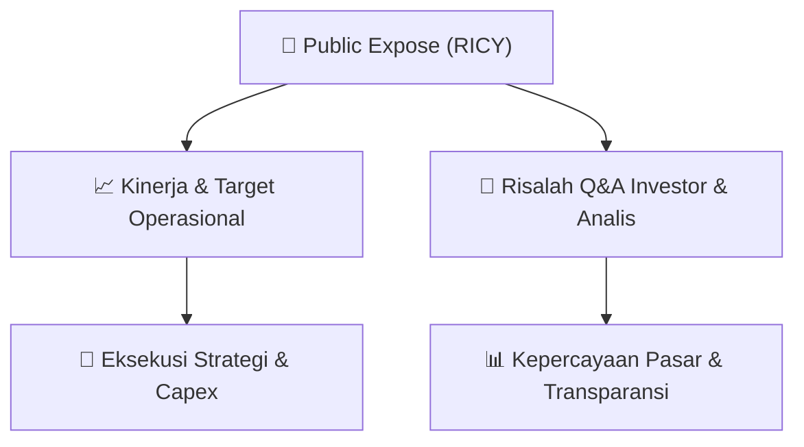

# 📢 Laporan Intelijen Paparan Publik (Public Expose) - [[RICY]]
🏢 **Emiten**: `[[RICY]]` | 📅 **Tanggal Pelaksanaan**: `2026-08-28` | 📑 **Dokumen**: `Public Expose`
⬅️ [[knowledge-base/daily-digests/Daily_Digest_20260828|Kembali ke Daily Digest]] | 🎛️ [[Dashboard|Ke Dashboard Utama]]

---

## 📌 1. Ringkasan Eksekutif & Paparan Direksi
> [!NOTE]
> Dokumen ini merupakan surat penyampaian materi Public Expose Tahunan Ricky Putra Globalindo Tbk (RICY) yang mengoreksi surat sebelumnya. Tidak terdapat rincian kinerja atau materi paparan dalam dokumen ini; hanya pemberitahuan bahwa materi public expose disampaikan sebagai lampiran.

#### 🎯 Guidance Operasional & Target Strategis
- Tidak ada informasi mengenai katalis, target kinerja, ekspansi, atau capex dalam dokumen ini.

## 📊 2. Matriks Indikator Operasional & Parameter Kunci
| Parameter Utama | Nilai / Keterangan Resmi |
| :--- | :--- |
| **Perihal** | `Penyampaian Materi Public Expose Tahunan` |
| **Nomor Surat** | `0045/RPG/CDR/VIII/2026` |
| **Tanggal Surat** | `28-08-2026 15:32` |
| **Lampiran** | `1. Public_Expose_RICY_FY2025.pdf, 2. Materi PE.pdf` |

---

## 💬 3. Risalah Tanya Jawab (Q&A Session)
`Materi presentasi Public Expose / Risalah Q&A terlampir dalam dokumen resmi bursa.`

## 📌 4. Peta Jalur Strategis & Roadmap

---

## 🔗 Knowledge Graph
- [[knowledge-base/daily-digests/Daily_Digest_20260828|📄 Daily Digest 2026-08-28]]
- [[knowledge-base/calendars/Action_Calendar|🗓️ Kalender Terpusat Aksi Korporasi]]
- [[Dashboard|🎛️ Kembali ke Dashboard Utama]]