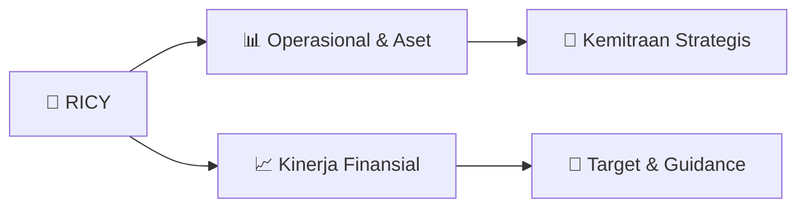

# 📊 Materi Public Expose: [RICY]

🏢 **Emiten**: `RICY` | 📅 **Tanggal Pelaksanaan**: `2026-08-28` | 📑 **Total Slide**: `19 Slide`
⬅️ [[knowledge-base/daily-digests/RICY_20260828|Kembali ke Daily Digest]] | 🎛️ [[Dashboard/RICY|Ke Dashboard Emiten]]

> [!NOTE]
> Ringkasan materi presentasi resmi Public Expose RICY yang disampaikan oleh manajemen kepada investor dan bursa. Seluruh poin strategis, matriks operasional, dan angka kinerja diekstrak langsung dari slide deck resmi.

---

## 📅 1. Jadwal & Metadata Penyelenggaraan

| Parameter | Detail Informasi |
|---|---|
| **Nomor Surat Pengantar** | 0045/RPG/CDR/VIII/2026 |
| **Perihal Pengumuman** | Penyampaian Materi Public Expose Tahunan |
| **Waktu Pelaksanaan** | 2026-08-28 28-08-2026 15:32 |
| **Lokasi / Media** | Aplikasi Zoom / Daring |
| **Lampiran Resmi** | `2` |

## 📋 2. Agenda Paparan Publik

1. Kinerja dan Prospek RICY
2. Perkembangan Terkini dan prospek RICY
3. Riwayat Singkat Perseroan
4. Profil singkat, visi-misi, dan posisi pasar
5. Peristiwa Penting 2025 & Restrukturisasi
6. Proses PKPU, homologasi, dan dampaknya ke posisi keuangan
7. Ikhtisar Data Keuangan 2025
8. Kinerja dengan konteks non-recurring items
9. Transformasi Posisi Keuangan Pasca-Homologasi
10. Highlight perubahan current ratio, modal kerja, dan ekuitas
11. Posisi Risiko & Mitigasi
12. Risiko utama dan komitmen terukur manajemen
13. Outlook & Strategi 2026
14. Target terukur dan prioritas eksekusi

## 🏢 3. Profil & Pilar Portofolio Bisnis

### 🏛️ Pilar Usaha & Aset Utama
- Strategi 2026 — Empat Pilar dengan Metrik Target
Operasional
•  Peningkatan utilisasi vs 2025
•  Pengurangan idle capacity
•  Target: utilisasi naik bertahap setiap kuartal
Profitabilitas
•  Optimalisasi margin produk
•  Pengendalian biaya produksi
•  Target: gross margin membaik dari 13,3%
Pasar
•  Reaktivasi pelanggan existing
•  Ekspansi selektif
•  Target: stabilisasi pendapatan H1, pertumbuhan H2
Keuangan
•  Pelaksanaan kewajiban homologasi
•  Pengelolaan kas konservatif
•  Target: zero default, cash monitoring ketat

## 🏗️ 4. Kinerja Operasional & Portofolio Aset

> Pasal Sanggahan
Presentasi ini telah disiapkan oleh PT Ricky Putra Globalindo Tbk secara independen dan diedarkan untuk tujuan informasi umum saja. Informasi
dalam laporan ini telah diperoleh dari sumber-sumber yang kami anggap terpercaya. Tidak ada jaminan (tersurat maupun tersirat) dibuat untuk
keakuratan atau kelengkapan informasi. Semua pendapat dan estimasi di dalamnya merupakan penilaian kami pada tanggal ini dan dapat berubah
tanpa pemberitahuan sebelumnya.
Kami melepaskan setiap tanggung jawab atau kewajiban apapun yang timbul yang dapat dibawa atau diderita oleh setiap orang sebagai akibat dari
seluruh atau sebagian dari isi laporan ini.
Catatan penting mengenai proyeksi di masa mendatang: Laporan ini mungkin berisi pernyataan mengenai usaha PT Ricky Putra Globalindo Tbk dan
anak perusahaan di masa mendatang dan didasarkan pada asumsi manajemen tentang proyeksi masa mendatang. Proyeksi masa mendatang
melibatkan risiko dan ketidakpastian tertentu. Kami tidak berkewajiban untuk mempublikasikan setiap perubahan atau revisi dari setiap pernyataan
proyeksi di masa mendatang.

> Transformasi Posisi Keuangan Pasca-Homologasi — Highlight Utama
Current Ratio 0,87x → 3,62x
↑ 4x lipat
Modal Kerja Defisit
Rp 199 M
→ Surplus
Rp 682 M
Berbalik positif Ekuitas Defisit
Rp 86,6 M
→ Positif
Rp 269,8 M
Berbalik positif
Penjelasan Lonjakan Aset Tidak Lancar (Rp 185 M → Rp 890 M+)
Peningkatan aset tidak lancar terutama berasal dari revaluasi aset tetap (surplus revaluasi signifikan yang juga menjadi sumber utama ekuitas
positif) serta reklasifikasi pinjaman terkait skema restrukturisasi. Ekuitas positif Rp 269,8 miliar per 31 Des 2025 sebagian besar didukung oleh
surplus revaluasi aset tetap (Rp 727 miliar). Investor perlu memahami bahwa kualitas ekuitas ini bergantung pada realisasi nilai aset di masa depan.

## 📈 5. Kinerja Keuangan & Posisi Finansial

### 🧮 Rasio Keuangan Utama
```text
Kinerja dan Prospek RICY
Risiko PKPU Telah Berakhir
Homologasi 15 Des 2025 memberikan
kepastian hukum. Skema restrukturisasi
mengalihkan utang jangka pendek menjadi
jangka panjang yang terjadwal. Risiko
kebangkrutan akut sudah dilalui.
Neraca Bertransformasi Signifikan
Current Ratio naik dari 0,87x → 3,62x.
Modal kerja berbalik dari defisit Rp 199 M
menjadi surplus Rp 682 M. Ekuitas dari
defisit Rp 86,6 M menjadi positif Rp 269,8
M.
Fondasi untuk Pemulihan
Terukur
Merek kuat (GT Man No.1 underwear pria),
fasilitas terintegrasi, dan fokus pasar
domestik. Tahun 2026 adalah tahun awal
pemulihan dengan target yang dapat
diverifikasi.
```

```text
Dampak Restrukturisasi terhadap Posisi Keuangan
Kesepakatan restrukturisasi mengalihkan sebagian besar utang jangka pendek menjadi utang jangka panjang yang terjadwal, memperbaiki
struktur likuiditas secara material.
SEBELUM HOMOLOGASI
Per 30 Sep / sebelum Des 2025
•  Utang jangka pendek dominan (tekanan likuiditas tinggi)
•  Current Ratio: 0,87x (di bawah 1x)
•  Modal kerja: defisit ~Rp 199 miliar
•  Ekuitas: defisit Rp 86,6 miliar
•  Risiko PKPU masih terbuka
SETELAH HOMOLOGASI
Per 31 Desember 2025
•  Utang digeser ke jangka panjang & terjadwal
•  Current Ratio: 3,62x (naik 4x lipat)
•  Modal kerja: surplus ~Rp 682 miliar
•  Ekuitas: positif Rp 269,8 miliar
•  Risiko PKPU selesai (kepastian hukum)
```

```text
Rasio Keuangan — Konteks yang Perlu Dipahami
Rasio 2025 2024 Catatan Penting
Current Ratio (x)
3,62 0,87
Perbaikan material pasca-homologasi
Quick Ratio (x)
1,11 0,34
Likuiditas jangka pendek membaik
Cash Ratio (x)
0,07 0,01
Masih rendah — fokus pengelolaan kas 2026
Debt to Equity (x)
5,79 (18,07)*
*Negatif 2024 karena ekuitas defisit, bukan kondisi baik
Debt / Asset
0,85 1,05 Sedikit membaik
Catatan Kunci untuk Investor
• Debt to Equity negatif di 2024 adalah dampak akuntansi dari ekuitas defisit, bukan indikator leverage yang "baik". Setelah ekuitas kembali positif,
DER 5,79x mencerminkan leverage yang masih tinggi namun sudah memiliki struktur yang lebih terjadwal.
• Cash Ratio 0,07x masih rendah. Manajemen memprioritaskan pengelolaan arus kas konservatif dan pelaksanaan kewajiban homologasi secara
disiplin sebagai fokus utama 2026.
```

## 🧭 6. Inisiatif Strategis, Kolaborasi, & Kemitraan

*Strategi usaha difokuskan pada penguatan fundamental dan ekspansi operasional.*

## 🎯 7. Target Pertumbuhan & Guidance Manajemen

> Outlook 2026: Tahun Awal Pemulihan dengan Target Terukur
Pendapatan
Stabilisasi di H1
Pertumbuhan selektif di H2
Fokus reaktivasi pelanggan existing
EBITDA Perbaikan signifikan vs 2025
Menuju zona yang lebih sehat secara
bertahap Utilisasi
Peningkatan vs 2025
Pengurangan idle capacity
Kepatuhan
100% sesuai jadwal
homologasi
Prioritas utama arus kas
Fokus Manajemen 2026
1. Stabilitas operasional & peningkatan utilisasi kapasitas
2. Perbaikan EBITDA dan pengurangan tekanan kerugian
3. Pelaksanaan kewajiban homologasi secara disiplin
4. Pengelolaan arus kas konservatif dan monitoring ketat
5. Reaktivasi pelanggan existing + ekspansi selektif di pasar domestik

## 🗺️ 8. Peta Jalur Strategis & Eksekusi



## 📑 9. Daftar Indeks Slide Presentasi

| Slide # | Judul / Topik Slide | Ringkasan Konten |
|---|---|---|
| Slide 1 | **PT RICKY PUTRA GLOBALINDO Tbk** | PUBLIC EXPOSE FY 2025 Audited  |  Kode Saham: RICY Restrukturisasi utang telah selesai melalui homologasi PKPU (15 Desember 2025). |
| Slide 2 | **Pasal Sanggahan** | Presentasi ini telah disiapkan oleh PT Ricky Putra Globalindo Tbk secara independen dan diedarkan untuk tujuan informasi umum saja. Informasi dalam la |
| Slide 3 | **Agenda** | 01 Kinerja dan Prospek RICY Perkembangan Terkini dan prospek RICY |
| Slide 4 | **Kinerja dan Prospek RICY** | Risiko PKPU Telah Berakhir Homologasi 15 Des 2025 memberikan kepastian hukum. Skema restrukturisasi |
| Slide 5 | **Riwayat Singkat Perseroan** | PT Ricky Putra Globalindo Tbk adalah produsen pakaian dalam pria terkemuka di Indonesia dengan merek terkenal seperti GT Man, Ricky, dan Ricsony. Peru |
| Slide 6 | **Peristiwa Penting 2025: Perjalanan Restrukturisasi** | 5 Maret 2025 Permohonan PKPU Kreditur mengajukan permohonan PKPU. |
| Slide 7 | **Dampak Restrukturisasi terhadap Posisi Keuangan** | Kesepakatan restrukturisasi mengalihkan sebagian besar utang jangka pendek menjadi utang jangka panjang yang terjadwal, memperbaiki struktur likuidita |
| Slide 8 | **Ikhtisar Data Keuangan 2025** | PENJELASAN PENTING: Penurunan penjualan 2025 (~36%) dan rugi yang melebar bersifat non-recurring, terutama didorong oleh proses PKPU sepanjang tahun,  |
| Slide 9 | **Dekomposisi Kerugian 2025: Operasional vs Non-Recurring** | Agar investor tidak salah membaca, kerugian besar 2025 perlu dipisahkan antara komponen operasional murni dan biaya satu kali terkait restrukturisasi. |
| Slide 10 | **Komposisi Penjualan: Kekuatan Diversifikasi Divisi** | Mengapa Komposisi Ini Merupakan Kekuatan? Underwear 48% Inti bisnis dengan merek kuat (GT Man No.1). Margin relatif lebih baik dan |
| Slide 11 | **Transformasi Posisi Keuangan Pasca-Homologasi — Highlight Utama** | Current Ratio 0,87x → |
| Slide 12 | **Rasio Keuangan — Konteks yang Perlu Dipahami** | Rasio 2025 2024 |
| Slide 13 | **Posisi Pasca-Homologasi: Risiko & Mitigasi** | Pemulihan pendapatan lambat Fokus reaktivasi pelanggan existing, peningkatan utilisasi kapasitas secara bertahap, dan ekspansi selektif. Target utilis |
| Slide 14 | **Komitmen Terukur yang Dapat Dipantau Investor** | Manajemen menetapkan indikator yang dapat diverifikasi setiap kuartal agar investor memiliki benchmark yang jelas. Utilisasi Kapasitas Peningkatan ber |
| Slide 15 | **Outlook 2026: Tahun Awal Pemulihan dengan Target Terukur** | Pendapatan Stabilisasi di H1 Pertumbuhan selektif di H2 |
| Slide 16 | **Strategi 2026 — Empat Pilar dengan Metrik Target** | Operasional •  Peningkatan utilisasi vs 2025 •  Pengurangan idle capacity |
| Slide 17 | **Prioritas Eksekusi 2026** | Operasional Peningkatan utilisasi dibanding 2025 |
| Slide 18 | **Kesimpulan** | • Restrukturisasi telah selesai. Risiko PKPU tidak akan berulang. • |
| Slide 19 | **Hubungi Kami** | PT Ricky Putra Globalindo Tbk Jl. Sawah Lio II No. 29–37, Jembatan Lima, Tambora Jakarta Barat 11250, Indonesia |

---

*Dokumen diolah otomatis oleh **Swarm Intelijen Pasar Modal Indonesia** pada 2026-10-12 16:48 WIB.*