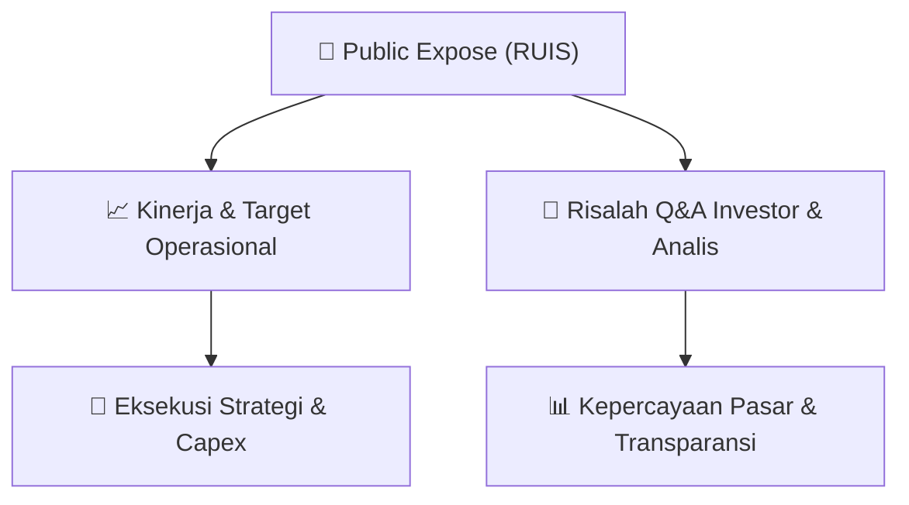

# 📢 Laporan Intelijen Paparan Publik (Public Expose) - [[RUIS]]
🏢 **Emiten**: `[[RUIS]]` | 📅 **Tanggal Pelaksanaan**: `2026-08-28` | 📑 **Dokumen**: `Public Expose`
⬅️ [[knowledge-base/daily-digests/Daily_Digest_20260828|Kembali ke Daily Digest]] | 🎛️ [[Dashboard|Ke Dashboard Utama]]

---

## 📌 1. Ringkasan Eksekutif & Paparan Direksi
> [!NOTE]
> Radiant Utama Interinsco Tbk (RUIS) menyampaikan rencana penyelenggaraan Public Expose Tahunan untuk tahun buku yang berakhir pada 2026. Acara akan diselenggarakan secara live melalui website idx.co.id pada 11 September 2026 pukul 10:00. Agenda public expose meliputi Laporan Kinerja Kuartal II Tahun 2026, Prospek dan Strategi Usaha, serta lain-lain. Pengumuman disampaikan oleh Head of Corporate Secretary Mona Nazaruddin pada 28 Agustus 2026 pukul 23:51.

#### 🎯 Guidance Operasional & Target Strategis
- Dokumen ini hanya merupakan pemberitahuan rencana penyelenggaraan Public Expose dan belum memuat rincian target kinerja, ekspansi, belanja modal (capex), atau guidance operasional. Informasi tersebut diharapkan dipaparkan pada saat pelaksanaan Public Expose tanggal 11 September 2026.

## 📊 2. Matriks Indikator Operasional & Parameter Kunci
| Parameter Utama | Nilai / Keterangan Resmi |
| :--- | :--- |
| **Kode Emiten** | `RUIS` |
| **Nama Perusahaan** | `Radiant Utama Interinsco Tbk` |
| **Jenis Acara** | `Public Expose Tahunan / Public Expose Live 2026` |
| **Tanggal Pelaksanaan** | `11 September 2026` |
| **Waktu Pelaksanaan** | `10:00` |
| **Tempat Pelaksanaan** | `Public Expose Live 2026, tercantum pada website idx.co.id` |
| **Agenda** | `1. Laporan Kinerja Kuartal II Tahun 2026; 2. Prospek dan Strategi Usaha; 3. Lain-lain` |
| **Tanggal dan Waktu Pengumuman** | `28-08-2026 23:51` |
| **Nama Pengirim** | `Mona Nazaruddin` |
| **Jabatan Pengirim** | `Head of Corporate Secretary` |
| **Alamat Perusahaan** | `Kapten Tendean No. 24` |
| **Telepon** | `7191020` |
| **Fax** | `7191002` |
| **Website** | `www.radiant.co.id` |

---

## 💬 3. Risalah Tanya Jawab (Q&A Session)
`Materi presentasi Public Expose / Risalah Q&A terlampir dalam dokumen resmi bursa.`

## 📌 4. Peta Jalur Strategis & Roadmap

---

## 🔗 Knowledge Graph
- [[knowledge-base/daily-digests/Daily_Digest_20260828|📄 Daily Digest 2026-08-28]]
- [[knowledge-base/calendars/Action_Calendar|🗓️ Kalender Terpusat Aksi Korporasi]]
- [[Dashboard|🎛️ Kembali ke Dashboard Utama]]