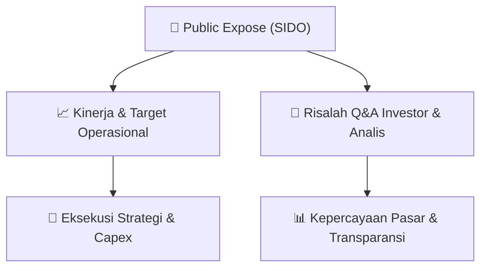

# 📢 Laporan Intelijen Paparan Publik (Public Expose) - [[SIDO]]
🏢 **Emiten**: `[[SIDO]]` | 📅 **Tanggal Pelaksanaan**: `2026-09-14` | 📑 **Dokumen**: `Public Expose`
⬅️ [[knowledge-base/daily-digests/Daily_Digest_20260914|Kembali ke Daily Digest]] | 🎛️ [[Dashboard|Ke Dashboard Utama]]

---

## 📌 1. Ringkasan Eksekutif & Paparan Direksi
> [!NOTE]
> PT Industri Jamu Dan Farmasi Sido Muncul Tbk (SIDO) menyelenggarakan Public Expose Tahunan pada 04 September 2026, dengan dihadiri 186 peserta (tidak termasuk manajemen dan karyawan). Paparan ini merupakan bagian dari kewajiban pelaporan kepada OJK dan Bursa Efek Indonesia. Dokumen yang disampaikan mencakup surat pengantar, notulen paparan, dan daftar hadir. Manajemen menegaskan komitmen terhadap transparansi dan kinerja berkelanjutan di tengah dinamika industri jamu dan farmasi.

#### 🎯 Guidance Operasional & Target Strategis
- Tidak ada rincian spesifik mengenai target kinerja, capex, atau ekspansi yang disebutkan dalam dokumen. Namun, kehadiran 186 peserta menunjukkan minat investor yang tinggi. Manajemen diharapkan memberikan panduan mengenai strategi pertumbuhan, inovasi produk, dan efisiensi operasional untuk menjaga profitabilitas di pasar yang kompetitif.

## 📊 2. Matriks Indikator Operasional & Parameter Kunci
| Parameter Utama | Nilai / Keterangan Resmi |
| :--- | :--- |
| **Tanggal Public Expose** | `04 September 2026` |
| **Jumlah Peserta** | `186 orang` |
| **Nomor Surat** | `029/SIDO/SPE.OJK-IDX/IX/2026` |
| **Corporate Secretary** | `Budiyanto` |

---

## 💬 3. Risalah Tanya Jawab (Q&A Session)
`Materi presentasi Public Expose / Risalah Q&A terlampir dalam dokumen resmi bursa.`

## 📌 4. Peta Jalur Strategis & Roadmap

---

## 🔗 Knowledge Graph
- [[knowledge-base/daily-digests/Daily_Digest_20260914|📄 Daily Digest 2026-09-14]]
- [[knowledge-base/calendars/Action_Calendar|🗓️ Kalender Terpusat Aksi Korporasi]]
- [[Dashboard|🎛️ Kembali ke Dashboard Utama]]