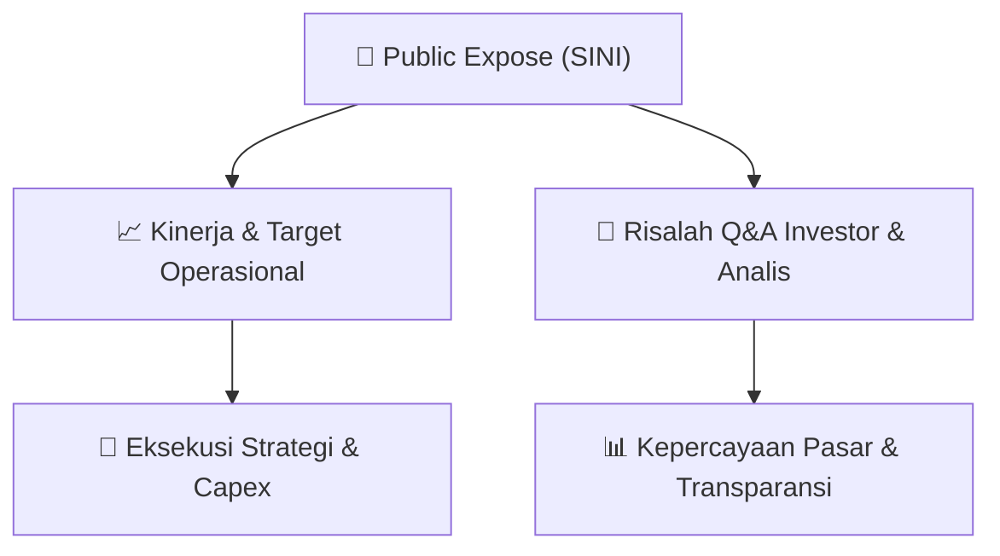

# 📢 Laporan Intelijen Paparan Publik (Public Expose) - [[SINI]]
🏢 **Emiten**: `[[SINI]]` | 📅 **Tanggal Pelaksanaan**: `2026-09-09` | 📑 **Dokumen**: `Public Expose`
⬅️ [[knowledge-base/daily-digests/Daily_Digest_20260909|Kembali ke Daily Digest]] | 🎛️ [[Dashboard|Ke Dashboard Utama]]

---

## 📌 1. Ringkasan Eksekutif & Paparan Direksi
> [!NOTE]
> PT Singaraja Putra Tbk. (SINI) akan menyelenggarakan Public Expose Insidentil pada 11 September 2026 pukul 13:30 WIB secara virtual melalui Zoom Meeting. Public Expose ini bersifat sukarela (voluntary) atas permintaan Otoritas Jasa Keuangan (OJK), bukan atas permintaan Bursa Efek Indonesia. Agenda utama mencakup pemaparan kinerja keuangan dan kondisi bisnis terkini, perkembangan negosiasi rencana pengambilalihan oleh PT Petrindo Jaya Kreasi Tbk (CUAN), serta informasi/fakta material lainnya. Acara ini akan dipimpin oleh Direktur Utama, Amir Antolis.

#### 🎯 Guidance Operasional & Target Strategis
- Katalis utama yang akan dibahas adalah perkembangan negosiasi rencana pengambilalihan (akuisisi) SINI oleh PT Petrindo Jaya Kreasi Tbk (CUAN), yang merupakan emiten batu bara besar di BEI. Investor akan mendapatkan update terbaru mengenai status negosiasi, yang berpotensi menjadi katalis positif jika terdapat kemajuan signifikan. Selain itu, manajemen akan memberikan paparan mengenai kinerja keuangan dan kondisi bisnis terkini Perseroan, yang menjadi dasar penilaian fundamental sebelum aksi korporasi. Belum ada guidance kuantitatif spesifik (target pendapatan, laba, capex) yang diungkapkan dalam pengumuman ini; detail lebih lanjut akan dipaparkan saat acara berlangsung.

## 📊 2. Matriks Indikator Operasional & Parameter Kunci
| Parameter Utama | Nilai / Keterangan Resmi |
| :--- | :--- |
| **Jenis Aksi Korporasi** | `Rencana Pengambilalihan (Akuisisi) oleh PT Petrindo Jaya Kreasi Tbk (CUAN)` |
| **Status Negosiasi Akuisisi** | `Masih dalam tahap negosiasi (belum final), akan di-update pada Public Expose` |
| **Dasar Penyelenggaraan Public Expose** | `Sukarela atas permintaan Otoritas Jasa Keuangan (OJK)` |
| **Tanggal & Waktu Pelaksanaan** | `11 September 2026, 13:30 WIB` |
| **Media Pelaksanaan** | `Zoom Meeting (Meeting ID: 827 864 7840)` |
| **Narasumber / Penanggung Jawab** | `Amir Antolis (Direktur Utama)` |

---

## 💬 3. Risalah Tanya Jawab (Q&A Session)
### ❓ Pertanyaan 1 (Analis / Investor (pertanyaan umum yang diperkirakan akan muncul))
**Pertanyaan**: Bagaimana perkembangan terakhir negosiasi pengambilalihan SINI oleh CUAN? Apakah sudah ada kesepakatan harga (valuasi) dan struktur transaksi yang final?

**Jawaban Manajemen**: Manajemen akan memberikan update terkini mengenai status negosiasi dengan PT Petrindo Jaya Kreasi Tbk, termasuk perkembangan pembahasan valuasi dan struktur transaksi. Detail lengkap akan dipaparkan pada saat Public Expose berlangsung.

> [!TIP]
> **Implikasi Bagi Investor**: Kejelasan status negosiasi akan menjadi sentimen utama bagi pergerakan harga saham SINI. Jika negosiasi menunjukkan kemajuan positif, harga saham berpotensi menguat; sebaliknya, jika terjadi kebuntuan, dapat menekan harga.

### ❓ Pertanyaan 2 (Analis / Investor (pertanyaan umum yang diperkirakan akan muncul))
**Pertanyaan**: Bagaimana kinerja keuangan dan kondisi bisnis terkini Perseroan di tengah proses akuisisi ini? Apakah ada perubahan signifikan pada operasional?

**Jawaban Manajemen**: Manajemen akan memaparkan kinerja keuangan terkini, kondisi bisnis, serta prospek operasional Perseroan. Penjelasan akan mencakup pendapatan, laba, dan perkembangan bisnis inti.

> [!TIP]
> **Implikasi Bagi Investor**: Pemaparan kinerja keuangan akan memberikan gambaran fundamental terkini SINI. Investor dapat menilai apakah valuasi yang dinegosiasikan dengan CUAN sudah wajar dibandingkan kinerja aktual Perseroan.

### ❓ Pertanyaan 3 (Analis / Investor (pertanyaan umum yang diperkirakan akan muncul))
**Pertanyaan**: Apakah ada informasi atau fakta material lain selain rencana akuisisi yang perlu diketahui publik? Bagaimana dampaknya terhadap kelangsungan usaha?

**Jawaban Manajemen**: Manajemen akan mengungkapkan seluruh informasi dan fakta material yang relevan sesuai ketentuan OJK, termasuk hal-hal yang dapat mempengaruhi kelangsungan usaha dan nilai perusahaan.

> [!TIP]
> **Implikasi Bagi Investor**: Pengungkapan fakta material tambahan dapat mempengaruhi keputusan investasi. Investor perlu mencermati apakah ada risiko atau peluang baru yang belum diperhitungkan sebelumnya.

## 📌 4. Peta Jalur Strategis & Roadmap

---

## 🔗 Knowledge Graph
- [[knowledge-base/daily-digests/Daily_Digest_20260909|📄 Daily Digest 2026-09-09]]
- [[knowledge-base/calendars/Action_Calendar|🗓️ Kalender Terpusat Aksi Korporasi]]
- [[Dashboard|🎛️ Kembali ke Dashboard Utama]]