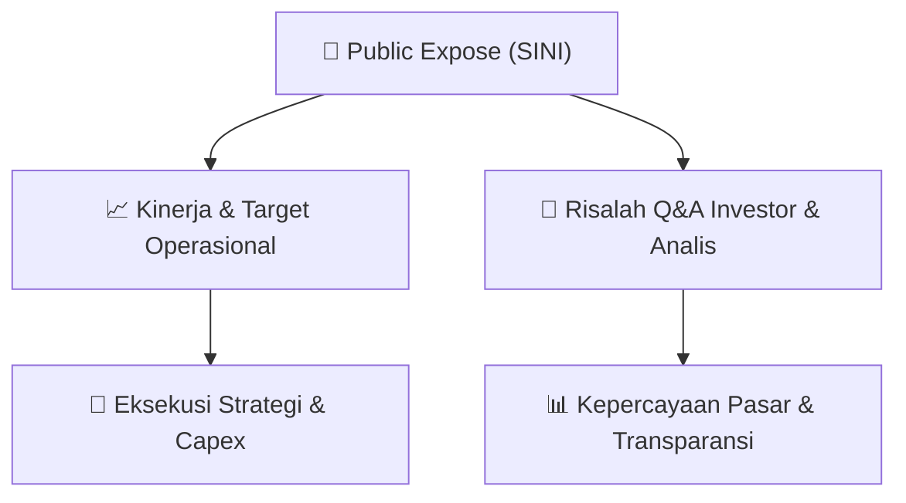

# 📢 Laporan Intelijen Paparan Publik (Public Expose) - [[SINI]]
🏢 **Emiten**: `[[SINI]]` | 📅 **Tanggal Pelaksanaan**: `2026-09-11` | 📑 **Dokumen**: `Public Expose`
⬅️ [[knowledge-base/daily-digests/Daily_Digest_20260911|Kembali ke Daily Digest]] | 🎛️ [[Dashboard|Ke Dashboard Utama]]

---

## 📌 1. Ringkasan Eksekutif & Paparan Direksi
> [!NOTE]
> PT Singaraja Putra Tbk. (SINI) menyelenggarakan Public Expose Insidentil pada 10 September 2026, dengan laporan hasil disampaikan pada 11 September 2026. Acara ini bersifat sukarela (voluntary) dan dihadiri oleh 81 peserta (tidak termasuk manajemen dan karyawan). Paparan ini merupakan tindak lanjut dari surat penyampaian materi Public Expose No. 03/SP/IX/2026. Dokumen yang tersedia hanya memuat informasi administratif pelaksanaan acara, tanpa menyertakan rincian materi presentasi, paparan kinerja, atau sesi tanya jawab secara eksplisit dalam teks yang diberikan.

#### 🎯 Guidance Operasional & Target Strategis
- Tidak terdapat informasi mengenai target kinerja, ekspansi, capex, atau panduan operasional dalam dokumen yang disampaikan. Dokumen hanya mengonfirmasi pelaksanaan Public Expose Insidentil dan jumlah peserta yang hadir. Investor perlu merujuk pada lampiran dokumen 'Lap Hasil Pubex Insidentil.PDF' yang tidak tersedia dalam teks ini untuk mendapatkan detail materi paparan dan guidance manajemen.

## 📊 2. Matriks Indikator Operasional & Parameter Kunci
| Parameter Utama | Nilai / Keterangan Resmi |
| :--- | :--- |
| **Jenis Kegiatan** | `Public Expose Insidentil (Incidental Public Expose)` |
| **Dasar Pelaksanaan** | `Sukarela (Voluntary)` |
| **Tanggal Pelaksanaan** | `10 September 2026` |
| **Tanggal Pelaporan** | `11 September 2026` |
| **Jumlah Peserta Hadir** | `81 orang (tidak termasuk manajemen dan karyawan)` |
| **Nomor Surat Rujukan** | `03/SP/IX/2026` |
| **Nomor Surat Laporan** | `04/SP/IX/2026` |
| **Nama Direktur Utama** | `Amir Antolis` |

---

## 💬 3. Risalah Tanya Jawab (Q&A Session)
### ❓ Pertanyaan 1 (Tidak tersedia dalam dokumen)
**Pertanyaan**: Tidak ada sesi tanya jawab yang tercantum dalam teks dokumen yang diberikan.

**Jawaban Manajemen**: Tidak ada jawaban manajemen yang tercantum dalam teks dokumen yang diberikan.

> [!TIP]
> **Implikasi Bagi Investor**: Tidak ada implikasi investasi yang dapat dianalisis dari sesi Q&A karena tidak tersedia. Investor disarankan mencari risalah lengkap pada lampiran dokumen resmi atau kanal keterbukaan informasi BEI.

## 📌 4. Peta Jalur Strategis & Roadmap

---

## 🔗 Knowledge Graph
- [[knowledge-base/daily-digests/Daily_Digest_20260911|📄 Daily Digest 2026-09-11]]
- [[knowledge-base/calendars/Action_Calendar|🗓️ Kalender Terpusat Aksi Korporasi]]
- [[Dashboard|🎛️ Kembali ke Dashboard Utama]]