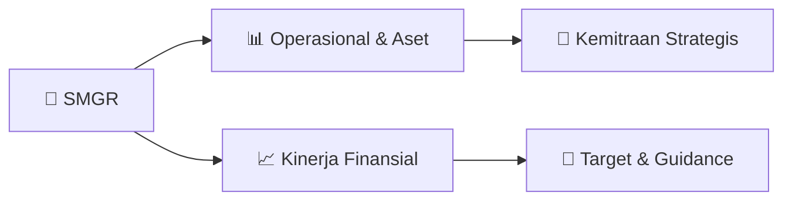

# 📊 Materi Public Expose: [SMGR]

🏢 **Emiten**: `SMGR` | 📅 **Tanggal Pelaksanaan**: `2026-08-21` | 📑 **Total Slide**: `1 Slide`
⬅️ [[knowledge-base/daily-digests/SMGR_20260821|Kembali ke Daily Digest]] | 🎛️ [[Dashboard/SMGR|Ke Dashboard Emiten]]

> [!NOTE]
> Ringkasan materi presentasi resmi Public Expose SMGR yang disampaikan oleh manajemen kepada investor dan bursa. Seluruh poin strategis, matriks operasional, dan angka kinerja diekstrak langsung dari slide deck resmi.

---

## 📅 1. Jadwal & Metadata Penyelenggaraan

| Parameter | Detail Informasi |
|---|---|
| **Nomor Surat Pengantar** | 009420/KS.08/SUP/50056838/2000/08.2026 |
| **Perihal Pengumuman** | Rencana Penyelenggaraan Public Expose Tahunan |
| **Waktu Pelaksanaan** | 08 September 2026 14:00 |
| **Lokasi / Media** | Public Expose Live 2026 yang tercantum pada website |
| **Lampiran Resmi** | `1` |

## 📋 2. Agenda Paparan Publik

1. : 009420/KS.08/SUP/50056838/2000/08.2026
2. Perihal
3. : Penyampaian Rencana Penyelenggaraan Public Expose Live 2026
4. Kepada Yth.
5. PT Bursa Efek Indonesia
6. Gedung Bursa Efek Indonesia
7. Jl. Jendral Sudirman Kav. 52-53
8. Jakarta, 12190
9. Dengan hormat,
10. Dalam rangka memenuhi Peraturan PT Bursa Efek Indonesia No. I-E tentang Kewajiban
11. Penyampaian Informasi, bersama ini kami sampaikan rencana Public Expose Tahunan PT Semen
12. Indonesia (Persero) Tbk sebagai berikut:
13. Hari, Tanggal
14. :  Selasa, 8 September 2026
15. Waktu
16. :   14.00 – 15.00 WIB
17. Tempat
18. :   Public Expose Live 2026 yang tercantum pada website www.idx.co.id
19. Pembicara
20. :   1. Indriefounny Indra – Direktur Utama
21. 2. Bapak Andriano Hosny Panangian – Wakil Direktur Utama
22. 3. Bapak Sigit Prastowo – Direktur Keuangan dan Manajemen Risiko
23. 4. Bapak Dicky Saelan – Direktur Sales dan Marketing
24. Agenda
25. :   1. Presentasi/Pemaparan Kinerja Perseroan
26. 2. Press Conference
27. Demikian disampaikan, atas perhatian dan kerja samanya diucapkan terima kasih.
28. Jakarta, 20 Agustus 2026
29. PT Semen Indonesia (Persero) Tbk
30. Vita Mahreyni
31. Sekretaris Perusahaan
32. Tembusan Yth.:
33. - Dewan Komisaris SIG;
34. - Direksi SIG.

## 🏢 3. Profil & Pilar Portofolio Bisnis

## 🏗️ 4. Kinerja Operasional & Portofolio Aset

*Detail aset operasional terlampir pada dokumen slide resmi.*

## 📈 5. Kinerja Keuangan & Posisi Finansial

## 🧭 6. Inisiatif Strategis, Kolaborasi, & Kemitraan

*Strategi usaha difokuskan pada penguatan fundamental dan ekspansi operasional.*

## 🎯 7. Target Pertumbuhan & Guidance Manajemen

*Target pertumbuhan ditetapkan mengacu pada prospek industri dan kondisi makroekonomi terkini.*

## 🗺️ 8. Peta Jalur Strategis & Eksekusi

## 📑 9. Daftar Indeks Slide Presentasi

| Slide # | Judul / Topik Slide | Ringkasan Konten |
|---|---|---|
| Slide 1 | **Nomor** | : 009420/KS.08/SUP/50056838/2000/08.2026 Perihal : Penyampaian Rencana Penyelenggaraan Public Expose Live 2026 |

---

*Dokumen diolah otomatis oleh **Swarm Intelijen Pasar Modal Indonesia** pada 2026-10-12 16:48 WIB.*