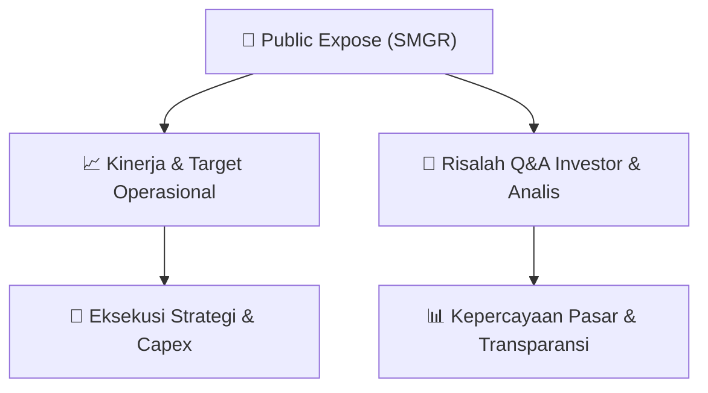

# 📢 Laporan Intelijen Paparan Publik (Public Expose) - [[SMGR]]
🏢 **Emiten**: `[[SMGR]]` | 📅 **Tanggal Pelaksanaan**: `2026-09-11` | 📑 **Dokumen**: `Public Expose`
⬅️ [[knowledge-base/daily-digests/Daily_Digest_20260911|Kembali ke Daily Digest]] | 🎛️ [[Dashboard|Ke Dashboard Utama]]

---

## 📌 1. Ringkasan Eksekutif & Paparan Direksi
> [!NOTE]
> PT Semen Indonesia (Persero) Tbk (SMGR) menyelenggarakan Public Expose Tahunan pada 21 Agustus 2026, dengan laporan hasil disampaikan melalui surat resmi bernomor 009711/KS.08/SUP/50056838/2000/09.2026 tertanggal 11 September 2026. Acara ini dihadiri oleh 189 peserta (tidak termasuk manajemen dan karyawan). Paparan ini merupakan bagian dari kepatuhan regulasi BEI dan menjadi wadah bagi manajemen untuk menyampaikan kinerja, strategi, serta menjawab pertanyaan investor dan analis. Dokumen yang tersedia saat ini hanya berisi pengantar laporan hasil Public Expose, tanpa detail materi paparan atau risalah tanya jawab yang disertakan dalam lampiran.

#### 🎯 Guidance Operasional & Target Strategis
- Informasi rinci mengenai target kinerja, ekspansi, dan capex tidak tersedia dalam dokumen pengantar ini. Namun, penyelenggaraan Public Expose Tahunan ini sendiri merupakan katalis informasi bagi investor untuk mendapatkan pemutakhiran strategi dan prospek perusahaan. Investor disarankan untuk merujuk pada lampiran laporan hasil Public Expose yang dirujuk dalam surat ini untuk mendapatkan detail guidance operasional dan keuangan dari manajemen SMGR.

## 📊 2. Matriks Indikator Operasional & Parameter Kunci
| Parameter Utama | Nilai / Keterangan Resmi |
| :--- | :--- |
| **Tanggal Penyelenggaraan Public Expose** | `21 Agustus 2026` |
| **Jumlah Peserta Public Expose** | `189 orang (tidak termasuk manajemen dan karyawan)` |
| **Nomor Surat Pengantar Laporan Hasil** | `009711/KS.08/SUP/50056838/2000/09.2026` |
| **Tanggal Penyampaian Laporan Hasil** | `11 September 2026` |
| **Nama Pejabat Penandatangan** | `Vita Mahreyni (Corporate Secretary)` |
| **Jenis Paparan** | `Public Expose Tahunan` |

---

## 💬 3. Risalah Tanya Jawab (Q&A Session)
### ❓ Pertanyaan 1 (Tidak tersedia dalam dokumen)
**Pertanyaan**: Tidak tersedia dalam dokumen. Dokumen yang dianalisis hanya berisi surat pengantar penyampaian laporan hasil Public Expose, bukan risalah lengkap acara.

**Jawaban Manajemen**: Tidak tersedia dalam dokumen. Risalah Q&A diperkirakan terdapat pada lampiran laporan hasil Public Expose yang dirujuk dalam surat.

> [!TIP]
> **Implikasi Bagi Investor**: Investor perlu mengakses lampiran laporan hasil Public Expose untuk mendapatkan wawasan mendalam mengenai pandangan manajemen terhadap isu-isu pasar, strategi, dan potensi dampaknya terhadap kinerja saham SMGR.

## 📌 4. Peta Jalur Strategis & Roadmap

---

## 🔗 Knowledge Graph
- [[knowledge-base/daily-digests/Daily_Digest_20260911|📄 Daily Digest 2026-09-11]]
- [[knowledge-base/calendars/Action_Calendar|🗓️ Kalender Terpusat Aksi Korporasi]]
- [[Dashboard|🎛️ Kembali ke Dashboard Utama]]