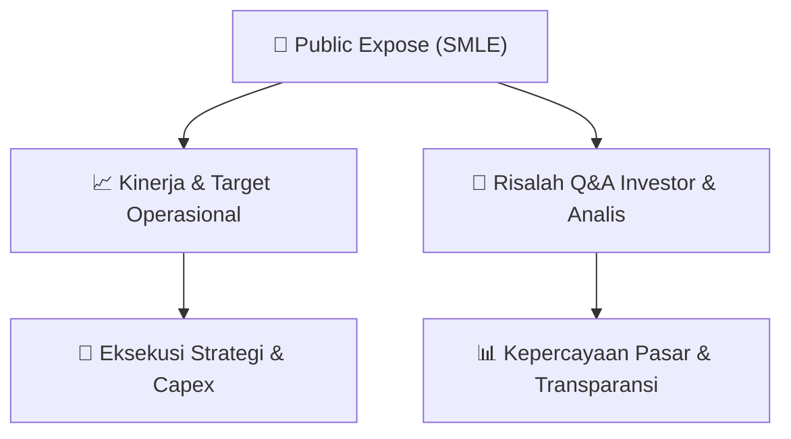

# 📢 Laporan Intelijen Paparan Publik (Public Expose) - [[SMLE]]
🏢 **Emiten**: `[[SMLE]]` | 📅 **Tanggal Pelaksanaan**: `2026-08-28` | 📑 **Dokumen**: `Public Expose`
⬅️ [[knowledge-base/daily-digests/Daily_Digest_20260828|Kembali ke Daily Digest]] | 🎛️ [[Dashboard|Ke Dashboard Utama]]

---

## 📌 1. Ringkasan Eksekutif & Paparan Direksi
> [!NOTE]
> PT Sinergi Multi Lestarindo Tbk (SMLE) menyampaikan pemberitahuan resmi rencana penyelenggaraan Public Expose Tahunan untuk tahun buku 2026. Acara akan dilaksanakan pada 11 September 2026 pukul 09:10 melalui platform IDX Public Expose Live 2026, dengan agenda Paparan Kinerja Perseroan, Prospek Bisnis, dan Press Conference. Dokumen ini hanya merupakan pengumuman jadwal dan tidak memuat data kinerja keuangan, proyeksi, atau materi paparan.

#### 🎯 Guidance Operasional & Target Strategis
- Dokumen tidak memberikan guidance kinerja, target ekspansi, atau rencana belanja modal (capex). Informasi yang tersedia hanya agenda Public Expose yang akan membahas prospek bisnis perseroan, sehingga katalis dan guidance baru dapat diperoleh setelah pelaksanaan acara pada 11 September 2026.

## 📊 2. Matriks Indikator Operasional & Parameter Kunci
| Parameter Utama | Nilai / Keterangan Resmi |
| :--- | :--- |
| **Nama Perusahaan** | `PT Sinergi Multi Lestarindo Tbk` |
| **Kode Emiten** | `SMLE` |
| **Jenis Acara** | `Public Expose Tahunan` |
| **Tahun Buku** | `2026` |
| **Tanggal Penyelenggaraan** | `11 September 2026` |
| **Waktu** | `09:10` |
| **Tempat** | `IDX Public Expose Live 2026, pendaftaran di https://pubexlive.idx.co.id/` |
| **Agenda** | `Paparan Kinerja Perseroan, Prospek Bisnis, dan Press Conference` |
| **Corporate Secretary** | `Arry Wahyu Riansyah` |
| **Tanggal Pengumuman** | `28 Agustus 2026` |

---

## 💬 3. Risalah Tanya Jawab (Q&A Session)
`Materi presentasi Public Expose / Risalah Q&A terlampir dalam dokumen resmi bursa.`

## 📌 4. Peta Jalur Strategis & Roadmap

---

## 🔗 Knowledge Graph
- [[knowledge-base/daily-digests/Daily_Digest_20260828|📄 Daily Digest 2026-08-28]]
- [[knowledge-base/calendars/Action_Calendar|🗓️ Kalender Terpusat Aksi Korporasi]]
- [[Dashboard|🎛️ Kembali ke Dashboard Utama]]